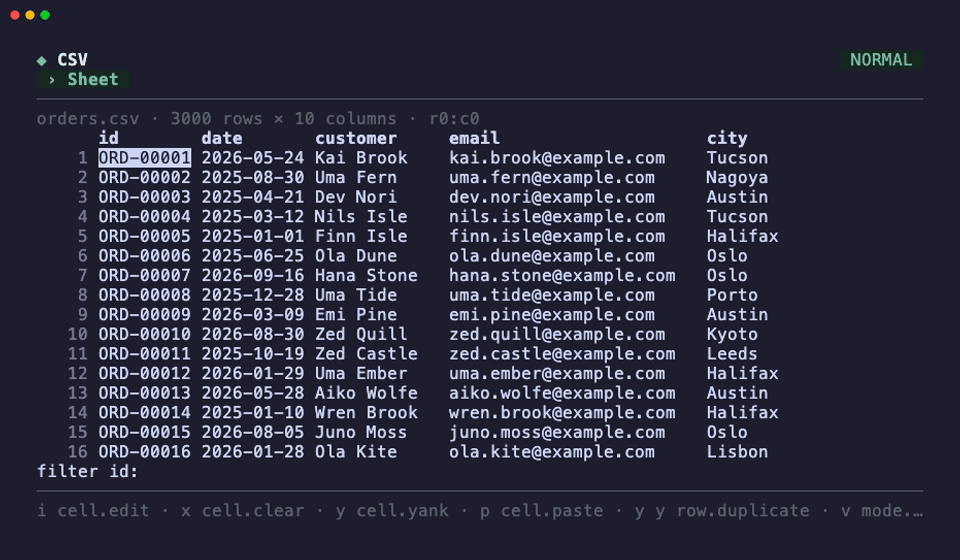

<p align="center">
  <picture>
    <source media="(prefers-color-scheme: dark)" srcset="assets/logo-dark.svg">
    
  </picture>
  <br>
  <a href="https://github.com/unixsuperhero/ochazuke/releases"></a>
  <a href="https://pkg.go.dev/github.com/unixsuperhero/ochazuke"></a>
  <a href="go.mod"></a>
  <a href="LICENSE"></a>
</p>

<p align="center">A Go TUI framework on Bubble Tea v2 where nouns, verbs and keybindings are data, so every action in your app is also a command you can run from the shell.</p>

<p align="center"></p>

Ochazuke builds on Charmbracelet Bubble Tea v2 (`charm.land/bubbletea/v2`, Lip Gloss v2, Bubbles v2) and adds retained pages, default Lip Gloss styling, partial-screen modals, nouns and instances with one stack walk for actions and bindings, modal text editing, a nested command palette, and live CLI control.


Module `github.com/unixsuperhero/ochazuke`; requires Go 1.26 or newer. It builds on [oden](https://github.com/unixsuperhero/oden) for CLI resolution.

```sh
go get github.com/unixsuperhero/ochazuke@latest
```

## Explore the architecture

Open the [interactive architecture field guide](docs/architecture.html) locally:

```sh
open docs/architecture.html
```

No server, install, or internet connection is needed. Search 12 components, inspect their responsibilities and source locations, step through keyboard/CLI/picker/modal journeys, and experiment with retained modal state. The state lab illustrates ownership; it does not connect to a running Go application. The linked [architecture map](docs/architecture-map.html) supports node exploration and light/dark themes; its editable specification is [architecture-map.json](docs/architecture-map.json).

The guide links to four generated pages: [Actions](docs/actions.html), [Default bindings](docs/bindings.html), [Go API](docs/api.html), and [CLI & socket](docs/transport.html). Each page has separate navigation links; the action, binding, and Go API pages have their own search. Actions and bindings reflect a fresh demo, not a running application's customized registry. Editor grammar shortcuts remain in the [keyboard guide](#keyboard-guide).

The [keybinding execution walkthrough](docs/keybinding-walkthrough.html) follows Tab through input focus, Ctrl-N through modal creation, and a configured `g g` sequence through timed longest-match resolution (`g`, `g g`, `g g g`). It includes Go excerpts, concrete state snapshots, GitHub source links, and an illustrative sequence stepper.

For a graph beside the code, open the [keybinding execution explorer](docs/keybinding-explorer.html). Hover or focus a function to preview its source; click to pin it. Choose Tab, Ctrl-N, or the sandbox sequence path and follow highlighted source lines. This is a source-backed snapshot, not a live debugger. Rebuild it with `python3 docs/keybinding-explorer/generate.py`; stale source mappings must be reviewed before regeneration.

Regenerate after changing registrations or Go declarations/comments:

```sh
go run ./cmd/docgen
```

Go's built-in documentation also works directly in the Ochazuke project directory:

```sh
go doc
go doc -all .
go doc Runtime.Execute
```

The HTML API catalog uses the standard `go/doc` library, with no documentation-server dependency. Edit `cmd/docgen/main.go` for the layout; do not hand-edit the four generated pages. Keep all four HTML files beside `architecture.html` when copying the guide.

## Run on macOS

Requires Go 1.26 or newer.

```sh
go run ./cmd/ochazuke run
```

For a reusable executable:

```sh
go build -o /tmp/ochazuke ./cmd/ochazuke
/tmp/ochazuke run
```

In another terminal:

```sh
/tmp/ochazuke operations list
/tmp/ochazuke page open --json '{"id":"playground"}'
/tmp/ochazuke input undo
/tmp/ochazuke input undo --json '{"steps":3}' --target directory
/tmp/ochazuke state get --json '{"path":"/inputs/directory/text"}'
```

Global `--socket PATH` goes before `run` or `NOUN VERB`. It selects a specific application instance. The default socket on macOS is `~/Library/Caches/ochazuke/app.sock`. `run --headless` uses the same Bubble Tea event loop without terminal rendering.

### Keybinding sandbox

Run `ochazuke keybinding` (or `go run ./cmd/ochazuke keybinding`) without starting the demo or socket server. It opens **Stage 1: Define bindings**:

- `a`: add a binding; enter Tea key names and a dummy action identifier in separate fields.
- `e` / `d`: edit / delete the selected binding; arrows select a row.
- `t`: edit the ambiguous-binding timeout (Go durations such as `1000ms` or `1s`; must be positive). The current timeout is shown in setup and in the sandbox.
- `i` / `o`: import / export JSON. Enter a path or press Ctrl-O to browse files and folders. An export folder selection proposes `bindings.json`; the filename remains editable.
- Enter: **Enter sandbox**. In **Stage 2**, the left column shows the latest key, outcome, and effective bindings; the right column logs messages newest first (last 200 retained).
- Ctrl-G: return to setup without losing bindings or history. Ctrl-C exits either stage.

Import replaces in-memory bindings only after the whole file validates. Export asks before overwriting an existing file. Changes remain in memory until exported; exiting does not autosave.

Preload setup from a file with `ochazuke keybinding --bindings=path/to/bindings.json`. The import/export format is:

```json
[
  {"keys": "ctrl+s", "action": "save"},
  {"keys": "g g", "action": "go-top"}
]
```

Names come directly from Bubble Tea's `tea.KeyPressMsg.String()` (a paste shows as `[text]`), quoted in the log to make whitespace visible. Ctrl-C and Ctrl-G are reserved and cannot be bound. Keys that the terminal encodes identically cannot be distinguished by the sandbox.

You can also preload dummy actions with repeatable `--bind 'KEYS=ACTION'` options. These override matching keys from `--bindings`, regardless of flag order:

```sh
go run ./cmd/ochazuke keybinding \
  --bind 'ctrl+s=save' \
  --bind 'g g=go-top' \
  --bind 'alt+x=alternate'
```

These are real Ochazuke rows on the `app` noun dispatched through `Runtime.Dispatch` and the operation registry. Each dummy action prints `ACTION: <identifier>` in the sandbox's latest-result area and history, without performing any app operation. The left column lists the effective bindings; history labels unmatched keys, pending sequences, cancelled sequences, and timed-out sequences. A later definition of the same key sequence replaces the earlier one.

#### Timed ambiguous bindings

When a complete binding is also a prefix of a longer binding, the runtime waits instead of firing at once. With `g`, `g g`, and `g g g` all bound:

- The first `g` is complete but ambiguous: it is deferred, and the timer starts.
- Each valid continuation (`g g`, then `g g g`) refreshes the timer. The longest complete match so far is the fallback.
- When no longer continuation remains possible, the third `g` runs `g g g` immediately.
- On timeout, the fallback (the longest completed binding) runs. The sandbox updates the outcome of the last key row rather than adding a key; if nothing runs, it shows that the sequence timed out.
- If a different key arrives, the completed fallback (if any) runs and the mismatching key is then dispatched fresh through the whole stack, so it still reaches the editor or any row that binds it.
- A pure prefix (not itself a binding) times out and clears without running anything.
- While a sequence waits, the focused instance is in a prefix mode named after the base mode and the keys so far (`normal g`); `bindings.list` then lists the continuations.
- Escape cancels all deferred work. Late timer events from a cancelled or superseded wait do nothing, and context changes cancel pending sequences.

The timeout defaults to 1000ms (Neovim's timeoutlen). Set it with `--timeout DURATION` (for example `--timeout 1s`; zero or negative values are rejected) or press `t` in setup. The timeout is not stored in the bindings JSON, which remains a plain array, so it is not persisted by export. It is kept when bindings are imported, edited, or deleted.

Coalesced ordinary typing is split into keys, like the app's dispatcher, so multi-key sequences work during rapid typing. Bracketed paste remains one logged message and does not trigger bindings.

## Full-project example

[`examples/full-project`](examples/full-project/README.md) is a standalone application assembled from separate configuration, action, binding, and page modules. Its JSON files define pages, instances and nouns, inputs, actions, binding rows, modals, modes, and appearance. Go registries supply the handlers and renderers named by that configuration.

```sh
go run ./examples/full-project
go run ./examples/full-project --config ./examples/full-project/config
go run ./examples/full-project --smoke
```

The default configuration is embedded in the executable. `--config` reads an editable directory instead. The smaller [`examples/core`](examples/core/main.go) remains a headless example of action fallback, modal restoration, and isolated undo.

## CSV example

[`examples/csv`](examples/csv) is the lightweight second consumer from [`docs/CSV-APP-SKETCH.md`](docs/CSV-APP-SKETCH.md): a modal CSV reader and editor built without touching the resolver, the editor spec or the modal stack. It brings its own component, [`grid`](grid/grid.go), a two-dimensional cursor with one instance for the focused cell parented to a row instance parented to a column instance, so the stack under a cell is `[cell, row, column, grid, sheet, app]` and `dd` resolves on `row`, `s` on `column`, `i` on `cell`, `ctrl+s` on `sheet`.

```sh
go run ./examples/csv examples/csv/testdata/people.csv
go run ./examples/csv --smoke examples/csv/testdata/people.csv   # render one frame and exit
go run ./examples/csv bindings list --all > csv-bindings.json # all stored binding tables as config rows
```

What it shows: motions with counts (`3j`, `2G`, `gg`) through the grid's `move` verb; a cell edit, rename, add-column, open and save-as through one prompt modal (`enter` commits, `esc` cancels, `ctrl+o` opens the path picker into the field); a persistent filter field below the grid, the sheet's second focus stop (`}` or `tab` from the grid lands on it ready to type, `enter` filters by the cursor column and returns to the cell, `shift+tab`, `esc` and `{` from the grid move between the two, `/` on a column focuses it); three visual modes (`v`, `V`, `ctrl+v`) that share one mode table on the grid noun with `m`/`M`/`ctrl+a` marks, and `:` inside a selection opens the palette over it without dropping it; yank, delete and paste through the shared registers with the yank's shape (`V y p` pastes rows, `ctrl+v y p` pastes columns); `transform` on every noun that resolves to a cell set (cell, row, column, selection) as one verb over a map of named transformations (`t u`, `t l`, `t t`, `t i` title, `t s` slug, `f` for fill-down), whose `name` parameter takes its pick list from `transformations.list` (ids with labels; `ctrl+n`/`ctrl+p`, type to filter, `enter`); every edit as one `Patch` that is also its undo record (`u`, `ctrl+r`); per-verb `Confirm` on `dd` (`Delete row r1?`) and `D` (`Delete column c1 (email)?`, the header carried by a row the grid puts on the column instance through `grid.WithInstanceRows`); verb guards, so the palette offers `selection.*` only during a selection and `row.*`/`column.*` only while the focus is in the grid (the grid's `selecting` and `in-grid` guards). The one core addition it needed is `Runtime.StoreYank`/`ReadYank` ([`yank_api.go`](yank_api.go)), so a component outside the package can store a yank of a shape the editor does not know; the second is the verb guard below.

## Pages and default presentation

`run` launches the demo in `internal/demo` (`demo.New()`), not an application you must adopt; the framework package itself holds no application pages. It starts on **Overview**. The framework accepts your own page IDs, renderers, state, inputs, and registered actions.

The shell around a page is one chrome, `Layout.Shell`: a title row with the mode badge right-aligned, a subtitle row (the page tabs, or the page title beside the sidebar), a rule, the body, a rule, the footer and a margin, inside a two-cell gutter. `Layout.PageBlock` renders through the same method, so a page and the application around it reserve the same rows and `Layout.BodySize` is the body a renderer receives (less the sidebar). The footer and every modal's hint line are `BindingHints`: the focused instance's binding rows in resolution order (`ctrl+j page.next · : palette.open`, each row its key and `noun.verb`, or the row's `Hint`; the descriptions are in `BindingHelp`), the same data `bindings list` prints, so a hint can never name a key that is not bound and rebinding a key moves its hint. The last key's error replaces the footer until the next key.

`?` keyboard help is a list table with prefix, key, operation, arguments, and description columns: a key sequence is split into its prefix and final key (`SplitKeys`; `ctrl+a v` reads `ctrl+a` | `v`, `g c x` reads `g c` | `x`), a prefix's rows sit together sorted by key after the section's single keys, and the prefix is drawn once per group (`Column.Group`, any table can use it); the keys, operation and description wrap inside their columns. Arguments are compact JSON, resolved against the focus and mode when help opens; values depending on a future pattern key remain `$key`, `$digit`, or `$text`. Long arguments truncate with `…` rather than wrapping. `BindingHelp` exposes the full preview in `HelpRow.Args`, the split key in `HelpRow.Prefix`/`Final`, and the request a hinted row runs in `HelpRow.Request` (its `Hint` in `HelpRow.Hint`); opening help never executes the bindings.

| Demo page | Purpose |
|---|---|
| Overview | Navigation and a short framework tour |
| Playground | Text, path and multiline paths fields, shared yanks, nested drafts, path picker |
| Commands | Live operation catalog, argument schemas, and remembered Playground bindings |
| Appearance | Live theme and density controls: `t` cycles theme, `d` toggles density |

In normal mode, `Ctrl-J` advances and `Ctrl-K` goes back. The demo does not bind Alt-number shortcuts.

These are suggested starter/demo pages. Domain pages such as Agents, Panes, Projects, and application Settings belong to consuming applications; the framework does not require those names or behaviors.

### Registering your own pages

A page is an instance of kind `page` under `app`. `Page` carries a title, the instance it starts focused on (`Focus`, the page itself by default) and a renderer; while another page is open the page remembers its focus and mode (`Page.Remembered`), and `page.open` restores both. Pages, lists, inputs and terminals share one constructor family taking the same options (`Parent`, `Kind`, `Focus`): `r.AddPage(id, title, render, Focus(..))`, `r.AddList(id, items, Parent(..))`, `r.AddInput(in, Parent(..), Kind(..))`, `r.AddTerminal(id, stream, Parent(..))`. `RegisterPage(&Page{...})` and `NewList(r, ...)` are the same registrations for callers that hold the struct or the runtime as a value. Register the page's instances and inputs first when the page starts inside one of them:

```go
r := ochazuke.NewRuntime()
r.Instance("home")                                   // noun "home" is defined with it
r.AddInput(ochazuke.NewInput("title", "", false), ochazuke.Parent("home"))
_, err := r.AddPage("home", "Home", func(r *ochazuke.Runtime, width, height int) ochazuke.Block {
    return ochazuke.Text("Welcome to your application.")
}, ochazuke.Focus("title"))
if err != nil { panic(err) }
if err := r.OpenPage("home"); err != nil { panic(err) }
model := ochazuke.NewModel(r)
if _, err := tea.NewProgram(model).Run(); err != nil { // Model.View sets AltScreen
    panic(err)
}
```

Registration does not activate a page; `OpenPage` (or `page.open`) sets `Runtime.Page` and restores the page's frame. Switching reuses the page's exact frame and input instances: selection, focus, modes, drafts, undo history, and scrolling survive a round trip. Normal-mode `Ctrl-J/K` cycles `PageList()`, app's page children in registration order. Rows bound on a page instance or its noun apply while that page holds the focus. Page tabs have no numeric shortcuts; `'` (`page.pick`) opens a chooser of every page, the pages visited before most recent first, then the never-visited ones in registration order, then the current page last, marked `current` (so `'` then enter goes back to the page last left; type to filter by title, enter opens), or type `page ` in the palette to complete a page ID. When the tabs do not fit, the row windows around the active tab and shows `‹N` / `N›` for the pages hidden on each side.

Any page can be hidden from the tabs and `Ctrl-J/K`: the `pages.hidden` setting (a list of page ids; `settings set pages.hidden '["runs"]'`, or `page hide runs` / `page show runs`, which write it; with no id they act on the current page). A hidden page stays reachable: `page.open`, `'` (marked `hidden`), the palette and `OpenPage` open it, and its tab shows while it is current. `pages list` marks each page `hidden`. Pages are also the things of the `page` noun (an instances store): `page list`, `page get [ID]`, `page set ID hidden true|false` (or `--toggle`) and `page watch` are its standard verbs, and `page hide`/`page show` are aliases of `page set` with `hidden` preset. An application declares an opt-in page hidden by default with `Page.DefaultHidden` or the `DefaultHidden()` option (a catalog page: `defaultHidden: true`); those ids are the setting's default until the user sets it, and `settings reset pages.hidden` returns to them. `page hide` refuses the last page in the tabs, and `Model.Init` opens the first page in the tabs when the start page is hidden (`Runtime.OpenVisibleStart`). `Runtime.HidePage`, `ShowPage`, `PageHidden`, `HiddenPages` and `TabPages` are the Go side.

Ordinary modals block page switching. The palette closes before dispatching its line, so `open page alpha` works when no other modal is underneath it. Focusing an inactive page's input does not silently navigate; open that page first. Explicitly targeted editing operations may still update an offscreen input without moving focus.

```sh
/tmp/ochazuke pages list
/tmp/ochazuke page open --json '{"id":"commands"}'
/tmp/ochazuke page next
/tmp/ochazuke page previous
/tmp/ochazuke state get --json '{"path":"/page"}'
/tmp/ochazuke state get --json '{"path":"/pages/playground/frame/focus"}'
/tmp/ochazuke surface scroll --json '{"lines":8}'
```

### Styling and modal behavior

- Default styling uses restrained teal/green accents, rounded panels, heavier focused borders, page tabs, a mode badge, and a status line. The status line and modal hints are derived from binding rows (`BindingHints`), never written by hand; the picker's own help line is derived the same way.
- Themes: `adaptive`, `dark`, `light`, `mono`, plus the user's colour schemes (below). Density: `comfortable` or `compact`. Adaptive follows the terminal's detected background; `NO_COLOR` disables theme colors. Focus remains visible through border weight and a tab marker.
- Modals are centered, content-sized panels, at most about 80% of the terminal width (no fixed column cap) and about 75% of its height; a chooser fills that width. They leave a visible, subdued perimeter of the previous screen whenever the terminal can accommodate it. Nested modals retain the previous modal and page underneath.
- Resizable panes: a page that draws a list/detail split passes its `Layout` through `Runtime.PaneLayout(page, layout)`; `Layout.Split`, `SplitBlock` and `SplitFocusBlock` then follow the page's divider (`Layout.Shift`), and a split drawn by hand divides with `layout.Divide(defaultFirst, total, ochazuke.PaneMinWidth)` (`PaneMinHeight` stacked). Catalog pages with a detail (`cli.MountPage`) and the demo's Library do this already. In normal mode `ctrl+w >` grows the first pane (the list, left or top) by `PaneStep` (5%) of the split, `ctrl+w <` shrinks it, `ctrl+w =` resets; counts repeat (`3 ctrl+w >`). `ctrl+w w` and `ctrl+w W` walk the focus stops (`focus.next`/`previous`; Vim's count picks a window number, here there is none). The bare `>`, `<` and `=` no longer resize (until this release they did, even in an editor or the outline, where Vim users expect shift operators); a user restores them with `bindings.json` rows, `{"noun": "app", "mode": "normal", "keys": ">", "request": {"noun": "ochazuke.pane", "verb": "grow"}, "when": "pane-split"}`. The shift stops at `PaneShiftLimit` (30 points) either way and each side keeps `PaneMinWidth` cells (`PaneMinHeight` rows stacked). The keys answer, and the footer shows `ctrl+w >/< resize`, only on a page whose last frame drew a split; `pane grow`, `pane shrink` and `pane reset` (each with an optional `page`) work from the CLI and palette anywhere. Dividers persist per page id in `panes.json` in the state directory (`Config.PanesPath()`), replaced atomically on each change; with no state directory (`Config.Disable`) they last the session.
- Tiny terminals use reduced chrome rather than overflowing the screen. Bubbles viewports handle overflowing page and modal content; `PgUp/PgDn` scroll the active surface.
- In an input modal, Escape returns insert mode to normal; another Escape closes the modal. A pending normal-mode operator/count is canceled before closing. "Escape pops a modal" is one row: the `modal` noun's normal-mode `esc`, which sits inside `app` and outside the editor and palette tables. `Ctrl-G` closes demo drafts directly. Palette and picker cancellation retain their own documented behavior.
- App-specific modal rendering is registered through `Model.ModalViews[frameID] = ModalView{Title, Render}`. The framework owns positioning and composition; the renderer receives the modal frame and available content dimensions.
- Render callbacks return a `Block{Text, Cursor}` and may use trusted Lip Gloss ANSI styling in `Text`. Sanitize external text before rendering it; built-in input and filesystem labels already do so. `Text(s)` wraps content that has no cursor.
- The terminal cursor is real, not painted. `InputBlock(in, w, h)` reports the cursor cell of the input it renders; compose it only for the focused input and use `InputView` for the rest. Every composer (`Layout.PageBlock/PanelBlock/SplitBlock/SidebarBlock`, `ComposeModalBlock`, the shell) moves the child's cursor by where it placed the child, so `Model.View` can set `tea.View.Cursor`: a bar in insert mode, a block in normal mode, an underline in visual modes, hidden when no input is focused or a modal without an input covers it. Wide/combining graphemes, terminal-cell clipping, and visual-selection reverse video share the same renderer; moving the cursor never shifts following text.

```sh
/tmp/ochazuke themes list
/tmp/ochazuke appearance get
/tmp/ochazuke appearance set --json '{"theme":"dark","density":"compact"}'
```

Theme and density changes are atomic and apply immediately to all pages and modals. `appearance set` changes them for the session. `NewStyles(*model.Appearance)` supplies the same style vocabulary to application renderers.

#### Colour schemes

The `theme` setting selects the colour scheme and persists in `settings.json`. The framework declares it (`Runtime.EnsureConfigSettings`, called by `Model.Init` and the CLI shell) unless the application declared a setting of that name, which it then applies itself. Its choices are the built-in themes followed by the schemes in `themes.json`, a file beside `settings.json` (`themes path` prints it):

```json
{
  "kombu": {
    "background": "dark",
    "accent": "#C9A227",
    "border": "#5C4A1E",
    "error": {"light": "#B3261E", "dark": "#FF6F61"}
  }
}
```

| Role | Draws |
|---|---|
| `text` | Body text and the title |
| `muted` | Hints, inactive tabs, the dimmed backdrop under a modal, the focus beside the mode (`focus-display`) |
| `accent` | The active tab, the badge, the subtitle, focused panel and modal borders |
| `border` | Unfocused panel borders |
| `surface` | The background of the active tab and the badge |
| `error` | Errors. It must differ from `accent` and `muted`. |

Each role is `"#RRGGBB"`, `"#RGB"`, an ANSI index `"0"` to `"255"` (for 16- and 256-colour terminals), or `{"light": ..., "dark": ...}`. `background` picks the side: `adaptive` (the default, the terminal's), `light` or `dark`. A role left out keeps the built-in palette's. The selected row stays reverse video in every scheme, so it reads without colour.

A scheme that does not validate is skipped and reported as a notice. That covers an unknown role, a bad colour, background or tone, a built-in's name holding anything but tones, and an error colour equal to the accent or muted one. A `theme` value that names a skipped scheme reads its default, so the screen falls back to `adaptive`. After editing the file, `themes reload` reads it again and withdraws fixed notices. `Appearance.Accent` still goes on top of any scheme. `mono` and `NO_COLOR` draw no colour whatever the scheme. An application can supply its own schemes with `model.Appearance.Schemes = ochazuke.NewSchemeSet(...)` (`ParseSchemes` reads the file format).

#### Tones

A cell, or a run of runes inside one, can carry a named tone instead of colour: `ListItem.Tones` (and `TreeNode.Tones`, and `"tones"` on a catalog row line) hold `ToneSpan{Cell, Tone, From, To}`, rune offsets into the cell's text, `To` 0 for its end. The theme decides what a tone looks like, so colour stays configuration:

```go
ochazuke.ListItem{ID: "w1", Noun: "pane", Label: "work/claude",
    Cells: []string{"★ work/claude", "needs input"},
    Tones: []ochazuke.ToneSpan{ochazuke.SpanTone(0, 0, 1, ochazuke.ToneStar), ochazuke.CellTone(1, ochazuke.ToneNeedsInput)}}
```

| Tone | Light / dark | Attributes |
|---|---|---|
| `state.working` | `#1F6FB2` / `#7CB7E8` | |
| `state.needs-input` | `#9A6700` / `#E3B341` | bold |
| `state.done` | `#2E7D32` / `#8BC48A` | |
| `state.errored` | the scheme's `error` | bold |
| `state.idle` | the scheme's `muted` | |
| `state.exited` | the scheme's `muted` | dim |
| `marker.star` | `#B08800` / `#F2CC60` | bold |
| `marker.queued` | the scheme's `accent` | |
| `error` (`ToneError`) | background `#F6D3CE` / `#5E2722` | bold |
| `chip` (`ToneChip`) | background `#E2EAE5` / `#26362F` | |
| `chip.focused` (`ToneChipFocused`) | the scheme's `surface` on its `accent` | bold |

`mono` and `NO_COLOR` draw the attributes alone. An unknown tone draws plain. The text never changes, so tones never count toward a width or a cut. The selected row stays one reverse-video bar: inside it a tone keeps its bold and drops its colour and dim. In `themes.json` a scheme takes `"tones"`, laid over the built-in ones, and an entry named after a built-in theme may hold tones alone:

```json
{
  "dark": {"tones": {"state.working": {"fg": "#5FAFD7", "bold": true}, "build.cached": "muted"}},
  "mono": {"tones": {"state.done": {"bold": true}}}
}
```

A tone is `{"fg": ..., "bg": ..., "bold": true, "dim": true}` or a colour alone; `fg` and `bg` are a colour as a role takes it or a role's name (`text`, `muted`, `accent`, `border`, `surface`, `error`), which follows the scheme. A tone with a `bg` fills its run's cells (mono draws none). A span's `Bg` (`ToneSpan{Cell, Tone, Bg}`, `"bg"` in JSON) names the tone whose background goes under it while `Tone` keeps the foreground, so `{"cell": 0, "tone": "state.working", "bg": "error"}` is a working-blue key on the error background; `Bg` alone only fills. On the selected row the setting `tones.selected-background` (`SelectedBackgroundSetting`, `drop` default | `keep`, in `settings/ochazuke.json`) drops the background with the colour, or keeps the cell on its background, bold, out of the reverse bar. `adaptive`'s entry reaches `dark` and `light` too. `Styles.Tone(name)` is a tone's style for an application's own text.

### Keyboard guide

The demo starts on Overview in normal mode. Open Playground with `Ctrl-J`; Tab/Shift-Tab cycle its directory, notes, and paths fields. Overview, Commands, and Appearance support `j/k` and up/down scrolling. Demo page shortcuts are normal-mode-only, so insert-mode `Ctrl-K` still kills to line end. The footer of every screen is the live version of this table for the focused instance and its mode: the rows `bindings list` prints, innermost first.

Macro recording consumes exactly one register character after `q`, except `:`: `q:` opens the palette on the last command, Vim's command-line window (`:help q:`; the exact `:` row of `macro_pending` beats its `any` register row, so `:` is never a register, as in Vim). Compared with Vim: there is no history window; the line holds the last command and up/down walk older ones. `q/` and `q?` (search history) are not bound: there is no search history yet. For `qq:`, the first `q` prompts for a register, the second starts recording into `q` and displays `REC @q`, and `:` opens the palette. A normal-mode `q` stops recording. Invalid register input reports an error but does not trap later commands in register selection.

| Context | Keys | Behavior |
|---|---|---|
| Normal input | `h j k l`, arrows | Rune/line movement |
| Normal input | `w b e`, `0 $`, `gg G` | Word, line, and document motions |
| Normal input | `i a I A` | Insert here, after cursor, at first nonblank, or at line end |
| Multiline normal input | `o O` | Open a line below/above and insert |
| Normal input | `x`, `u`, `Ctrl-R` | Delete, undo, redo |
| Normal input | Numeric prefix | Count for motions, delete, undo/redo; `Ngg`/`NG` select a line |
| Normal input | `v`, `V`, `Ctrl-V` | Character, line, or block visual selection |
| Insert input (select) | any text, `backspace`, arrows, `esc` | After `Input.SelectText`/`SelectAll` (or `outline.add {text, select: true}`): typing or pasting replaces the selected text, backspace/delete removes it, a motion or `esc` keeps it (UX-RULES R9.6) |
| Normal input | `yy`, `p`, `P` | Yank a line; paste after/before |
| Normal app | `g y` | Open shared yank history (`ctrl+y` until this release; `ctrl+y` is now Vim's line scroll) |
| Normal input | `"a` | Select named register `a` for the next operation |
| Normal app/input | `qa … q`, `@a`, `@@` | Record macro `a`, replay it, repeat the last macro |
| Insert input | `Ctrl-A/E`, `Ctrl-B/F` | Line start/end, previous/next rune |
| Insert input | `Ctrl-P/N`, `Alt-B/F` | Previous/next line, previous/next word |
| Insert input | `Ctrl-W/U/K`, `Ctrl-Y` | Kill path component/to line start/to line end; paste the app's current yank |
| Insert input | Backspace, Delete/`Ctrl-D`, Enter | Delete backward/forward; newline in multiline inputs |
| Insert input | Escape | Return to normal mode |
| Normal input | Escape | Cancel a pending operator, count, prefix or register |
| Normal app/input | `:` | Open the palette's command line |
| Any editing mode | `Ctrl-Space` | Open palette without stealing Readline `Ctrl-P` |
| Normal Playground | `Ctrl-O` | Open the shared picker using the field's filter |
| Normal path/paths field | Enter | Open picker using the current value/line |
| Normal Playground / draft | `Ctrl-N` | Open a draft / nest another draft |
| Draft modal | `Ctrl-G` | Close and restore the parent |
| Normal Playground | `Ctrl-X` | Inspect the handling noun |
| Normal app | `?` | Open the scrollable keyboard guide |
| Insert (any input) | `Ctrl-\` | Open the keyboard guide (`?` types itself there) |
| Normal list | `/` | Filter the list's rows (see Filtering a list) |
| Normal list | `gg`, `G`, `NG`/`Ngg` | First row, last row, row N (`list.goto`; clamps, never spills) |
| Normal list | `Ctrl-D/U`, `Ctrl-F/B` | Half a page / a page down and up, the window moving with the selection (`list.scroll`; `3 Ctrl-D` is 3 rows, `2 Ctrl-F` two pages) |
| Normal cell table (`CellSelect`) | `h`/`l`, `0`/`^`/Home, `$`/End, `N\|`, `gc` | Move the current column: one left/right (counts), the first, the last, column N, a chooser of titles (`list.column`, `list.choose-column`); the view scrolls to show it |
| Normal cell table | `y` | Copy the current cell into the registers (`list.yank`) |
| Normal cell table | `z>`, `z<`, `z=` | Widen / narrow the current column by 2 cells (counts), every column automatic again; remembered per table (`list.resize-column`, `list.reset-columns`) |
| Normal table | `Y` | Copy the row's cells joined by tabs into the registers (`list.yank {what: row}`) |
| Normal table | `V` | Visual row selection over the marks: `j`/`k` extend it, a row's verb then runs for every selected row (one confirm), `esc` ends it (`list.visual`, `list.end-visual`) |
| Normal table | `zl`/`zh` | Scroll the columns one right/left; the pinned columns stay (`list.scroll-columns`) |
| Normal row table (the default) | `l`/`h` | Scroll the columns one right/left; at the last column / the start move the focus to the next / previous stop (`list.scroll-columns`, `focus.next`/`focus.previous`) |
| Normal row table (the default) | `$`, `^`/`0` | Scroll to the view with the last column / back to the first (`list.scroll-columns`) |
| Normal cell table | `zp` | Pin or unpin the current column (`list.toggle-pin-column`); any table: `list.pin-column`, `unpin-column`, `unpin-columns` from the palette |
| Normal Appearance | `t`, `d` | Cycle theme / density |
| Normal demo | `Ctrl-J/K` | Next/previous page |
| Normal page with a list/detail split | `>`, `<`, `=` | Grow / shrink the list pane by 5% (counts: `3>`), reset the divider; remembered per page |
| App or modal | `PgUp/PgDn` | Scroll the active surface |
| App | `Ctrl-C` | Quit (`q` is reserved for macro recording) |
| Attached terminal | any key | Forwarded to the pane; `Ctrl-A` is the leader (`d` detach, `Ctrl-A` literal, bound key runs, other key sends both, timeout sends the leader) |

On terminals where Option does not send Meta sequences, configure Option-as-Meta to use `Alt-B/F`. `Ctrl-Space` is received as `ctrl+space` by Bubble Tea v2 (v1 spelled it `ctrl+@`). Every row above is a registered binding: the demo's on its nouns and instances, the editor's in `editor_bindings.json`. `bindings list` prints the rows the focus answers to in its current mode, pending modes included, so `2`, `d` or `"` followed by `bindings list` shows the count, operator or register table.

### Palette and selectors

- `:` opens the palette: an ex-mode command line, one `prompt` input (insert pinned, the Readline rows edit it: `Ctrl-W` deletes a word, `Ctrl-U` the line). The line's text is the command; there are no stages.
- Words resolve left to right. The first word is a verb or a noun; the second is the complement (a noun that has the verb, or a verb or instance of the noun); then the operation's parameters in order (required first, then by name). Every word may be a unique prefix (`tr r up`); an ambiguous prefix stays unresolved and the list shows its candidates. A first word that is a prefix of exactly one verb and one noun takes the reading the next words resolve. A value with spaces is quoted (`add note "two words"`).
- Omit the noun and the verb acts for the nearest instance on the focus path whose noun has it: on a CSV cell `transform upper` changes the cell, `transform row upper` the row under the cursor, `transform column upper` the column, `transform selection upper` the selection (offered only while one exists; verb guards hide verbs the focus does not answer to). The cursor never moves.
- The list under the line completes the next word, grouped verbs, nouns, then parameter choices, narrowed by the word being typed. Typing `:v`, `:n` or `:p` as the word restricts the list to verbs, nouns or choices; the code is consumed, not appended, and lapses at the next word.
- Nothing is highlighted until `Ctrl-N`/`Ctrl-P` moves onto the list; typing clears the highlight. Enter or Tab on a highlighted entry appends its word and a space. Enter with nothing highlighted runs the line as typed. A line whose verb still lacks a required word opens the args form: a field per parameter (required first, optional ones marked), the typed words filled in, the first missing one focused; choices and noun-typed words are picked from a type-to-filter chooser. `enter` runs the verb once every field is valid and otherwise moves to the field that still needs a value; `esc` (from normal mode) cancels, runs nothing and gives the line back as typed. A key whose binding row leaves a required argument out opens the same form. A `path` parameter's field opens the path chooser (sources browse, recent, typed and the application's; `tab` cycles them, `enter`/`ctrl+l` browse into a folder, `alt+up` or backspace on an empty query goes up, `alt+enter` picks the highlighted row). A choices source that declares a `query` parameter is called with the word typed so far, so it completes as you type. With the setting `palette.missing-opens-form` off, an incomplete line stays and the error names its first missing word (`missing name (string, pick)`). The CLI and the API still fail with `NAME is required`. Tab with nothing highlighted completes a word that has one completion.
- `Esc` clears a non-empty line, then closes; `Ctrl-C` closes. Up and Down recall earlier lines from the action history (entries with the source `palette`, which every request a line runs is recorded with).
- The originating interaction context is captured before the palette opens. `undo input` edits the originating input, not the palette's line. A failing request reopens the palette with the line and the error.
- Commands returning a JSON array of objects open a read-only Results modal (for example, `operations list` or `jobs list`). This also accepts typed Go slices/arrays and encoded JSON. Columns with fields present in every row come first, followed by less common fields in descending occurrence count; ties sort alphabetically. Missing fields are blank, explicit nulls read `null`, and nested values are compact JSON. Long cells truncate and rare columns drop first at narrow widths. `j/k` navigate; `Esc` closes and restores the originating focus. Empty lists show `No rows`; non-object results are unchanged. Only palette execution presents results: direct bindings, API/CLI calls, refreshes, and completion sources do not open a table.
- Pending commands present their results after delivery and their existing `Then` callback. Failed, cancelled, orphaned jobs, or results arriving while another modal is open do not open a table; an existing modal is never replaced.
- Instance sources explicitly declare their default verb and ID argument: `page playground` runs `page.open {id: "playground"}`, and the instances are also the choices of that argument (`open page playground`). The [full-project example](examples/full-project/README.md) configures these defaults in JSON.
- Scripts drive the line through the same registry: `palette set {text}` replaces the line, `palette run` presses Enter, `palette complete {value}`, `palette move {delta}`, `palette recall {delta}`, `palette cancel`. Each returns the palette state: the `line`, its parsed `words`, the `operation`, `missing` word and the completion `entries`.

```js
// The grammar, one example per form (focus on the cell r1:c1 of row r1)
"transform row upper"   // verb noun arg      -> { key: "row.transform", target: "r1",    args: { name: "upper" } }
"row transform upper"   // noun verb arg      -> same request
"tr r up"               // unique prefixes    -> same request
"transform upper"       // noun omitted       -> { key: "cell.transform", target: "r1:c1", args: { name: "upper" } }
"page playground"       // noun instance      -> { key: "page.open", args: { id: "playground" } }
"t r up"                // "t" is ambiguous: tidy, transform -> stays, list shows both
"transform row"         // incomplete         -> the args form asks for name (setting off: "missing name (string, pick)", line stays)
"transform :p"          // filter code        -> line "transform ", list shows only choices
```
- The shared path picker uses an editable absolute path and a Readline-only editor. `Ctrl-N/P` moves through results without moving the text cursor. Other Readline bindings still edit the path; `/` and whitespace delimit `Ctrl-W` kills, while dots and hyphens remain part of a filename.
- Tab completes the highlighted result into the picker's path input without confirming or closing it. Directories receive a trailing separator for continued browsing; the originating field stays unchanged until confirmation.
- Escape cancels immediately without changing the originating input. `Alt-Up` browses the parent directory. Enter opens a directory/selects a file, and `Ctrl-S` confirms a path. Letters always edit the path; the picker never enters Vim normal mode.
- Results recursively fuzzy-match the full relative path. Native Git supplies `.gitignore` semantics, including nested rules, negations, repository excludes, and global excludes; Git must be on `PATH`. Non-repositories use temporary Git metadata outside the browsed tree. `.git` and directory symlinks are never traversed.
- Results are a table (path, size, modified) laid out by the same code as a list with columns (`table.go`): a header under the `Results n/m` line, the size right-aligned, `…` cuts, and modified then size dropping as the results pane narrows; the path takes the rest. Size and modification time are statted lazily: the index walk never stats; only the rows the table draws are looked up, off the loop in the picker's `stat` slot, cached per path (an LRU of 4096, cleared when a new index starts); a row draws blank cells until its stat lands, and the fixed column widths keep anything from moving. Directories show no size. The selected result keeps the picker's own `> ` marker and is the one reversed row.
- The picker publishes immediate children first, then builds the recursive index in the background. Listed paths remain selectable and Tab-completable while indexing continues. Query edits search the available index; recursive results preserve the highlighted path when it still matches. Canceled or stale results cannot overwrite newer results. A recursive failure keeps usable shallow results and shows `Index incomplete`.
- Leading `~` and `~/` resolve to the home directory. Explicitly opening a directory excluded by an ancestor repository's ignore rule makes that directory a fresh ignore boundary, so a home-repository rule such as `proj/` does not hide every project. Root-local, nested, and global ignore rules still apply.
- `Ctrl-S` confirms the highlighted result; an empty query includes a current-directory entry for `any`/`dir`. The action `picker.choose {current:true}` explicitly chooses the root. Changing the originating text while the picker is open rejects selection instead of replacing stale offsets.
- The split view pairs results with the selected entry's metadata and a text or directory preview. Narrow terminals retain the list and selected-entry metadata. Preview work runs outside the UI loop, limits displayed file content to 64 KiB or directory listings to 128 entries, and ignores stale deliveries after selection changes or reopening. Symlinks show their target without following it; binary and special files do not display raw contents.
- Controls are ordinary rows of the `picker` noun in `insert` mode; the path field is a `prompt` input beneath it. Override or add them with `r.Define("picker").Mode("insert").Bind(...)` or a binding file row (`"request": null` removes one). The picker help is derived from `bindings.list`, so remapped and removed controls are reflected without changing the renderer. No function keys are assigned.

#### Standard verbs on the line

A noun with props and a store (`props.go`, `standard_verbs.go`) reads one grammar in the palette and the CLI (`standard_grammar.go`, `Runtime.ReadNounWord`):

```js
"task get"                      // the focused task's props: prop and value rows in the results view
"task get t3 status"            // one prop of t3; "task get status" is the focused one's
"task set status done"          // the first word is a prop, so the subject is the focus
"task set t3 status done"       // any other first word is the key
"task set title=Ship estimate=5" // several props
"task set --id status status done" // a key that equals a prop name: --KEY (the flag named after the key prop)
"task status"                   // NOUN PROP reads it; "task status done" writes it; "task starred --toggle" flips it
"task list --where status=todo" // --NAME VALUE names any parameter, as on the CLI
```

- After a noun a word is a verb, else a prop, else a key or an instance (owner decision 18): an exact verb, an exact prop, a unique verb prefix, a unique prop prefix. `NOUN KEY` alone keeps running a palette noun's default verb. `NOUN PROP [VALUE]` is a prop-shaped request (`{noun, prop}`, `{noun, prop, value}`, `{noun, prop, toggle}`), so history keeps it as typed; from the CLI it is `bin task status done --id t3`.
- The key word after a verb is optional: when the first word is the next parameter's (a prop name, or `prop=value` after `set`; `Operation.SubjectOmitted`, read from the parameters' `Enum` and `Pairs`), the subject comes from the focus, a target or `--KEY`.
- Completion: the props follow the verbs after a noun; after `set` the props come before the things; after `set PROP` and `NOUN PROP` the prop's values (`Parameter.ValueOf`: its `Enum`, a boolean's `true`/`false`, a reference's things); `where` (`Parameter.Pairs`) completes `prop=` (taking it leaves the cursor after the `=`) and then that prop's values.
- `:set NOUN ...` (the `set` bare alias) reads only one-value nouns: a noun whose `set` is its own (`mode`, `focus`, `palette`, `register`, `confirm`, `setting`, `settings`, `appearance`) or whose store is a singleton. A collection's standard `set` is `NOUN set ...`, never `set NOUN ...`, so `:set pa` offers the `palette.*` and `path.*` settings and the `palette` noun, never a collection named `parcel`. A registry test checks that every declared setting reads as a setting.
- `palette.standard-verbs` (a list, default `[last, tag, record]`) is the one opt-out for how the palette shows standard verbs: `last` lists a noun's named verbs first, `mixed` one alphabetical list, `hidden` leaves them out of the verb list (typing the name, the CLI and bindings still reach them); `tag` marks them `std`; `record` shows a `get` as prop and value rows. A part left out is the palette before standard verbs, so `[]` turns them all off. The `?` help lists bound keys only, so it is unchanged.

Compared with Vim: `:task status done` reads like `:set {option}={value}` (`:help :set`), but it acts on a thing, not an option, and the key word is the thing's name; `:set` itself is unchanged and reads only settings and one-value nouns. `--NAME` words have no Vim counterpart on the command line; they mirror the CLI.

#### Configuring noun instances

`NewPalette` supplies live page instances with `page.open` as their default. Applications can replace that configuration or register sources for their own nouns:

```go
err := model.Palette.RegisterNoun("page", ochazuke.PaletteNoun{
    Source: ochazuke.PagesPaletteSource,
    DefaultVerb: "open",
    Argument: "id",
})
if err != nil { return err }
```

A `PaletteSource` receives the runtime and originating context and returns `[]PaletteInstance`, each with an `ID` and `Label`. An instance word after the noun passes its ID to the configured argument, then dispatches through the normal operation path. The source is queried live (again after every edit of the line) so newly registered pages appear without rebuilding the palette. After a noun a verb wins over an instance of the same name; the instance stays reachable as the default verb's argument (`page open open`).

#### Argument choices

A `Parameter` with `Enum` (static values) or `Source` (an operation key such as `transformations.list` whose result is `[]string`, `[]{id, label}` or `[]any` of either) completes in the palette: at that parameter's word the list shows the choices (a boolean completes `true`/`false`), the word is a unique prefix of a choice's id, and `Ctrl-N/P` then Enter or Tab appends a highlighted one. A value outside the choices is refused, by the palette and by `Execute`, unless the parameter sets `Free`. A source is called at execution to validate; if it fails, validation is skipped rather than blocking the operation. `operations.list` publishes the fields, and `ochazuke NOUN VERB --help` prints the choices from the running app.

A `Parameter` with `Noun` (and no `Source`) names one of that noun's things: its choices are the rows of `NOUN.list` when that verb is registered, asks no confirmation and needs no argument (it then stands in for the `Source`, off the loop for an application verb, and `cli.Catalog` and `cli.Mount` publish it as the source), else the ids of the noun's live instances, labelled by their labels: instances in registration order, each list followed by its rows of the noun (every row, filtered out or not, in list order; the row instance id, never a foreign id in `Data`). Map rows give their id as `id`, `key` or `name` and their label as `label` or `title`; `[]Operation` rows are `noun.verb`. `Enum` values come first and an explicit `Source` wins; a `Noun` adds no validation at execution. The framework marks `page.open id` (`pages`), `mode.set`/`mode.enter mode` (`modes`), `confirm.set operation` (`operations`), `list.focus id` (`list`, free) and `input.focus id`/`modal.push input` (`editor`, free).

```js
// Parameters of transform.apply
{ name: { type: "string", required: true, source: "transformations.list" },
  case: { type: "string", enum: ["upper", "lower"] },
  tag:  { type: "string", enum: ["draft"], free: true } }
// transformations.list returns ["trim", "dedupe"] or [{ id: "trim", label: "Trim spaces" }]
```

### Readline-only inputs: the prompt noun

Register an input as an instance of the `prompt` noun:

```go
prompt := ochazuke.NewInput("prompt", "", false)
if err := r.AddInput(prompt, ochazuke.Kind("prompt")); err != nil {
    return err
}
```

`prompt` pins insert mode: registration starts the editor in insert mode and `SetMode`/`mode.set` keep it there. It binds nothing of its own, so the editor's Readline rows apply and Escape, which only returns insert mode to normal, has no effect; a page, modal or noun on the stack may bind Escape to cancel its own UI, as the picker does. Single-line and multiline editing, path-aware kills, shared yanks, and undo/redo use the existing implementation. Inputs of the default `editor` kind keep their Vim/Readline behavior.

### Path fields

One picker handles files and directories. Field kind determines replacement behavior; its separate filter controls eligible results:

```go
directory := ochazuke.NewInput("directory", "/tmp", false)
directory.Kind = "path"
directory.PathFilter = "dir"

paths := ochazuke.NewInput("paths", "/tmp\n.", true)
paths.Kind = "paths"
paths.PathFilter = "any"
```

| Field kind | Picker starting context | Selection result |
|---|---|---|
| Empty / `text` | Working directory or explicitly supplied path | Insert at the cursor captured when opened |
| `path` | Entire field value | Replace the entire value |
| `paths` | Current line | Replace only that captured line, preserving the rest |

Filters are `file`, `dir`, and `any`. A `paths` field is an ordinary multiline editor: motions, `o/O`, visual selection, registers, yanks, macros, and undo operate on its text. It does not serialize a JSON array or use a separate chip/list widget. Filenames containing a newline cannot be represented as one path per line and are rejected rather than silently splitting the set.

```sh
/tmp/ochazuke picker open --json '{"filter":"file","path":"/work"}'
/tmp/ochazuke picker choose
/tmp/ochazuke picker close
```

Applications constructing their own picker only add its modal renderer; `NewPicker` registers the `picker` instance whose `Component` the runtime drives through the delivery contract:

```go
picker := ochazuke.NewPicker(r)
model.ModalViews["picker"] = ochazuke.ModalView{
    Title: "Choose a path",
    Render: func(_ *ochazuke.Runtime, _ *ochazuke.Instance, w, h int) ochazuke.Block {
        return picker.ViewBlock(w, h)
    },
}
```

### Selectable lists

`List` reuses the stack walk, binding rows, and bounded row-rendering helpers. The application owns records; each row names a registered noun, and the list turns every row into an instance of that noun under the list:

```go
r.Define("worktree").Verbs("open", "remove").Mode("normal").Bind("o", ochazuke.Do("worktree.open"))
items, err := ochazuke.NewList(r, "sidebar", []ochazuke.ListItem{
    {ID: "repository", Label: "Repository: ochazuke", Noun: "repo"},
    {ID: "main", Label: "Worktree: main", Noun: "worktree"},
}, ochazuke.Parent("workspace"))
if err != nil { return err }
if err := items.Focus(); err != nil { return err }
```

The id (`sidebar` here) identifies the list instance (`r.List("sidebar")` returns it); the list instance answers to the `list` noun (`Kind` picks another). Render `items.View(width, height)` inside an existing page or panel. It keeps the selected row visible as selection or viewport size changes. Default normal-mode `j/k`, up/down and Space (toggle mark) are rows of the `list` noun; a row's noun sits inside the list on the stack and can override them, and a row instance may carry its own rows above its noun's.

- `Focus()` points the focus at the selected row (or the list when empty). `Runtime.SetFocus(id)` switches to another instance; the old selection remains, but its rows are no longer active. A list is one focus stop: `}` and `tab` leave it for the next stop, and jumping back lands on its selected row (`FocusTarget`).
- `Move(delta)` and `Select(itemID)` change selection without stealing focus. `Selected()` returns the selected value and whether one exists.
- `SetItems(rows)` copies the records and preserves selection by stable ID. It creates the instance of each new row under the list (`Instance{ID: item.ID, Noun: item.Noun, Parent: <list>}`) and removes the instances of rows that disappear; a retained row keeps its instance and marks. A removed selection falls back to its previous index, clamped to the remaining rows. An empty list focuses the list itself. An empty or duplicate ID, an unregistered noun, or an ID that is already another instance rejects the whole update.
- Refreshes also move every focus reference (the focus, a page's remembered focus, a modal's return) that pointed at the list or a removed row to the selected row (`RetargetFocus`), so returning from another page/modal cannot restore a removed row's rows.
- `ToggleMark(id)` and `Marked()` keep a multi-selection. `list.apply {verb, args}` runs `<row noun>.verb` with the row as target and `args` as its arguments for every marked row (the selected row when none is marked), skipping and reporting rows whose noun lacks the verb; a verb with a confirm asks once for all the rows.
- Call these methods on the runtime's event loop. Data loading and domain actions remain application-owned. There is no tree expansion or built-in search provider.

#### Moving through a list

Every list (page lists, tables, trees, a catalog page's lists, the Settings page's, lists in modals such as `?` help) answers the Vim paging motions in normal mode, rows of the `list` noun beside `j`/`k`, so a row noun, the list instance or a component that binds the same keys answers first:

| Keys | Operation | Does |
|---|---|---|
| `g g` / `G` | `list.goto {position, row}` | The first / last row; with a count the row of that number (`5G`, `5gg`), clamped |
| `ctrl+d` / `ctrl+u` | `list.scroll {delta, half}` | Half a page down / up; a count is rows (`3 ctrl+d`) |
| `ctrl+f` / `ctrl+b` | `list.scroll {delta}` | A page down / up; a count is pages |
| `ctrl+e` / `ctrl+y` | `view.scroll {lines}` | The window a line down / up, the selection staying unless it would leave the window's scrolloff margin (then it moves to the nearest row inside); a count is lines (`5 ctrl+e`), as Vim's `CTRL-E`/`CTRL-Y` |

A page is the rows the list's own window showed in the last frame when the list windows itself, else the height of the page body it is drawn on (a list drawn at its full length on a scrolling page), else the rows it showed (a list in a modal), else 10 before any frame. The window moves with the selection by the rows moved, so the selected row keeps its line (Vim's `ctrl+d`), and the scrolloff margin then applies as for `j`/`k`. None of them spills to the next stop: at the list's edges they stop quietly. They are motions: off the footer, under `movement` in `?` help. `pgup`/`pgdn` still scroll the surface without moving the focus. Story: `lists/page-motions`.

`ctrl+e`/`ctrl+y` are rows on `app` in normal mode (`bindings/scroll.json`) to one verb, `view.scroll {lines, count}`, for every scrollable: it scrolls the innermost component on the focus path that windows its lines (`LineScroller`: `CanScrollLines`, `ScrollLines`; a list, so tables and trees, a timeline, a markdown document; a component held by another scroller, a timeline's card list, defers to its holder), else the page's detail while it overflows (as `J`/`K` do). With nothing to scroll the verb is unavailable and the key does nothing. A component of an application scrolls the same way by implementing `LineScroller`. The timeline's own `ctrl+e`/`ctrl+y` rows (`timeline.scroll`) answer first on a timeline. Compared with Vim: the same, but a list that shows every row (drawn at its full length on a scrolling page) has no window of its own, so the key falls to the detail or does nothing; on a table with tall rows a line is a row; an editor's text does not scroll yet. Stories: `scroll/ctrl-e-ctrl-y-list`, `tables/ctrl-e-scroll`, `markdown/ctrl-e-scroll`, `detail/ctrl-e-scrolls-detail`.

#### Tables select rows; cell mode is opt-in

A table (a list with columns) selects rows. Only a table added with `CellSelect()` (an `InstanceOption` for `AddList`; for a table one reads cell by cell, such as a JSON or CSV view) has a current column as well as a selected row, the way a spreadsheet (o-csv, on `grid`) has a current cell. Every other table, trees' lists, the `?` help modal, the Settings page and cli catalog tables included, leaves `h`/`l` to its row nouns: where the row noun does not bind them, `l` scrolls the view one column right until the last column shows and then moves the focus to the next stop, `h` scrolls back to the start and then moves it to the previous stop (the horizontal twin of the `j`/`k` spill; a modal, a `NoSpill` list and the page's first or last stop clamp), `$` scrolls to the view with the last column and `^`/`0` (without a count) back, `z l`/`z h` one column (`list.scroll-columns`). `RowSelect()` is a deprecated no-op kept for code written against v0.12.0.

Pinned columns draw first, in declared order, and never scroll; the default is the columns declared `Column.Pinned`, else the first column. `list.pin-column {column}`, `list.unpin-column {column}`, `list.toggle-pin-column {column}` (`z p` on a cell-mode table) and `list.unpin-columns` change them on any table (`column` is a title or a 1-based number; without it a row-select table opens the column chooser), `list.reset-columns` (`z =`) puts the default back, and a user's pins are remembered per table in `tables.json`. When the pins leave no room for a scrolling column the view leaves pins out from the right (the saved pins stay). A table with a header whose columns do not fit reserves 8 cells and marks its edges: `‹N` after the pinned columns, `N›` at the right edge, N the scrolling columns hidden on that side.

On a cell-mode table the row keeps the list's one highlight; the current cell is drawn underlined inside it, the header underlines the current column's title, and an unfocused table fades both with the list. Rows of the `list` noun in normal mode that answer only on a cell-mode table (`table_cells.go`), except where the table says every table:

| Keys | Operation | Does |
|---|---|---|
| `h` `l` `left` `right` | `list.column {delta, steps}` | One column left / right in drawing order (pins first); a count is columns; on the first / last column `focus.previous` / `focus.next` instead (clamped in a modal, on a `NoSpill` list, at the page's first / last stop) |
| `0` (no count) `^` `home` / `$` `end` | `list.column {to}` | The first / last column |
| `N \|` | `list.column {index}` | Column N (`3|`); `\|` alone the first |
| `g c` | `list.choose-column` | A chooser of the column titles |
| `y` | `list.yank {what: cell, register}` | The cell's text into the registers (`"ay` names one) |
| `Y` | `list.yank {what: row, register}` | Every table: the row's cells joined by tabs |
| `z >` / `z <` | `list.resize-column {delta, steps}` | Widen / narrow the current column by `ColumnWidthStep` (2) cells, never below 3 |
| `N z f` | `list.fit-column {width}` | The current column as wide as its widest cell over every row or its title, at most the table's width; with a count N cells (`20 z f`) |
| `z F` | `list.fit-columns` | Every table: every column at its content's width when they fit; else the widest narrowed first (never below its least width) so as few columns as can be are cut; answers only where it changes a width |
| `z =` | `list.reset-columns` | Every table with a width given or pins chosen: every column automatic again, the default pins back |
| `z p` | `list.toggle-pin-column` | Pin or unpin the current column |
| `z l` / `z h` | `list.scroll-columns {delta, steps}` | Every table that scrolls: the view one column right / left; on a cell-mode table the current column is carried along when it scrolls off |
| `V`, then `esc` | `list.visual {on}`, `list.end-visual` | Every table with marks: visual row selection (below) |

`j`/`k` keep the column. Each frame scrolls the column offset as little as shows the current column: the first column stays (it names the row), a column dropped by `Priority` or past the right edge comes into view as the column reaches it, and the first column brings the unscrolled view back. The movement keys are motions (off the footer, under `movement` in `?` help); `y`, `Y`, `V` and the width keys are hidden from the footer too and listed in `?` help. A row noun that binds one of these keys answers first (the walk is inner-first): that table keeps the app's key and loses the cell key. `enter` is unchanged, the row's default action. The width keys need a current column, so they answer on cell-mode tables only, except `z F` and `z =`, which need none. A cell-mode table's current column, every table's widths (`z >`, `z <`, `z f`, `z F`, `SetColumnWidth`) and pins are remembered per table id in the state directory's `tables.json` (`Runtime.TableState`, `SetTableState`; in memory without a state directory; `TableState.Version` marks widths a row-select table may read, so widths left by v0.12.0 stay ignored there).

`z f` and `z F` are sticky: they write fixed widths, the ones `z >`/`z <` give, so moving the cursor, scrolling or filtering never reflows the table; only the next width key or `z =` does, and rows that arrive wider than a fitted column are cut until the next fit. The `table.fit-follows-cursor` setting (default off) makes a cell-mode table lay its current column out at its content's width as the cursor reaches it, the column going back to its width when the cursor leaves; nothing is written, and a width given with a width key wins. It is off because it shifts the columns as the cursor moves. Stories `tables/fit-column`, `tables/fit-columns`, `tables/fit-follows-cursor`.

Compared with Vim: columns stand in for windows. `z f` is `ctrl-w _` / `ctrl-w |` (`:help CTRL-W_|`): without a count Vim makes the window as wide as it can be, here the column as wide as its content needs (at most the table's width), and `N z f` sets N cells as `N ctrl-w |` does. `z F` is like `ctrl-w =` (`:help CTRL-W_=`), which ignores a count too, but sizes each column to its content, not to equal shares; when they do not fit it narrows the widest first. `z =` keeps its meaning here, every column automatic again, and also undoes `z f` and `z F`. `table.fit-follows-cursor` is Vim's `'winwidth'` (`:help 'winwidth'`) set to the content's width: the current column grows on entering it; unlike Vim, the column it leaves goes back to its own width, so only the current one changes. API: `List.Column`, `SetColumn`, `ColumnWidths`, `SetColumnWidth`, `ResetColumnWidths`, `ColumnOffset`, `PinnedColumns`, `SetPinnedColumns`, `PinColumn`, `UnpinColumn`, `UnpinColumns`, `ResetPins`.

A host's own `h` "back" row on a table should take the guard `list-first-column` (cli's groups rail does): on a cell-mode table `h` then moves left and goes back only from the first column; on a row-select table it holds, so `h` goes back at once. An instance row answers before the list noun's, so a host's `h` back row wins over the table's scroll and spill.

`V` starts a visual row selection at the selected row on any table (not on a `NoMarks` one). It is the marks: while it lasts they are the marks V found plus every shown row between the anchor and the selection, so `j`/`k`, counts and the paging motions extend it (they clamp instead of spilling), the `* ` gutter draws it and `list.apply` fans out over it. The mode stays normal, so the rows' keys still answer; a key whose row runs an application verb of the row's noun runs it for every selected row through `list.apply`, with one confirm when the verb has one, and ends the selection. `esc` (or `V`) ends it without running anything. Either way the marks go back to the ones V found; `space` during it toggles those.

The design is in `docs/UI-MODEL.md` "Tables". Stories: `tables/cell-motion`, `tables/column-count`, `tables/column-resize`, `tables/visual-apply`, `tables/unfocused-cell-dimmed`, `tables/column-motions`, `tables/row-select`, `tables/scroll-then-focus-{right,left}`, `tables/cell-edge-focus`, `tables/nospill-clamps`, `tables/modal-clamps`, `tables/row-noun-l-wins`, `tables/edge-markers{,-start,-fit}`, `tables/pin-{cell,row-palette,declared,narrow}`, `tables/unpin-columns`, `catalog/groups-table-h`; an o-story list opts in with `cellSelect`, a column with `pinned`.

#### Filtering a list

Every list filters: `/` on a focused list (a page list, a table, a catalog page's list, the Settings page's, a list in a modal) opens a query line above its rows, and typing keeps the rows whose label or cells hold every word of the query, ignoring case, in list order:

```
/idle                                                                 2 of 4
pane                  harness      state    cwd
work/claude           claude-code  idle     ~/proj/matomeru
play/pi               pi           idle     ~/proj/nabe
```

| Keys (mode `list_filter`) | Does |
|---|---|
| printable keys, space, paste | `list.filter-type`: add to the query |
| backspace / `ctrl+h` | `list.filter-erase`; on an empty query `list.filter-keep` (leaves the line) |
| up/down, `ctrl+p`/`ctrl+n` | `list.move {clamp}`: move among the matches, never spilling |
| enter | `list.filter-keep`: back to normal mode with the filter kept (the line stays; `/` edits it again). On a list added with `ClearFilterOnEnter()` (or a tree), with a match: `list.filter-choose`, which clears the filter, keeps the selection on the match and goes back to normal mode |
| esc | `list.filter-clear`: clear the filter and select the row `/` found |
| `ctrl+u` | `list.filter {query: ""}`: empty the query |

In normal mode `esc` on a filtered list clears the filter (`list.filter-clear`, guarded off on an unfiltered list so `esc` there stays the outer level's). The `/` row is an `app` row guarded by `list-filterable` and added after the Model's defaults: an application's own `/` on any level (its row noun, the list, the page) answers first, and the footer's `/ filter` is the hint a narrow footer cuts first.

The filter hides rows from drawing and from motions (`j`/`k`, counts, spills) and never removes them: their instances, marks and data stay. `SetItems` and `List.Patch` (which patches every row, hidden ones included) while filtered filter the new rows and keep the selection by id; `list.apply` fans out to the marked rows the filter shows (a mark on a hidden row waits); a command that lands on a hidden row (`Select`, `focus.set`, a job's focus) clears the filter. `Items()` and `Len()` are every row; `Shown()` counts the shown ones, `Filter()` is the query, `Filtering()` reports the line, `SetFilter(q)` sets it, and `Height()` (`Len()` plus the line) is what a host sizing a list to its rows passes to `View`. The CLI form is `list filter --target LIST --query Q` (an empty query clears); the state at `/lists/<id>` then has `filter` and `total`, and its `items` are the shown rows. Stories: `lists/filter-*`, `catalog/filter-setitems`, `tables/filter-by-cell`, `settings/filter`.

The operation equivalents are `list.focus {id}`, `list.move {id?, delta, clamp?}`, `list.goto {id?, position?, row?}`, `list.scroll {id?, delta, half?, steps?}`, `list.scroll-columns {id?, to?, delta?, steps?}`, `list.column {id?, to?, index?, delta?, steps?}`, `list.choose-column {id?}`, `list.yank {id?, what?, register?}`, `list.resize-column {id?, delta, steps?}`, `list.reset-columns {id?}`, `list.pin-column {id?, column?}`, `list.unpin-column {id?, column?}`, `list.toggle-pin-column {id?, column?}`, `list.unpin-columns {id?}`, `list.visual {id?, on?}`, `list.select {id?, item}`, `list.mark {id?, item?}`, `list.apply {id?, verb, args?}` and `list.filter {id?, query}`. Omit `id` to operate on the list on the focus stack. State is inspectable under `/lists/<id>` (rows show their `noun`, `marked` lists marks) and `/instances/<rowId>`. The full-project example's **Items** page mixes `repo`, `worktree` and `branch` rows in one list: each row answers to its noun's verbs and keys, `?` lists the focused row's rows, and Space plus `list.apply` fans one verb out over several rows.

### Outline nodes that refuse a change

In normal mode an outline nests a line with `tab` or Vim's `> >` (`outline.indent`) and takes it out with `shift+tab` or `< <` (`outline.outdent`); `> >`/`< <` are rows of `bindings/tree.json` (story `tree/outline-shift-operators`). Compared with Vim: one line per press, no count or motion (`3>>`, `>j`) yet.

An editable tree (`AddTree` with `OnChange`) writes every add, rename, move and delete as a `TreeChange`. A node refuses changes by data: `TreeNode.Fixed` lists `rename`, `move` (move, indent, outdent) and `delete` (deleting it or any ancestor), so a document root is `{"fixed": ["rename", "move", "delete"]}` and an array item, whose key is its index, `{"fixed": ["rename"]}`. The verbs a node refuses are not available on it (guards `outline-renamable`, `outline-movable`, `outline-deletable`): their keys do nothing, their hints drop out, the palette does not offer them, and the API and CLI are refused. `Tree.Refuse func(node TreeNode, change TreeChange) error` is the application's own check on any change (for an add, the node is the parent); its error is the reason the status line shows. Undo and redo are not checked.

### Terminal instances

A terminal is an instance of the `terminal` noun whose component shows a pane the application streams in. The framework owns no PTY, shell or daemon: `AddTerminal(id, stream, Parent(page))` takes a `TerminalStream` (`Next(ctx)` blocks for the next `TerminalFrame{Lines, Cursor, Shape, Hidden}`, `Send(keys...)` forwards key names as bindings spell them, `Paste(text)`, `Resize(cols, rows)`), which is the application's daemon client; the examples use an in-process echo stream. A stream that also implements `TerminalReleaser` (`Release() error`) is released once when the terminal closes (`Pop`, `SetItems`, `RemoveInstance`), so a daemon size lease is given back without an app override. `terminal.detach` only moves focus and keeps the pane for a later attach; `AddTerminal(id, stream, Parent(page), CloseOnDetach())` makes detach remove the instance too, releasing the stream. Frames arrive through the delivery contract: each read is work owned by the instance (`Runtime.Start`), its completion is delivered to the component when still current, and a frame that completes after the instance closed or a newer read started is dropped. `term.ViewBlock(width, height)` renders the pane into the area a page gives it, tells the stream that size when it changes, and reports the pane's cursor; while the terminal is focused the shell places the real terminal cursor there, shaped as the pane reports (`bar`, `underline`, else block).

The instance starts in the `terminal` base mode, where the noun's `any` and `paste` rows forward every key and paste to the pane, so nothing on the page or the application answers keys while a pane is attached. The leader `ctrl+a` is an `Enter("leader_pending", Payload{Prefix: "{terminal-leader}", Request: send {terminal-leader}})` row keyed `{terminal-leader}`: `leader_pending` is a one-shot exclusive mode, the prefix makes it a pending sequence like any other (`sequence-timeout`, `sequence-unknown`) and the stored request is its shorter match:

| Keys | Behavior |
|---|---|
| any key, paste | Forwarded to the pane unchanged (Escape and `Ctrl-C` included) |
| `ctrl+a` then `d` | `terminal.detach`: focus returns to the terminal's parent; the pane keeps running |
| `ctrl+a` then `ctrl+a` | Sends one literal `ctrl+a` |
| `ctrl+a` then a bound key | Runs that row's request (bind rows into the `terminal` noun's `leader_pending` table in code or config) |
| `ctrl+a` then an unbound key | `sequence-unknown` `pass` (default): sends the leader, then handles the key as if typed alone (it reaches the pane), back in terminal mode; `swallow`: sends neither and says `ctrl+a x is not bound` |
| `ctrl+a` alone | Waits for the next key (`sequence-timeout` `0`, the default); with a positive `sequence-timeout` it sends the leader alone when that passes, and the next key starts fresh |

Every row under the leader is a `Request`: `d` runs `terminal.detach`, `{terminal-leader}` runs `terminal.send {keys: "{terminal-leader}"}`; there is no catch-all row, since an unbound key is the sequence mechanism's (`sequence-unknown`), and a paste after the leader is one too (pass: the leader, then the paste). The leader is a setting: `terminal-leader` (`TerminalLeaderSetting`, default `ctrl+a` in `settings/ochazuke.json`, one `ctrl+` or `alt+` key) is declared by `Runtime.EnsureTerminalLeader()` unless the application declared it (an application with terminals calls it at setup; `cli.AddCommands` does; an application without terminals never shows the setting), read from `settings.json` and followed on every change (`settings set terminal-leader ctrl+b`, the Settings page, another process's write). The rows follow it because they name it: a binding row's keys, hint, help and string arguments may hold `{setting-name}`, resolved when the row is installed and again whenever the setting is declared or changes (`binding_settings.go`; before the setting is declared, its embedded default). The framework's leader rows are keyed `{terminal-leader}`; an application's own leader row (a richer hint) or a user's `bindings.json` row writes the same `{terminal-leader}` in its keys, prefix and request and moves with it. A row that writes `ctrl+a` literally stays on `ctrl+a`. A row whose new key takes the identity of another row of its table replaces it, as a file row does. The old leader becomes ordinary input that reaches the pane. `Runtime.TerminalLeader()` reads the setting; `Runtime.SetTerminalLeader(key)` sets it. `terminal.attach {id}` focuses a pane from anywhere on its page; `terminal.send {keys}` and `terminal.paste {text, keys?}` are the operations the rows run and are available to the CLI. `bindings list` in terminal mode prints the terminal table alone (the leader, `any`, `paste`); in `leader_pending` it prints the leader table, so the footer shows exactly what the pane will do with the next key. The leader row carries a `hint` (`Binding.Hinted`, config field `hint`), so the attached footer reads `ctrl+a leader: d detaches, ctrl+a sends ctrl+a` instead of its `mode.enter` operation; any row may set one, and `bindings list` returns it with the row. The full-project example's **Console** page is a terminal page added from config rows and the public API only.

### Markdown and checklists

The [`markdown`](markdown) package renders Markdown with Charm's Glamour v2 and edits task lists in place. It is a package of its own, built on the public API like `grid`, so only an application that imports it carries Glamour, goldmark and chroma (the demo binary, `cmd/ochazuke`, grows from 10.2 MB to 19.9 MB, mostly chroma's lexers; a binary that does not import `markdown`, such as `examples/hello`, is unchanged).

- `markdown.Block(text, width, appearance)` renders text in Glamour's standard `dark` or `light` style, chosen from the appearance's background (`Appearance.Background()`: an adaptive theme follows `Dark`), and the plain `notty` style under the mono theme and `NO_COLOR` (`markdown.StyleOf`). Glamour's blank first and last lines are dropped and every line is cut to the width. Renderings are cached by text, width, style and options. `markdown.Block(text, w, a, markdown.PreserveNewlines())` keeps every newline inside a paragraph a line break (Glamour's `WithPreservedNewLines`), for notes written as plain lines; code blocks and tables draw the same either way, and `markdown.New(r, id, parent, src, markdown.PreserveNewlines())` gives a Doc the same rendering without changing its items or toggles. For a read-only preview, put it in a detail so `J`/`K` scroll it: `body, marker := detail.Window(markdown.Block(text, w, *m.Appearance).Text, w, h)`.
- `markdown.New(r, id, parent, src)` is a `*markdown.Doc`: a rendered document with a line cursor, edited in place, vim style. Draw it with `doc.Block(width, height, *m.Appearance)` (or `View` for the text alone; `Block` carries the terminal cursor while a block is open). The document is a sequence of elements (`markdown.Elements(text)`: `heading`, `paragraph`, `bullet`, `numbered`, `task`, `table` (one per row), `code`, `quote`, `rule`, `note`), each a range of whole source lines. The cursor sits on a drawn line: the stop is a list child (`doc.ListID()`, `id + "/lines"`, added `NoMarks`) with a row per line an element covers (`markdown-line`; a checklist item's lines are `markdown-task` rows, a note's `markdown-note` rows), so `j`/`k`, `g g`/`G`, `ctrl+d`/`ctrl+u`, `ctrl+f`/`ctrl+b`, counts and spills are the list's. The cursor's line is the one reverse-video highlight while the Doc holds the focus. With `height` 0 every line is drawn and the page scrolls; with a height the Doc windows itself and draws a position marker. A drawn document is a stop; an empty read-only one is not (an empty editable one has one blank line to stand on).
- Motions on the `markdown` noun in normal mode (all motions, all with counts): `}`/`{` `markdown.next-block`/`previous-block` move between components (a heading, a paragraph, a whole list, an item's notes, a table, a code block, a quote); `] ]`/`[ [` `markdown.next-same`/`previous-same` to the next or previous element of the kind under the cursor; `]` or `[` and a kind letter `markdown.next-kind`/`previous-kind {kind}`: `h` heading, `t` table (a table counts once), `x` checklist item, `l` list item, `c` code, `q` quote, `n` note, `p` paragraph. At an edge they do nothing. `g O` `markdown.outline` is a chooser over the headings.
- Editing: `i` `a` `I` `A` (`markdown.insert {at: cursor|after|start|end}`) open the cursor's element in the ochazuke editor as its raw Markdown, in place: only that element switches to source (`markdown-edit` input, insert mode), the rest stays rendered; `esc` (`markdown.leave`) writes it, tidies it (a table's pipes aligned, an ordered list renumbered) and draws it again. `o`/`O` (`markdown.open {where}`) open a new line below or above that continues the structure: a list item with the same marker and indent (numbered one on, the list renumbered unless numbered `1.` throughout; a checklist item unchecked; below an item's whole subtree), an empty table row, a note line on a note, else a paragraph. In the editor: `enter` on an item ends it at the cursor and starts the next (`markdown.continue-item`), on an empty item ends the list (`markdown.end-list`), on a row starts a row (`markdown.next-row`), after a heading starts a paragraph, in a quote quotes the next line; `tab`/`shift+tab` nest or take out a list item (`markdown.indent`/`outdent`) and move between table cells (`markdown.cell`; past the last cell a new row); `backspace` on an empty marker (`markdown.unmark`) leaves an indented continuation line; `/` on an empty line (`markdown.insert-block`) is a chooser of block kinds (table asks for its columns, checklist, bullets, numbered list, heading 1 to 3, code block, quote, rule). Each insert-mode key is a guarded row, so elsewhere the editor's own key answers. Normal mode: `x` `markdown.toggle` (on a checklist item), `d d` `markdown.delete` (the cursor's line of a paragraph, quote or code block; an item with its notes and nested items; a heading's line only; a table's header the whole table), `y y` `markdown.yank` and `p`/`P` `markdown.paste` (lines, the shared registers), `u`/`ctrl+r` `markdown.undo`/`redo` (every edit, each written), `markdown.reload`.
- Notes: a blockquote nested directly under a list item whose first line has the shape `> **author** date:` holds notes (any other blockquote is a quote); each `**author**` line starts a note, the lines after it continue it; ` ✓` after the date marks it resolved and ` · sent` sent (`> **owner** 2026-10-27 ✓ · sent: text`). The Doc draws an item's notes in a box of their own (author bold, date faint, the note colour on the border and author in the dark and light styles, none in mono). `n` `markdown.note` opens a new note line under the item after its notes, signed by `Doc.Author`, else the `markdown.note-author` setting (default `owner`), and dated today (`Doc.Now`); an untouched note writes nothing. `x` on a note row `markdown.resolve` toggles resolved; `z a` `markdown.fold` folds an item's notes to `· N notes` (the open ones; `, M resolved` after). Editing a sent note's text clears its sent marker. For a CLI: `markdown.Notes(text)` (ids `ITEM.N`: the item's place among list items and the note's under it), `AddNote`, `ReplyNote`, `SetResolved`, `SetSent`, `SetFlags`, `FindItem`, `CleanNote` (control characters dropped, `NoteMax` 4 KiB refused, never cut), `ItemText`, `ItemPath`, `NoteElement`.
- `markdown.Source{Load, Save}` is the store. `markdown.File(path)` reads the file and writes it atomically (a temporary file beside it renamed over it, permissions kept, a symlink written through; `markdown.WriteFile` is the same write). A custom Source, such as a note in a database, gets the whole edited text from `Save`. Without a `Save` the Doc is read-only and every edit is refused. `Doc.SetSource` points a Doc at another source (a buffer named with save as).
- Commit on change, no save key: typing is written after a pause (`Doc.Debounce`, default 400 ms, `markdown.DebounceMsg`) and when the element is left; every other edit at once. An edit rewrites only the bytes of what it changes (a toggle the box byte). Before writing, the Doc loads the source again; when it changed since the Doc read it, the element is found again by its text (and its place among elements with that text) and the edit is made on the new text; when it is gone, changed or ambiguous the edit is refused with an error wrapping `markdown.ErrRefused` (the footer status in the TUI, a non-zero exit on the CLI) and nothing is written. A write that fails while a block is open leaves the typed text in the unnamed register.
- `markdown.Tasks(text)` lists the checklist items as goldmark parses them (GFM, the parser Glamour uses), each with `Box` (the byte offset of the box character), `Checked`, `Text` (its first line) and `Line`. Every list form (`-`, `*`, `+`, `1.`, `2)`) and nesting count. A `- [ ]` in a code block, or outside a list item, is not a task.

How rendered lines map to elements: before rendering, each element's text gets a start marker and an end marker, single private-use runes (one per element, so wrapping cannot split one); a blockquote of notes is replaced by one placeholder quote line, which the Doc replaces with its note box. The Doc searches the rendered lines for the markers and strips them, giving a space back at the end of the line. An element covers the lines from its start marker to its end marker; one Glamour draws without text to carry a marker (a rule, an empty row) takes a line from the gap between its neighbours. The demo's **Checklist** page, the `markdown` o-story stories and `o-md` show it working.

### Input modes

Every `Input` has a noun and two field settings, plus behavior all inputs share. Modes are names, not an enum; these are the ones the built-in editor enters.

| Setting | Value | Effect |
|---|---|---|
| noun (`Kind`) | `editor` (default) | Vim editing. Starts in `normal`. `i a I A o O` enter `insert`; Escape returns to `normal`. `v V Ctrl-V` enter `visual`, `visual-line`, `visual-block`. Counts, operators, `g`, `"`, `q` and `@` enter the pending modes `count_pending`, `operator_pending`, `g_pending`, `register_pending`, `macro_pending`, `replay_pending`. |
| noun (`Kind`) | `prompt` | Insert only. Starts in `insert` and `mode.set` keeps it there. Escape has no effect of its own, so a noun on the stack can bind it, as the picker binds cancel. |
| `Kind` | `""` or `text` | Picker opens at the working directory or a supplied path and inserts at the cursor captured when it opened. |
| `Kind` | `path` | Picker opens at the whole value and replaces it. |
| `Kind` | `paths` | Forces `Multiline`. Picker opens at the current line and replaces only that line. |
| `PathFilter` | `any`, `file`, `dir` | Which picker results are eligible. Does not change editing keys. |

Shared by every input regardless of these settings:

- Readline keys in `insert` mode (`Ctrl-A/E/B/F/P/N`, `Alt-B/F`, `Ctrl-W/U/K/Y`, `Ctrl-H/D`). They are rows of the `editor` noun, the fallback of every stack; a row with `mode: insert` on any noun or instance on the stack, or a binding-file row on `editor` itself, overrides a key. There is no plain mode without them.
- `Ctrl-W` kills one path component, treating `/` and whitespace as boundaries, in every input, not only `path` kinds.
- One undo tree, named registers, shared yanks, and macros.

Mode resolution for key dispatch: the mode is global, like Vim's: `Runtime.Mode` is `{Name, Payload}` and `mode.set` (`Runtime.SetMode`) writes it. A pending mode is entered on it with a typed `Payload` (`Count`, `OpCount`, `Op`, `Prefix`, `Request`, `Shadow`) and leaves back to the base mode it replaced (`Payload.Return`, read as `BaseMode()`); a key-sequence prefix carries the count, so `3gg` reaches line 3. A focused input is in the global mode; `Input.Mode` is the editing mode (normal, insert or a visual mode) the editor code reads, kept equal to the base mode while the input is focused. A focus change that leaves the current focus stop resets the mode to `normal` with an empty payload, or to the pinned mode of the newly focused noun (`prompt` pins insert, `terminal` pins terminal); a move inside one stop (a grid's cell to the next, a list's row to the next) keeps it, so a visual selection survives cursor moves. Closing a modal and reopening a page restore the mode they left. A component that follows the mode implements `ModeObserver` (`ModeChanged(from, to)`), called when the base mode changes while the focus is on or beneath it. A pending mode on a focus without an input still works for what needs no input: `2@a` replays a macro from a page.

### API and ownership

Every keyboard action dispatches a registered operation. The CLI is a generic `NOUN VERB` adapter over that same registry; it has no separate list of supported actions. `operations list` returns the current catalog and argument specifications.

`cli.Mount` maps every registered noun and operation into oden command groups
and dispatch metadata, including parameter schemas. Oden owns contextual help
rendering and command resolution: `BIN NOUN` and `BIN NOUN -h`/`--help`
show that noun's verbs and schemas; `BIN NOUN VERB --help` describes only
that operation. The adapter only maps the registry and delegates execution to
`cli.Shell`. Help never enters `Shell.Prepare`, so it does not start a daemon
or execute an operation.

```go
r := ochazuke.NewRuntime()
input := ochazuke.NewInput("title", "Example", false)
if err := r.AddInput(input); err != nil { // Parent("app") and Kind("editor") by default
    panic(err)
}
if err := r.SetFocus("title"); err != nil {
    panic(err)
}
result, err := r.Execute(ochazuke.Request{
    Verb: "undo", Noun: "input", Target: "focused-input",
    Args: ochazuke.Arguments{"steps": 1},
})
```

`Runtime` is single-owner state and holds exactly: the operation registry (`Operations`, `Modes`, guards), the nouns and instances with their parent links, three plain interaction fields (`Focus`, `Mode`, `Page`), the chain of open modals (each modal instance's `Payload.Return` is the focus it opened over; read it through `Modals`, `TopModal`, `ModalFocus`, `BaseFocus`), the pending key-sequence state (`Pending`, `BindingTimeout`), `Quit` and the queue of off-loop commands the adapter drains. It holds no component fields: inputs, lists, pages, the picker and the registers are instances whose `Component` is the typed object, read through `r.Input(id)`, `r.List(id)`, `r.Inputs()`, `r.Lists()`, `r.PageOf(id)` and `r.Registers()`. In a running application, call it from Bubble Tea's update loop; external goroutines/processes use `Call`/`CallMsg`, not concurrent `Execute` calls. `Request.Target` names any instance: an input, a list, a list row, a page or a modal body; the request then runs in the context that addresses that instance (its ancestry, plus `InputID` for an input). `focused-input` means the current focus. `ExecuteAt` accepts a captured context for explicit originating-target dispatch. `Input.SetMode` is the mode transition hook; do not assign `Input.Mode` directly.

| File | Responsibility |
|---|---|
| `runtime.go` | Registry (operation kinds), the global mode (`Mode`, `SetMode`, `BaseMode`, `ModeObserver`), `ExecuteAt` through noun actions and confirm, typed lookups, JSON inspection |
| `focus.go` | `Runtime.Focus`, the modal chain (`Push`, `OpenModal`/`WithInput`, `Pop`), the mode rule on focus change, `RemoveInstance`, `RetargetFocus`, focus jumps (`focus.next`/`focus.previous`/`focus.set`, `JumpFocus`) |
| `delivery.go` | The component delivery contract: `Component`, `Ticket`, `Completion`, `Start`, `Deliver`, `PendingCommands`; application verbs (`Ctx`, `Result`, `Done`/`Failed`/`Pending`) |
| `confirm.go` | The `confirm` noun, `SetConfirm`, prompt templates |
| `verb_checks.go` | Verb checks (`AddVerbCheck`, `VerbCheck`, `Verdict`: `Allow`, `AskFirst`, `Refuse`), the quit hook `BeforeQuit` |
| `noun.go`, `instance.go` | `Define` builder, binding rows, key classes and guards; instances, parent links, `Payload`, targets |
| `resolve.go`, `bindings.go` | The stack walk, pending modes, key-sequence prefixes and their timer, `bindings.list` |
| `bindings/*.json`, `default_bindings.go`, `editor_keys.go` | The default key bindings as data (one file per area: the editor noun's mode tables, the app noun's count, register and macro rows, lists, tables, trees, timelines, forms, the terminal, ...), loaded at startup; `LoadDefaultBindings`, `bindings defaults` |
| `configuration.go` | `bindings.load`, `mode.register`, `context.select` |
| `input.go`, `editing.go`, `editor*.go` | Input-owned undo, the editor handlers (motions, operators, kills, insert, paste), visual geometry |
| `list.go` | Flat selectable rows as instances of their nouns, marks and fan-out, stable-ID refresh, viewport scrolling, row focus |
| `registers.go`, `macros.go`, `yank_history.go` | The `registers` component: yanks, named registers, history, active register, key recording/replay, history modal |
| `palette.go`, `palette_parse.go`, `palette_editing.go`, `palette_nouns.go`, `palette_choices.go` | The ex-mode command line: its operations and rows, the grammar (verb/noun either order, prefixes, omitted noun, parameters), completions and filter codes, history recall, instance sources and defaults, parameter choices, originating context |
| `palette_results.go` | Palette-only JSON object-array results: inferred frequency-ranked columns, read-only table modal, empty results |
| `params.go` | Parameter choices: `Choice`, `ParseChoices`, `Runtime.Choices`, Enum/Source validation at execution |
| `picker.go`, `picker_search.go` | Contextual path selection, asynchronous fuzzy indexing, native Git ignores |
| `pages.go` | Pages as instances of kind `page` (`AddPage`, `RegisterPage`), `Runtime.Page`, remembered focus and mode, navigation, the page picker (`page.pick`), and focus isolation |
| `chooser.go` | The chooser: a palette-shaped modal of rows (`OpenChooser`, `ChooserSpec`, `ChooserRow`), its ranking and its rows on the `chooser` noun |
| `chooser_sources.go` | Chooser sources: `ChooserSource{Name, Label, Load(query), Live, Empty, Open, Up, Create, CreateLabel}`, cycling (`tab`/`shift+tab`), opening a row inside its source and stepping out, the remembered source per kind (`chooser.remember-source`), `chooser.enter` |
| `path_chooser.go` | Path parameters (`Type: "path"`, `Path`, `Base`, `New`) and the path chooser (`OpenPathChooser`): browse, recent, typed, then `AddPathSource` sources (each may set `ChooserSource.Keep`, its columns cut last); `PathChooserSpec.Source` names the source it opens on (else `chooser.remember-source`'s); `PathStart`, `SetPathBase`, `SetRecentPaths`; settings `path.start`, `path.field`, `path.hidden`, `path.no-auto-list` |
| `completion.go`, `completion_list.go` | Inline completion: an input's triggers and searches (`Completions`, `NounBuilder.Completions`, `CompletionTrigger`, `Suggestion`, `SearchStrings`), the token rule (`FindCompletionToken`) and the `Completer`, the suggestion list that answers as the input's inner level while typing keeps editing it |
| `terminal.go` | The `terminal` noun: `AddTerminal`, `TerminalStream`, frames through the delivery contract, the leader contract, pane cursor |
| `layout.go` | `Layout.Shell`, the one page chrome (title row with badge, tabs or subtitle, body, footer), panels, splits, sidebar |
| `panes.go` | Resizable list/detail splits: the divider per page (`Layout.Shift`, read through `Runtime.PaneLayout(page, layout)`, applied by `Layout.Divide` and every `Split*`), `Runtime.PaneShift`/`SetPaneShift`, `pane.grow`/`pane.shrink {steps, page}` and `pane.reset {page}`, the `ctrl+w >` `ctrl+w <` `ctrl+w =` rows guarded by `pane-split`, `panes.json` in the state directory |
| `theme.go`, `surface.go` | Appearance operations, Lip Gloss styles, bounded modal composition on a Lip Gloss canvas |
| `block.go` | `Block` and `Pos`: rendered text plus the focused input's cursor cell |
| `model.go` | Bubble Tea adapter (delivers messages and drains commands through the runtime), renders through `Layout.Shell`, `BindingHints`, Bubbles viewports, modal renderers, terminal cursor |
| `transport.go`, `cli.go`, `cmd/ochazuke` | Private Unix socket and generic CLI dispatch |
| `internal/demo`, `examples/core`, `examples/full-project` | Runnable demo (`demo.New()`), noninteractive foundation example, configured application with list, modal, confirm and terminal pages |

#### Nouns and instances

A `Noun` is the behaviour of one kind of thing: its verbs, a binding table keyed by mode (`""` for every base mode), an optional pinned mode, and the action handlers that override an operation's default while the noun is on the stack. An `Instance` is one addressable thing on screen (`ID`, `Noun`, `Parent`, `Payload` for a modal body's data, optional `Bindings` of its own, `Unfocusable` to opt out of being a focus stop); it holds no mode; walking `Parent` links from the focused instance outward (`Ancestry`, `InstancePath`) is the stack keys resolve through and what `Context.Path` spells out. Declare with the builder and register instances with options:

```go
r.Define("worktree").
    Verbs("open").
    Verb("remove", removeWorktree).                        // registers worktree.remove, or overrides it on this noun
    Action("selection.inspect", inspectWorktree).          // overrides another operation while a worktree is focused
    Mode("normal").
        Bind("o", ochazuke.Do("worktree.open")).
        Bind("d", ochazuke.Enter("operator_pending", ochazuke.Payload{Op: "d"})).
        Pattern(ochazuke.Digit, ochazuke.Do("count.append").FromPayload("digit", ochazuke.SourceDigit)).
        Bind("enter", ochazuke.Do("worktree.open")).When("self").
        Unbind("x")
r.Instance("sidebar", ochazuke.Parent("home"), ochazuke.Kind("panel"))
r.AddInput(ochazuke.NewInput("path", "", false), ochazuke.Parent("sidebar"), ochazuke.Kind("prompt"))
```

`Runtime.Focus` names the focused instance and is the source of truth; `Context()` is derived from it. `Request.Target` and `context.select {instance}` address any instance; `ActionFor` resolves noun overrides innermost first. A row that matched at an outer level addresses that level's instance when its operation is the level's own (`d d` → `row.delete` bound on the row noun runs on the row, and its confirm names it); shared operations a level binds (`mode.set`, `input.*`, `focus.*`) keep addressing the focus. `ModeBuilder.Extends(parent)` gives a mode table inheritance: `Define("grid").Mode("visual-row").Extends("visual-block")` reads its own rows, then the parent's, including rows bound on the parent later. `state.get` exposes `/nouns`, `/instances/<id>/{noun,payload,parent}`, `/mode`, `/modeState`, `/modals`, `/inputs/<id>`, `/lists/<id>`, `/components/<id>`, `/jobs`, `/focus` and `/page`.

#### Operation kinds and application verbs

Every operation has a `Kind`: `interaction` (the default; `Run` executes synchronously on the loop) or `application`. An application verb is declared with the same builder but an `AppHandler`:

```go
r.Define("worktree").
    Verb("sync", func(c ochazuke.Ctx) ochazuke.Result {          // c.Instance is the worktree row: ID, Noun, Payload
        id := c.Instance.ID
        return ochazuke.Pending(func(ctx context.Context) (any, error) {
            return git.Fetch(ctx, id)                           // off the loop; ctx is cancelled if the row closes
        }).Then(func(c ochazuke.Ctx, v any, err error) {        // back on the loop, only while the job is current
            c.Runtime.List("worktrees").Select(id)
        })
    }).
    Verb("status", func(c ochazuke.Ctx) ochazuke.Result { return ochazuke.Done("clean") })
```

`Done(v)` and `Failed(err)` answer at once; `Pending(work)` returns a `Ticket{Owner, Job, Slot}` to the caller and schedules the work as a `tea.Cmd`. The framework never blocks the loop on application I/O. The palette, `operations.list`, the generated docs and the example's `?` modal show the kind.

Jobs on one owner accumulate by default: five independent verbs on one row (fetch, commit, push...) all deliver, in finish order, each with its ticket. `Pending(work).Replacing("preview")` opts into replacement: a newer job in the same slot on the same owner cancels the older one, which is what a preview or a search wants. `Pending(work).ReplacingAt(listID, "preview")` scopes the slot to an ancestor instead: the newest job in (`list`, `preview`) cancels the older whichever row asked, so `j p j p` keeps one capture per list, while the job still belongs to the row (its completion and `Then` land there). The scope must be the owner or one of its ancestors; per owner remains the default (`Replacing(slot)` is `ReplacingAt(owner, slot)`). A job is dropped only when its owner instance closes or a newer job claims its slot, never because the user did something else meanwhile. A `Then` that removes its own owner (a kill verb dropping its row) is safe: the job is settled first and the completion is not offered to the gone component.

```js
ticket = { owner: "repo-1", job: 42 }                      // accumulate: delivered whenever it finishes
ticket = { owner: "pane-7", job: 43, slot: "preview" }     // replace: job 44 in slot "preview" on pane-7 cancels 43
job    = { owner: "row-3", job: 45, slot: "preview", scope: "panes" } // ReplacingAt: job 46 from row-5 under panes cancels 45
```

`jobs.list` returns the jobs list, `[{job, owner, verb, slot?, scope?, started, state, error?}]` (`scope` is the slot's scope: the owner for `Replacing`, the ancestor for `ReplacingAt`) with `state` one of `running`, `done`, `failed`, `cancelled`; `verb` is the operation key for an application verb (`sync.worktree`), `read` for a terminal frame and the slot name for the picker. Finished entries stay in the list until a `jobs.list` read returns them (bounded to the last 32 meanwhile), so a status rail or toast reads each outcome once; `state.get /jobs` shows the running jobs only.

History eviction does not suppress completion delivery: a slow job still runs its `Then` callback and reaches its owning component even when newer jobs fill the retained history before it finishes.

#### Delivery contract

Work that completes later reports through one contract. A component is any `Instance.Component` implementing

```go
type Component interface {
    HandleMessage(tea.Msg) bool // apply a result on the loop; true when it was for this component
    PendingCommand() tea.Cmd    // the work scheduled since the last drain
    Close()                     // cancel outstanding work, release what is held
}
```

Results carry their owner instance id, job id and slot (`Completion{Ticket, Value, Err}`); `Runtime.Launch(owner, verb, result, ctx)` starts a `Pending` result as a job and queues its `tea.Cmd` (`Start(owner, work, then, ctx)` is the accumulating shorthand), `Runtime.Deliver(msg)` settles a running job's completion and hands it to its owner, dropping a stale (cancelled) or orphaned one, and `Runtime.PendingCommands()` batches every component's pending work. A component that runs its own commands uses the ticket-level form: `Issue(owner, verb, slot, ctx)` returns the ticket and the work context, `Accepts(ticket)` asks whether the job is still running and `Settle(ticket, err)` records its outcome. Closing an instance (`Pop`, a row dropped by `SetItems`, `removeInstance`) cancels its jobs and calls `Close`. The `Model` drives components from the instance registry, so an application registers one by setting `Instance.Component` and nothing else. The picker is a component whose index, search and preview are three replacing slots on the `picker` instance; the registers are one too (its only cancellable work is a recording in progress); a terminal's frame reads are one replacing `read` slot.

#### Per-verb confirm

Confirmation is a property of a verb, declared once rather than at each call site:

```go
r.Define("worktree").Verb("remove", removeWorktree).Confirm("Remove {{id}}?")
```

It compiles to the framework `confirm` noun: running `worktree.remove` opens a confirm modal instead, a modal instance parented at the focus with `Payload{Prompt, Request}`; `y` (or Enter) runs the stored request in its original context, `n` or `esc` pops, every other key is swallowed. Templates expand `{{id}}`, `{{noun}}`, `{{label}}` (a `label` argument on the request, else the instance's `Label`, a list row's label, else its id) and ``. A request that addresses no instance of the verb's noun (no target, none on the focus path: `worktree remove /src/a` on the command line) reads the request instead of naming `app`: `{{noun}}` is the verb's noun, `{{id}}`, `{{target}}` and `{{label}}` the argument of that name, else the first argument in parameter order (`Operation.ParameterOrder`, positional first). A request without a target addresses the nearest instance of its operation's noun on the focus path (`row.delete` chosen in the palette while a cell is focused acts for the row, so its prompt names the row); a binding row's own request keeps the row rule (the level it matched at, else the focus). A verb guarded off where it would act is refused (`<noun.verb> is not applicable now`) from every caller, and its rows drop out of `bindings list` and the hints. `confirm.set {operation, prompt}` adds or removes a prompt at run time (an empty prompt removes it; the full-project example sets one from `actions.json`), and a request with `"confirmed": true` skips the prompt for scripts.

#### Verb checks and the quit hook

A verb can carry checks an application hangs on it (`verb_checks.go`): each runs before the verb from every path (keys, the palette, the CLI, the API), after its guard and before its `Confirm` prompt, and returns a `Verdict`: `Allow()`, `AskFirst(prompt)` (the confirm modal asks; `y` runs the request marked Confirmed, so no check or prompt asks again) or `Refuse(reason)` (the request fails with the reason, the status line shows it). Checks run in the order added; the first that does not allow decides. A request with `"confirmed": true` or `force: true` skips them.

```go
r.BeforeQuit("unsaved", func(r *ochazuke.Runtime, c ochazuke.Context) ochazuke.Verdict {
	if app.unsaved() {
		return ochazuke.AskFirst("Quit without writing? The edits no write saved are lost.")
	}
	return ochazuke.Allow()
})
```

`BeforeQuit(name, check)` is `AddVerbCheck("app.quit", VerbCheck{Name, Check})`; `app.quit` declares `force` (boolean), so a row `{"key": "Q", "action": "app.quit", "args": {"force": true}}` quits without asking, as vim's `:q!`. `RemoveVerbCheck(key, name)` takes one off, `VerbChecks(key)` names them. A check of the same name replaces the earlier one in place.

Local checks:

```sh
make test       # every module: the root, cmd/o-story (the stories) and examples
OCHAZUKE_NESTED_TESTS=1 go test -race ./...
go run ./examples/core
```

The integrated implementation was checked locally on macOS with the test suite and live terminal/CLI sessions. Checks covered retained page edits and scroll, page-specific bindings, blocked navigation under modals, nested restoration, palette-driven page navigation, live appearance changes, and a narrow 56×18 modal. Regression tests and a live rapid-input check cover Bubble Tea's coalesced typing events without treating bracketed paste as commands.

The editor/picker expansion also passed the full suite and race detector. Live terminal/CLI checks exercised all three visual shapes, cross-field block paste and undo, named registers, counted macro replay, history selection without insertion, `o/O`, slash-delimited kills, contextual path replacement, recursive fuzzy ignore-aware picking, and a 48×15 layout.

## Requirements

- General UI infrastructure with a stack of stateful modals.
- First-class pages retaining their interaction state across navigation.
- Styled partial-screen modal overlays that leave the preceding screen visible.
- Pushing a modal preserves the previous modal's state; popping restores the previous interaction exactly.
- Vim-style interaction with arbitrary, application-defined modes.
- Customizable keybindings scoped to modes, components, or the application, plus global bindings.
- Public operations available through an API and CLI tools, including a central CLI with subcommands.
- JSON export of application state and individually addressable public values.
- Ex-mode command line over the verbs and nouns: either word first, prefixes, completion of the next word.

## Stateful modal stack

Preserve modal instances rather than destroying and reconstructing them. Each frame owns its interaction state: mode, focused field, draft values, cursor, selection, and scroll position.

Illustrative state (JavaScript notation, not a Go API contract):

```js
{
  id: "edit-task",
  component: "task-editor",
  mode: "insert",
  focusedField: "description",
  values: {
    title: "Build UI framework",
    description: "Preserve nested modal state"
  },
  cursor: { row: 1, column: 12 },
  selection: null,
  scroll: { x: 0, y: 3 }
}
```

Opening a directory picker opens another modal. Closing it restores the editor's interaction state. A child can return a result to its parent, such as a selected directory.

In the Go API there are no frames: `Runtime.Focus` is the one focus and an open modal is an instance on the modal chain. `Push(id, focus)` opens modal `id` focused on `focus` and stores the focus (and mode) it opened over in the modal's `Payload.Return`; `Pop` restores both, falling back to the nearest surviving ancestor (ending at the page) when that focus was removed. An id that is not already an instance becomes one of the `modal` noun for as long as it is open, so "Escape pops a modal" is that noun's normal-mode `esc` row and a modal body may carry rows of its own. `OpenModal(kind, Payload{...}, opts...)` is the payload-carrying form: it creates a body instance of noun `kind` parented at the current focus, with the payload (`Prompt`, a stored `Request`, ...) the kind's rows read through `FromPayload` and `request.run`, and removes it (with what it holds) on `Pop` after closing its component. `WithInput(in, Kind("prompt"))` puts an input inside the body and focuses it, so a one-field prompt is one call; the `*Input` keeps its text for the next open. The `confirm` noun is built this way. `RemoveInstance(id)` closes and drops an instance with its descendants and moves every focus reference into it to the nearest surviving ancestor. Cursor, drafts, selection and undo live on the instances; the mode is global; scroll offsets live on the `Model`; application data lives with the application.

Focus moves between focus stops: instances of nouns declared `Focusable()` (list, grid, palette, terminal) and every input, unless the instance sets `Unfocusable`. `focus.next` and `focus.previous {steps, scope}` walk the top modal (else the page) in drawing order (the order the page's last frame drew its stops: `List.View`, `InputBlock`, `Terminal.ViewBlock`, `grid.View` and `Runtime.Placed(id)` record it; stops no frame drew follow in tree order), without descending into a stop (a grid is one stop, not its cells), wrap, and land on the stop's remembered child (its `FocusTarget`, such as the list's selected row, else the focus last held inside). Scope `region` jumps between instances of nouns declared `Region()` (panels, never stops themselves). The app noun binds `}` `{` and `tab` `shift+tab` to stops and `)` `(` to regions in normal mode, all taking a count; an inner level (a multiline editor's insert table, a palette field) binds its own. `focus.set {id}` is how handlers move focus. On a page, `list.move` (`j` `k` `down` `up`) past a list's last row moves the focus to the next stop in drawing order (a list on its first row), before its first row to the previous stop (on its last row), and stays put at the page's ends; `AddList(..., NoSpill())` keeps a list's motions inside it, and lists in modals never spill. Focus never rests on what the last frame did not draw: after the Model draws the page, a focus whose stop the frame did not place (a tab switched away from it, a collapsed panel; a list row counts as drawn when its list is) moves to its nearest ancestor below the page that was drawn, else to the page's first stop in drawing order, else to the page, and the page is drawn again before the footer, so the hints and the next key are what is on screen. It is a plain focus change (the mode rule applies; `}` goes back once the stop is drawn again) and waits while a modal is open, before the first frame and after a frame that placed no stop (UX-RULES R3.13).

Invariants:

- Only the focus (inside the top modal while one is open) receives keyboard input.
- Covered modals retain local editing state.
- Background results target the originating instance, not whichever modal is currently on top.
- Shared application data is separate from modal-local state. Pop restores an interaction, not a stale copy of the entire database.
- In-memory preservation and persistence across process restarts are separate capabilities. Restart persistence is not yet specified.

## Extensible interaction modes

Modal windows and editing modes are different concepts. A modal is an instance on the modal chain; the mode is one global value that determines input behavior.

```js
{
  modes: ["normal", "insert", "visual", "command", "directory-search"],
  focus: "edit-task-field",
  mode: { name: "insert", payload: {} },
  modals: ["edit-task"]           // edit-task.payload.return = "task-list"
}
```

Applications and extensions register mode names (`mode.register {name, pending?}` or `DefineMode`); the framework does not restrict them to a fixed enum. A base mode reads a noun's mode table and its any-mode table; a pending mode reads only its own table and is left by the key that answers it (see Scoped, customizable keybindings). Rows can be bound inside any mode, pending ones included, on any noun or instance.

Text fields, single-line text inputs, and multiline text areas support the basic Vim motions and Readline bindings listed above. Normal mode interprets Vim keys; insert mode interprets Readline keys. Full Vim compatibility is not implied.

## Input-local editing and undo

Each text input owns its editing state and undo tree. Histories are independent between fields and remain part of preserved modal-local state. An insert session is one undo change, including kills/yanks and open-line creation. Editing after undo creates a new branch without deleting alternatives. `input.redo` accepts optional `steps` and a zero-based `branch` index for its first step; omitted `branch` selects the newest child. API edits outside insert mode create separate changes.

Inputs expose editing verbs through the shared operation registry. In particular, `undo` accepts an optional number of steps, defaulting to one change. The input handles its own history; outside callers do not manipulate the tree.

The application supports dispatching an editing operation to the focused input without requiring callers to know its identity or implementation. JSON requests:

```js
[
  { target: "focused-input", verb: "undo", noun: "input" },
  { target: "focused-input", verb: "undo", noun: "input", args: { steps: 3 } }
]
```

The first request undoes the focused input's last change; the second requests three undo steps from that same input's history. These operations are available through the shared API and CLI as well as UI bindings. Normal/insert modes determine keyboard interpretation, not whether an external caller can invoke the input's editing verbs.

## Shared yanks, registers, and macros

Selection and undo belong to each input. Yanks, history, registers, the active register and macro state belong to the `registers` component, one instance under `app` (`r.Registers()` returns it: `Named`, `History`, `Active`, `Macro`), so a yank from notes can be pasted into paths or a modal editor. It is reached through the `register`, `macro` and `yank-history` operations, never through `Runtime` fields.

```js
{
  registers: {
    '"': { yank: { text: "ab\nef", shape: "block", width: 2 } },
    a: { yank: { text: "alpha", shape: "char" } }
  },
  yankHistory: [
    { text: "ab\nef", shape: "block", width: 2 },
    { text: "alpha", shape: "char" }
  ]
}
```

- `v`, `V`, and `Ctrl-V` select characters, whole lines, and display-cell rectangles. Motions extend selections; `y/d/c/p` yank/delete/change/replace. Escape cancels selection. Normal `yy/dd/cc` act on whole lines; motion operators and counts work too.
- `p/P` preserve the yank's shape. Block operations handle ragged rows and wide glyphs; block change repeats a contiguous first-row insertion across selected rows when leaving insert mode. Each block edit is one undo step. Single-line inputs reject line/block-shaped pastes rather than flattening them.
- `"a` selects register `a` for the next operation; `"A` appends. The unnamed register is shared; `0` holds the last yank, `1`–`9` hold line/multiline deletions, and `-` holds small deletions. `"_` discards without changing shared yanks or history.
- Normal `g y` or `yank-history.open` opens history (an editor reaches it through its `g` prefix, `g_pending` `y`; the `app` row is guarded `no-input` so an editor's `5gg` keeps its count). `j/k` or arrows highlight an entry; Enter makes it the unnamed yank and closes **without inserting**. Then use `p/P` or insert-mode `Ctrl-Y` to paste. Escape cancels. History keeps the newest 100 entries, including duplicates.
- `qa … q` records into register `a`; `qA` appends. `@a` replays, `3@a` repeats three times, and `@@` repeats the last macro. Mode changes, bindings, focus changes, and modal/palette interactions use the same dispatcher as live keys. Register yanks and macro recordings share storage: replacing one replaces the other.
- Macro replay is bounded to 16 nested calls and 10,000 dispatched keys. Errors are reported, not swallowed; earlier edits remain undoable rather than being rolled back as a transaction. Recording is the `macro_recording` shadow mode on the `app` noun: each key is appended, then dispatched again in the mode it shadowed; replay runs at depth and is not re-recorded. The `q`, `@`, `"` and count rows are `app` rows too (`registers_bindings.json`), so a page or list focus records, replays and counts without an input.

```sh
/tmp/ochazuke yank-history open
/tmp/ochazuke yank-history select --json '{"index":0}'
/tmp/ochazuke register get --json '{"name":"a"}'
/tmp/ochazuke register set --json '{"name":"a","text":"shared","shape":"char"}'
/tmp/ochazuke input paste --json '{"register":"a"}'
/tmp/ochazuke macro replay --json '{"register":"a","steps":2}'
```

`input.yank` captures a selection/current lines; `input.paste` inserts a stored yank. Insert `Ctrl-W/U/K` publish shared kills and `Ctrl-Y` pastes the unnamed text literally. These operations use the same registry as the keyboard, palette, and CLI. All this state is in memory.


## Scoped, customizable keybindings

Bindings are rows of mode tables. A row names the noun (or one instance) it belongs to, the mode table, an exact key or key sequence or a key class, and the request it runs; the shape is identical in Go, in `bindings list` output and in a binding file:

```js
[
  { noun: "directory", mode: "normal", keys: "U",
    request: { verb: "undo", noun: "input", args: { steps: 3 } } },
  { noun: "editor", mode: "insert", keys: "esc", request: null },          // unbind a default
  { instance: "notes", mode: "normal", keys: "g s",
    request: { verb: "summarize", noun: "workspace" } },
  { noun: "editor", mode: "macro_pending", pattern: "alpha",
    request: { verb: "start", noun: "macro" }, from: { register: "key" } },
  { noun: "editor", mode: "insert", keys: "enter", when: "multiline",
    request: { verb: "insert", noun: "input", args: { text: "\n" } } }
]
```

`bindings list --all` returns every stored noun and instance binding row across every mode, including inactive contexts, guarded rows, and bindings shadowed at the current focus. Noun names, their mode tables, and instance IDs have deterministic order; row order within each table is preserved. The result is a JSON array in the format accepted by `bindings load`, not an operation catalog or a full application snapshot. Operations, guards, instances, mode definitions, and mode inheritance must already exist in the receiving application. Without `--all`, the operation still lists only the rows the current focus and mode answer to. The socket CLI accepts `ochazuke bindings list --all` or `--json '{"all":true}'`.

`bindings stops` is the app-wide effective keyboard: one entry per focus stop, `{page, stop, focus, mode, bindings}`, the rows `bindings list` would print with the focus on that stop. The order is fixed: the pages in tab order, each page's stops in drawing order (as `}` walks them), the open modals' stops, then `app` in normal mode. Each stop is read at the focus a jump lands on and in the mode the focus would have there (the current mode at the current focus, else the stop's pinned mode, else normal); nothing moves. The two differ in kind: `--all` exports what is stored (every table, every mode, shadowed and inactive rows included, loadable with `bindings load`), `stops` reports what answers (after shadowing, guards and the modal boundary), per place.

Patterns are `digit`, `alpha`, `printable`, `paste`, `any`, a class minus keys (`alpha-q`) or a set (`one-of:h j k l`). `from` fills an argument from the key (`key`, `digit`, `text`) or the mode payload (`count`, `line`, `steps`, `op`, `opcount`, `prefix`); several sources separated by spaces (`"keys": "prefix key"`, `Join` in Go) join their texts with a space. `when` names a guard (`input`, `no-input`, `multiline`, `count`, `no-count`, `self`, `shadow-idle`, `op:<key>`, or one the application registers with `DefineGuard`). A verb takes a guard too: `Define(noun).Verb(verb, h).When(guard)` (`Noun.Guards`, `Runtime.VerbGuard`, `Runtime.VerbShown`) keeps the palette from offering the verb while the guard is false at the focus and mode the palette opened over; a palette noun's default verb is never guarded (`RegisterNoun` refuses one). The palette lists the nouns of that focus stack first, the focused noun first. A row's identity is its noun or instance, mode, keys or pattern, and `when`: a row with the same identity replaces the default in place, a new one adds (a new guarded row goes before the unguarded row on its keys, so it answers while its guard holds), `request: null` unbinds the row with the same identity. A row without `when` therefore never replaces or unbinds a guarded row on the same keys: give it the guarded row's `when` (`bindings list --all` shows every row's guard); the `bindings.json` loader reports a row a guarded default still answers before as a notice. The `input` guard the framework adds to the editor's `input.*` rows (`ImplicitGuard`) is not part of the identity, so `{noun: "editor", mode: "normal", keys: "x", request: null}` unbinds `x`, and an editor row of the user's that runs an `input.*` operation gets the same guard. `ModeBuilder.Unbind` removes the unguarded row, `UnbindGuarded(keys, guard)` the guarded one. Load a file of rows with `bindings.load {path}` or `Runtime.LoadBindings`; `Runtime.Bind` installs rows from Go and the `Define(...).Mode(...).Bind/Pattern/Unbind` builder writes the same tables.

The resolver is one stack walk. For each level from the focused instance outward to `app` (the `modal` noun's level sits just inside `app` while a modal is open) and then the `editor` noun as the fallback every stack ends with:

```js
for (inst of stack(focus)) {
  table = rows(inst) + nouns[inst.noun].bindings[mode] + nouns[inst.noun].bindings[""]   // the last only in a base mode
  hit = table[key] ?? table[classOf(key)] ?? table.any
  if (hit) return hit(key, mode.payload, inst)
}
```

Within one level the instance's own rows sit above its noun's, the mode table above the any-mode table, and an exact key beats a class beats `any`; between levels the inner one wins. Key sequences are the exception (Vim typeahead): a sequence extending the keys typed so far at any level, inner or outer, makes the walk wait, with the innermost exact match as the fallback (inner `x` with outer `x x`: `x x` runs the outer row, `x` alone runs the inner one after the timeout); a level answering with a key class (a terminal's `any`) ends that scan. A row whose verb is guarded off at the focus is skipped and the walk goes on. Application rows therefore beat the editor's defaults for a fresh key, while a pending mode (an operator, a count, a register, a macro prefix, a key sequence) is exclusive: only that mode's tables answer, so `dw` reaches the editor even when the app binds `w`. A pending mode is one-shot: the key that answers it consumes it before the request runs, so `d` then `w` leaves `operator_pending` and the operator's own request decides the next mode; a row whose request is `mode.enter` or `count.append` stays or moves on. Every pending condition is such a mode with a small typed payload:

```js
normal:           { i: mode.set insert, d: enter operator_pending {op: "d"}, g: enter g_pending, "<digit-0>": enter count_pending {count: digit}, q: enter macro_pending, '"': enter register_pending }
count_pending:    { "<digit>": count.append, ...normal rows with steps from the count, esc: cancel, any: leave and re-dispatch }
operator_pending: { w: operator {motion: "word-forward", steps}, d: operator {motion: "line"} when op:d, g: enter operator_g_pending, any: cancel }
g_pending:        { g: move first-line {line: count}, any: cancel }
macro_pending:    { any: macro.start {register: key}, esc: cancel }
macro_recording:  { q: macro.stop when shadow-idle, any | paste: macro.record {key} = macro.append then key.dispatch {mode: "shadow"} }
"normal g":       { "g g": … the continuations of the sequence; a timer leaves the mode and runs the completed match }
```

The editor noun's tables (Readline rows in `insert`, Vim rows in `normal` and the visual modes, the pending modes above) are `bindings/editor.json`, one of the embedded default files (see Default bindings are data). `bindings list` prints the rows the focus answers to in its current mode, so every Readline and Vim key appears there for its mode, and the help modal of the full-project example is built from it. Multi-key sequences such as `g g` wait in a prefix mode named `"<mode> <keys so far>"` on the focused instance for for a configurable timeout (`sequence-timeout`, default `0`: wait for the next key with no deadline; Neovim's timeoutlen is 1000ms, set `sequence-timeout` to `1s` for that); the timer and a mismatching key leave the mode, run the longest completed match, and the mismatching key is then dispatched fresh. Escape cancels the sequence through a row like any other: every table that binds a sequence keeps a generated `"<prefix> esc"` → `mode.leave` row for each prefix (`bindings list` shows it in the prefix mode), so the resolver itself never names a key. A paste is one event that matches only `paste` rows, so insert mode inserts it and normal mode ignores it.

### Capture rows

The walk above bubbles: the inner level wins. A row may set `capture: true` (`Captured()` in Go) to be consulted in a capture pass before it, outer-first (`app` first, the editor fallback last), for the few app-level keys an inner component must not swallow. The first capture row that answers wins; `bindings list` shows capture rows first.

```js
{ noun: "app", mode: "", keys: "ctrl+c", capture: true, when: "no-modal", request: { verb: "quit", noun: "app" } }
```

That row is the only default capture row: `NewModel` installs it (with the bubbling `ctrl+c` row it always had) so an inner `any` row cannot swallow quit. The `no-modal` guard stands it aside while a modal is open, so the palette's own `ctrl+c` still closes the palette. A passthrough mode (`DefinePassthrough`, the `terminal` mode) has no capture pass at all: while it is the base mode, `ctrl+c` goes to the attached pane, and quitting means detaching first (`ctrl+a d`) or a leader row bound to `app.quit`. To rebind `ctrl+c`, bind it on `app` before `NewModel` (then neither row is installed), or override or unbind each row on its own: an unbind or rebind without `when` touches the bubbling row only (the loader's notice says the capture row still answers first), and `{noun: "app", keys: "ctrl+c", when: "no-modal", request: null}` removes the capture row.

## Default bindings are data

Every default key is written once, in an embedded file in the grouped bindings format (see The bindings file format): the framework's in `bindings/*.json`, one per area (`editor.json`, `registers.json`, `list.json`, `table.json`, `list-modes.json`, `tree.json`, `timeline.json`, `form.json`, `terminal.json`, `app.json`, `palette.json`, `picker.json`, ...), the markdown, grid and Commands nouns' in `markdown/`, `grid/` and `cli/bindings.json`. A group may also carry `"fallback": true`: its rows are skipped on the keys its table bound before the file loaded (the app noun's `:`, `?`, `ctrl+c`: an application's row bound before `NewModel` keeps its key).

An application ships its defaults the same way:

```go
//go:embed bindings/*.json
var defaultBindings embed.FS

// after the verbs and guards the files name are registered, before Model.Init
if err := r.LoadDefaultBindingsFS(defaultBindings, "bindings/*.json"); err != nil {
    return err
}
```

The rows go into the default layer exactly where the same rows bound in Go would sit (a row replaces the row with its identity, a guarded row goes before the unguarded row on its keys, sequences get their prefix cancels), below the user's `bindings.json`. Unlike a user file, an embedded file is strict: an unknown operation, argument, source, guard, mode or instance is an error naming the file, the table and the key (`MustLoadDefaultBindings` panics), so a test that builds the app catches it. `Runtime.CheckDefaultBindings(source, data)` is the rule check for a test: every name exists, every `mode.enter` goes into a pending mode, no two rows of a table share a key and guard.

`BIN bindings defaults` (`ochazuke.bindings.defaults`, `Runtime.DefaultBindings`) prints the default layer as a bindings file, without the user's rows and with the rows they replaced back in place; every group carries `"source"`: the embedded file (`ochazuke/bindings/list.json`, an app's own path), `go` for a row bound in Go (an instance's rows, a row computed from a spec) or `generated` for a sequence's prefix cancel. Go `Bind` stays for rows that are computed at runtime.

## Atomic bindings

A binding row is atomic. A row is a `Request` (one registered operation, its arguments from the row, the key or the mode payload), a mode transition (`Enter`, `Leave`) or `null` (an unbind). There is no row that runs Go code with the key: `Binding` has no such field, and `TestBindingRowsAreAtomic` validates every table of the framework, the model, the picker, the demo and the full-project example (`Runtime.ValidateBindings`) and parses the resolver to check it names no key. The only code that compares key names is the key classifier (`printableKey`) and one key-name-to-text table (`keyText`).

The rule is recommended to any application built on the framework that wants to stay extensible and scriptable. Because every row is a `Request`, every key the user can press is also a CLI command (`NOUN VERB --json`), a palette entry, a macro step, a config override (the same row shape in a binding file replaces or unbinds it) and a help line (`bindings list`, the footer, the help modal), with no hidden branch in Go that a script cannot reach. Composite behavior is an operation that calls operations, so a script or an agent can call the pieces on their own; a condition is a named guard, so a config row can carry it (`"when": "shadow-idle"`) and `bindings list` can show it.

The macro recorder's `q` row, before and after:

```go
// Before: a Func row that reads the mode and the key in Go. Not a CLI command,
// not a palette entry, invisible to bindings list and to a binding file.
Bind("q", Func(func(r *Runtime, ev KeyEvent) error {
	shadow := ev.Mode.Payload.Shadow
	if shadow.Name == "normal" && shadow.Payload.empty() {
		_, err := r.Execute(Request{Verb: "stop", Noun: "macro"})
		return err
	}
	return record(r, ev)
}))

// After: two atomic rows. q stops under a named guard and falls through to
// the any row otherwise; recording is an operation that calls two operations.
Bind("q", Do("macro.stop")).When("shadow-idle").
Pattern(Any, Do("macro.record").FromKey("key"))      // macro.append {key}, then key.dispatch {key, mode: "shadow"}
```

The same row in a binding file is `{"noun": "app", "mode": "macro_recording", "keys": "q", "when": "shadow-idle", "request": {"verb": "stop", "noun": "macro"}}`, and `ochazuke macro record --json '{"key": "j"}'` is the recorder's step from the command line.

## Verb/noun command line

The palette's vocabulary is the registry's verbs and nouns, not a flat list of complete commands. One command line accepts either order:

- A verb first, then a noun that supports it (or no noun: the focus path supplies it).
- A noun first, then one of its verbs (or one of its instances, for a noun with a source).
- Both orders name the same registered operation; the order does not change its meaning.

Illustrative relationships (JavaScript notation, not a Go API contract):

```js
{
  operations: [
    { verb: "create", noun: "task" },
    { verb: "edit", noun: "task" },
    { verb: "edit", noun: "project" }
  ],
  firstWord: { verbs: ["create", "edit"], nouns: ["task", "project"] },
  "edit ":    { nextNouns: ["task", "project"] },   // the complement of the verb
  "task ":    { nextVerbs: ["create", "edit"] },    // the complement of the noun
  "edit task": { key: "task.edit" },
  "task edit": { key: "task.edit" }
}
```

Both completions derive from the shared operation registry, so they expose the same supported verb/noun pairs.

## Shared command and query API

One registry describes supported operations, validated argument types/requiredness, and result descriptions. Commands mutate state; queries inspect it. Unknown operations, unknown arguments, and invalid argument types are rejected before handler execution.

An operation key is `noun.verb` (`input.undo`, `worktree.remove`): the same string the CLI spells `NOUN VERB`, the same order as `Define(noun).Verb(verb)`, and ownership reads as a path, so a catalog sorted by key groups by noun. Rows written in the earlier `verb.noun` spelling are rewritten on load for one release and reported by `ValidateBindings` (two-word keys only: a longer key is never swapped).

### Noun namespaces

A noun may be dotted (`ochazuke.settings`, `ai.skills`), and so may a verb (`dirs.base.add`): the action table is flat, a key is a name looked up whole, and a registered action carries its own noun and verb. A name nothing is registered under splits on its last dot (`ochazuke.SplitKey`: `ochazuke.settings.set` is noun `ochazuke.settings`, verb `set`). See "Action aliases" below. The framework's own nouns live in the `ochazuke` namespace (`FrameworkNamespace`): everything `NewRuntime`, `NewModel` and the framework constructors register (inside `Runtime.Builtin`) is `ochazuke.<noun>` (`ochazuke.list`, `ochazuke.settings`, `ochazuke.page`; `app` itself stays `app`, so the app noun's verbs (`app.quit`, an application's own `app.state`) never collide with a framework noun such as `ochazuke.state`), with the short name as an alias (`Runtime.Alias`, `Runtime.Aliases`). So:

- **Input accepts either name.** `Do("list.move")`, `Request{Noun: "settings"}`, a `bindings.json` or `actions.json` row naming `list`, a palette word (`settings names` or `ochazuke.settings names`, one word each) and the CLI (`bin settings list`, `bin ochazuke settings list`, `bin ochazuke.settings list`) all reach `ochazuke.list` / `ochazuke.settings` (`Runtime.CanonicalNoun`, `CanonicalKey`, `Operation(key)`, `NounWords`).
- **Output is canonical.** History (and `history.jsonl`, which reads old short-named lines as canonical), `bindings.list`, `operations.list`, the snapshot and the catalog print `ochazuke.settings.set`; the footer's hints, the `?` help, the jobs ticker and confirm prompts draw the shortest name that reaches the noun (`DisplayNoun`, `DisplayKey`: `list.move`).
- **`Define` extends, `DefineOwn` claims.** `Define("terminal").Verb("copy", …)` (or `Register` with noun `terminal`, or `Kind("prompt")`) adds to the framework's `ochazuke.terminal`. An application with a noun of its own under a framework name declares it with `DefineOwn("settings")`: from then on `settings` (keys, files, palette, CLI) is the application's noun and the framework's stays reachable as `ochazuke.settings`, its verbs intact; nothing is deleted to make room. A noun the application registers under the short name before the framework registers its alias (an instance made before `NewModel`) owns the name the same way.
- **The v0.16.0 spelling still loads, for one release.** v0.16.0 named the framework's nouns `app.<noun>`; `app.settings`, `app.list.move`, `bin app settings list` and binding, actions and history files holding them are read as `ochazuke.<noun>` (deprecated) unless a noun of that exact name exists or `app` has a verb of that name (an application's `app.state` verb keeps `app.state`). History reads them back canonical.
- **No overlap.** A noun `x` and a noun `x.y` coexist, but a verb `y` on `x` beside a noun `x.y` (or the reverse) is refused when registered.
- **Extensions in a host.** A host mounting an extension's catalog names its nouns under the extension (`cli.Namespace("ai")` as `PageConfig.Noun`: `skills` is the host's `ai.skills`; `cli.Local` reads it back), the namespace taken from the binary with `cli.ExtensionNamespace(bin)` (its base name lower-cased without a leading `o-`: `o-ai` is `ai`, `o-qbt` is `qbt`, `mtm-mermaid` stays; an error when that is not one noun word or is `ochazuke`, `app` or a framework noun's short name), so every host mounts an extension under the same name and two extensions and the host never clash; the extension's own binary keeps its short names. The catalog publishes the active aliases (`CatalogDoc.Aliases`, `CatalogDoc.CanonicalNoun`).
- **A noun's row source.** A host's list of a catalog noun with no `source` loads the noun's row source (`cli.CatalogDoc.RowSource`): its `list` verb when that declares the noun's own rows (`NounBuilder.Rows`), else another verb declaring the noun's own rows, else a `list` declaring no rows (its answer is the noun's own rows), and only then a verb declaring another noun's rows (mtm's `store.tables`); inside a step, sorted order. A verb listing something else (`slack-channel.history`, the channel's messages) can declare its rows without taking the noun's list over.

Public user actions and registered state are the compatibility surface. Implementation helpers and handler functions are not remotely callable code.

The same registered operation is accessible through:

- The Go API.
- Keybindings.
- The command palette.
- A central CLI with subcommands.
- Optional individual CLI executables delegating to the same interface.

Live CLI examples:

```sh
/tmp/ochazuke modal push --json '{"id":"draft","input":"dialog"}'
/tmp/ochazuke modal pop
/tmp/ochazuke mode set --json '{"mode":"insert"}'
/tmp/ochazuke bindings list
/tmp/ochazuke state get --json '{"path":"/modals"}'
/tmp/ochazuke state get --json '{"path":"/inputs/directory/text"}'
/tmp/ochazuke mode register --json '{"name":"directory-search"}'
```

JSON inspection covers registered pages (`page`, `pages`), inputs and histories, the focus and the open modals (`focus`, `modals`, each modal instance's `payload.return`), the global mode (`mode`, `modeState`) and the registered modes (pending modes included), nouns with their tables, instances with their payload, and the rows the focus answers to (`bindings`). `state.get` accepts a JSON Pointer (`""` for the full state; `~1` escapes `/` and `~0` escapes `~` in a key). Appearance has its own `appearance.get` query. All registered inputs are public state: do not register secrets without adding an explicit export policy. Handlers, renderers, and terminal handles are not serialized.

## Telling the user: notices and status

A handler says what to tell the user and the host decides how it looks. There are three things to say:

- `ctx.Notify(text)` posts a persistent notice and returns its `NoticeID`; `ctx.ClearNotice(id)` takes it back. It stays until cleared.
- `ctx.Info(text)` sets the status line to a plain message ("copied 3 rows", "queued"): drawn before the hints until the next key, a `status:` line on the CLI.
- `ctx.Error(text)` sets the status line to an error: `Error: TEXT` in the error style in place of the hints until the next key, an `error:` line on the CLI. A verb that fails returns `Failed(err)` (drawn the same way); `Error` is for what fails beside the result (a job's `Then`, a refresh, a daemon event).

The status line is one slot: `Info` and `Error` replace each other and `""` clears it. Choose by what happened, never by habit: a failure is `Error`, anything else (progress, success, "nothing to do", a hint) is `Info`. `ctx.Status(text)`, the older spelling of `Error`, is deprecated: the name read as "any status", so plain messages posted through it were drawn `Error: …`. It works for one release; `strictcheck.Check(t)` (below) fails an app's tests on any use. Code without a `Ctx` (setup, a daemon event) posts the same through `r.UI()`: `Notify`, `ClearNotice`, `Info`, `Error`. A job's `Then` already gets a `Ctx`.

```go
r.Define("worktree").Verb("sync", func(ctx ochazuke.Ctx) ochazuke.Result {
	id := ctx.Notify("syncing " + ctx.Instance.Label)
	return ochazuke.Pending(sync).Then(func(ctx ochazuke.Ctx, _ any, err error) {
		ctx.ClearNotice(id)
		if err != nil {
			ctx.Error("sync failed: " + err.Error())
			return
		}
		ctx.Info("synced")
	})
}, "Sync the worktree")
```

Each host attaches a sink (`ochazuke.UISink`: `Notify(id, text)`, `ClearNotice(id)`, `Status(text)` for the error tone, `Info(text)` for the plain one; every sink has both, so no message falls back to the error tone, and a sink that wraps another forwards each message with `UIMessage.Apply(next)`; `InfoSink` is deprecated) with `r.UI().Attach(sink)`:

| Host | Shows |
|---|---|
| `NewModel` | notices in the footer (`Model.Notices`, `notice.list`, `notice.clear`); the status line: an error (`Model.Status`) as `Error: TEXT` in place of the hints, a plain message (`Model.Info`) before the hints cut to half the width; the next key clears either, what a key's handler sets stands |
| `cli.Shell` | `notice: TEXT`, `error: TEXT` (Error) and `status: TEXT` (Info) lines on stderr beside the `warning:` lines, while the command runs (a job's `Then` included); `UIMessage.Line` |
| A socket or API call (`HandleCall`) | the call's messages in `Response.Messages` (`[{kind, id, text}]`, kinds `notice`, `clear`, `status` (`UIError`, the error tone; `UIStatus` is its deprecated name) and `info`, omitted when empty) as well as the runtime's sink; `CallResponse` returns them and `ochazuke NOUN VERB` prints them on stderr as the shell does |
| Tests | `ochazuke.RecordingSink` (`Messages`, `Notices`, `LastError`, `LastInfo`; `LastStatus` is deprecated) |

### Deprecated names and the strict check

Every name ochazuke deprecates lives in `deprecated.go`, built only without the `ochazuke_strict` tag: it keeps working for one release, then goes. An application adds one test and its suite fails on any use, at the line, with the compiler's message (type-checked, so a `Status` method of the app's own types is never flagged):

```go
import "github.com/unixsuperhero/ochazuke/strictcheck"

func TestNoDeprecatedOchazuke(t *testing.T) { strictcheck.Check(t) }
```

`Check` runs `go vet -tags ochazuke_strict ./...` from the module root (pass patterns to narrow it), so a vet finding fails it too. Deprecated now: `Ctx.Status` and `UI.Status` (use `Error` for a failure, `Info` for anything else), `UIStatus` (`UIError`), `InfoSink` (`Info` is on `UISink`), `RecordingSink.LastStatus` (`LastError`).

With no sink attached messages are discarded, except that until the first sink attaches the UI keeps the last 32 (the startup ring) and replays them, in order, into that sink, then drops them; memory stays bounded whether or not a sink ever attaches. The UI is a component on an instance under `app`; `Runtime` has no field for it. `Model.Notify(text)` still works and posts through the same path.

## Tree queries

The instance tree is queried with predicate values, never a selector string. A query is a list of predicates, ANDed; the result is in tree order (`app` first, depth-first, siblings in the order they were added).

```js
// Go: r.Query(ByNoun("worktree"), Within("sidebar"), Not(Where("marked", "")))
instances.query({ where: [["noun", "worktree"], ["within", "sidebar"], ["not", [["marked"]]]] })
// → [{ id: "wt1", noun: "worktree", parent: "sidebar" }, ...]
```

Predicates: `noun`, `id`, `kind` (the component an instance fronts, lowercased: `input`, `list`, `page`, `terminal`; `row` for a list row, `modal` for a modal body, else `instance`), `within` (any ancestor), `child-of` (the direct parent), `focusable`, `region`, `state` (the global mode), and the combinators `any`, `all`, `not` over nested lists. A predicate is `Predicate{Name, Arg, Of}`; an application adds its own with `RegisterPredicate(name, func(inst, r, arg) bool)` and the CLI can use it at once.

## Action history and dot-repeat

Every executed request is one entry in the action history, with a kind:

```js
{ seq: 42, at: "2026-10-24T10:00:00Z", kind: "change",                          // action, change or fetch
  request: { verb: "operator", noun: "input", args: { operator: "d", motion: "word-forward", steps: 1 } },
  context: { focus: "editor", page: "main", mode: "normal", source: "key:w" },   // or "macro:a", "palette", "cli", "api"
  result: { ok: true },                                                         // or { ok: false, error: "..." }
  moved: { from: { focus: "row-a", page: "main", mode: "normal" },              // when the request moved the focus, page or mode
           to:   { focus: "row-b", page: "main", mode: "normal" } },
  job: 7 }                                                                      // when an application verb launched work
```

An entry is the user action, not the data: the value the operation returned stays with the caller (the CLI prints it) and is never encoded into the history, so `j` over a list of ten thousand rows records the same small entry as over ten. A move is the ids it went between (`moved`).

| Kind | What | Examples |
|---|---|---|
| `action` | The user's interaction: motions, focus, page and modal moves, modes, the palette's own keys | `list.move`, `focus.next`, `page.open`, `modal.pop`, `mode.enter` |
| `change` | Edits and verbs that change something; dot-repeat reads these | `input.delete`, `settings.set`, an application verb (`worktree.remove`) |
| `fetch` | Requests for data: state, list and show verbs, reloads, a host calling an extension | `state.get`, `jobs.list`, `bindings.list`, a verb declaring `Rows` or `State` |
| `system` | Reserved for what the runtime does on its own (a resize, a finished job); nothing records it yet | |

The kind comes from the operation (`Operation.HistoryKindOf`): its `HistoryKind` when set (`NounBuilder.Fetch()` sets `fetch`; actions.json and the catalog carry it as `history`), else `fetch` for a verb declaring `Rows` or `State`, `change` for a `Repeatable` one, `action` for a `Motion`, `change` for any other application verb (an extension verb that declares nothing may change something, so it is kept with the user's entries), and `action` for any other interaction verb. A host that mounts another CLI's verbs copies each catalog verb's `history` to its operation.

The ring keeps the last 500 actions and changes (`history-limit`) and, apart, the last 100 fetches (`HistoryFetchLimit`), so a host polling a state verb never pushes the user's entries out. A fetch typed into the palette is the user's line: it stays with the actions and changes, and palette Up/Down recalls it.

Read it with `history.list {last, kind}` (default the last 50 actions and changes; `kind` is a comma list or `all`) or `state get /history` (the last 50 actions and changes); `Runtime.History(n)` returns every kind and `Runtime.HistoryOf(n, kinds...)` the ones named. The resolver records `key:<keys>`, a macro replay `macro:<register>`, the transport `cli`, everything else `api`; a caller sets its own with `Runtime.Sourced(source)` (outermost caller wins, so keys inside a replay stay `macro:a`).

Dot-repeat rides on it. `.` on `app` in normal mode runs `history.repeat {steps}`: the last successful change whose operation is `Repeatable` runs again with its arguments kept, at the current focus (the recorded target is dropped unless the request came from the CLI and the instance still exists), with a count on `.` replacing the recorded `steps` (`3.`). A confirmed request repeats without asking again (`confirmed: true` is in the record). The repeatable operations are the editor's changes: `input.insert`, `input.delete`, `input.kill`, `input.paste`, `input.operator`, `input.replace`; motions, focus, pages, modals, lists and the history are not. An application marks its own with `Operation.Repeatable` on `Register`. Dot repeats one request, so after typing `hello` in insert mode `.` inserts the last `o`, not the whole insert; macros stay key-based.

#### Standard writes: one simple-value test

A noun with props and a store (`props.go`, `standard_verbs.go`) gets the standard writes `create`, `set` (alias `patch`) and `delete` beside `get` and `list`, and its props are reachable as prop-shaped requests: `{noun, prop}` reads, `{noun, prop, value}` writes, `{noun, prop, toggle: true}` flips a boolean, from the API, a key (`SetProp`/`ToggleProp`, a bindings file row's `"request"`) or `.`. One test decides both what `.` repeats and what the history file keeps: a write is *simple* when every prop it writes is an enum, a boolean, a number or a duration, and none is secret or multiline. A simple `set` (or prop write) repeats on the new focus with its value and persists whole; any other write stays in the ring but never repeats and writes no line (a line without its value would read back as another request). So `.` after editing a title repeats the status change before it. `create` and `delete` never repeat; `delete` asks first (`DefaultDeleteConfirm`, naming the thing by its label prop, else its `Fallback`) unless its store names another prompt. Over a visual selection `set` and `delete` run once per row, one undo group.

Compared with Vim: `.` repeats the last change on the new place as Vim's does (`:help .`), but only simple-value writes: text, lists and secrets are never repeated, where Vim's `.` repeats text changes too. A prop row such as `x` → `{task status done}` is closer to a mapping than to an operator: it takes no motion or count.

#### Undo of the standard writes: `history.undo`

Every standard change entry (`create`, `set`, `delete`, a prop row) records what it did to each thing in `HistoryEntry.Changes`: the noun, the key, and the changed props `before` and `after`, read with the store's `Get` around the write (a create has no `before`, a delete no `after`). A store that does not declare `Undo` is not read around its writes: its change is a mark (noun and key, no values) that `history.undo` stops at. A visual selection's write is one entry, so its changes are one group. `history.list` shows them; the history file keeps them only when every value is simple, by the same test as the line.

A store opts in with `Store.Undo`. Then `history.undo` reverts the newest change not yet undone: a `set` writes `before` back (`Patch`), a `create` is undone by `Delete`, and a `delete` by `Create` with the old key, which needs `Store.AcceptsKey` (the store's `Create` keeps a key it is given). The inverse is another write, not recorded as a change to undo, so each run goes one change further back; one notice names the things. When the newest change is on a store without `Undo` (or a delete on a store without `AcceptsKey`), `history.undo` is unavailable: it never skips that change to undo an older one. With nothing left it says `nothing to undo`; in an application where no store declares `Undo` it is unavailable, so it is never offered there. Changes restored from the history file (an earlier session) are never undone, as `.` never repeats them. `history.undo` has no default key (`u` is taken by lists and trees); the palette, the CLI and a `bindings.json` row reach it.

Compared with Vim: `u` (`:help undo`) reverts the last change and walks back one change per press, and a change made over a visual selection undoes as one, as here. Vim's undo is per buffer and covers every edit, and has redo (`ctrl-r`) and an undo tree (`:help undo-tree`); `history.undo` covers only the standard writes of stores that declare `Undo`, across nouns, and has no redo yet. Component undo (a tree's `u`, the Settings page, inputs) stays where it was.

### Persisted history

A TUI's history survives restarts. `Model.Init` calls `Runtime.EnsureHistory`, which reads `history.jsonl` from the application's state directory and keeps appending to it:

| | |
|---|---|
| File | `$XDG_STATE_HOME/<app>/history.jsonl`, else `~/.local/state/<app>/history.jsonl` (`Config.StateDir` overrides the directory; `history path` prints it) |
| Format | One entry per line, in the shape above. |
| Kept | Palette lines: entries with the source `palette`, the commands the user ran, failed ones included. Other operations that completed, such as `page.open`, `list.select`, `settings.set` and an application's verbs. Fetches only while the `history-fetches` setting is on (default off: a host polling would fill the file, and nothing reads a fetch back after a restart). |
| Never kept | Text editing and its plumbing: every operation of the `input`, `editor`, `key`, `count`, `register`, `macro`, `yank-history`, `mode`, `palette` and `terminal` nouns, so nothing typed or pasted into an input, a prompt, the palette line or a terminal reaches the file. Failed operations that did not come from the palette. |
| Arguments | An argument whose name contains `text`, `value`, `keys`, `password`, `secret` or `token` is left out of the line. An operation keeps them only when it sets `Operation.PersistArgs` (`NounBuilder.PersistArgs()`). `settings.set` does, so `set settings theme kombu` comes back whole. |
| Bound | The `history-limit` setting (integer, default 500, `0` keeps nothing). The framework declares it when the history is persisted, unless the application declared a setting of that name. It also bounds the ring. |
| Restore | The last `history-limit` entries go into the ring before the session's own, marked `restored: true`. Palette Up/Down recalls their lines; dot-repeat skips them. |
| Writes | Each entry is marshalled on the loop and appended by one writer goroutine, never on the loop. When the file reaches twice the limit, and at load, it is rewritten with the last `history-limit` lines through a temp file and a rename. `Config.Flush` (the Model calls it on quit) drains the writer. |
| Problems | Lines that do not parse are skipped. The file gets one notice and is rewritten without them. A write error is one notice, and later entries are not saved. |
| Off | No file without a state directory: `Config.Disable()` (o-story sessions), a test binary, or an application that sets `Config.NoHistoryFile`. The CLI shell neither reads nor writes the file. |

The in-memory ring still records every kind for `history.list` and dot-repeat. Only the file is filtered. `NoHistoryFile` turns the file off entirely.

## User actions (actions.json)

`actions.json` sits beside `bindings.json` in the config directory (`actions path` prints it). Each entry adds a verb to a noun the application already defines; the verb runs an external command. It is an ordinary application verb (`noun.verb`), so a `bindings.json` row, the palette, the CLI (`APP NOUN VERB`), `?` help and the catalog all see it. `Model.Init`, `cli.Mount` and the CLI shell install the file before the user bindings, so a row can name an action.

```json
[
  {"noun": "worktree", "verb": "open", "description": "Open in the editor",
   "command": ["code", "--goto", "{{data.path}}"], "label": "{{label}}"},
  {"noun": "worktree", "verb": "prune", "base": "wt", "target": "{{data}}",
   "confirm": "Prune {{label}}?", "parameters": {"force": {"type": "boolean"}}, "timeout": "30s"},
  {"noun": "app", "verb": "deploy", "command": ["deploy", "{{env}}"], "json": true,
   "parameters": {"env": {"type": "string", "required": true, "enum": ["staging", "prod"]}},
   "positional": ["env"], "confirm": "Deploy to {{env}}?"}
]
```

| Field | Meaning |
|---|---|
| `noun`, `verb` | The existing noun and the new verb (one word). A verb the noun already has is refused |
| `command` | An argv template, run directly, never through a shell. A string is split on spaces |
| `base` | The JSON convention instead of `command`: `BASE NOUN VERB --json ARGS [--target TARGET]`, the shape every ochazuke CLI accepts. `call` ("noun verb", the noun's words first: "app settings list") names another noun and verb, `target` is a template for `--target` (left out when it expands to nothing) |
| `json` | With `command`: append `--json ARGS` |
| `parameters`, `positional` | Parameters in the `Parameter` shape (`string`, `integer` or `boolean`; `required`, `enum`, `source`, `free`, `description`) and the order bare words fill them, so the palette, the CLI and help show them |
| `confirm` | A confirm prompt, as `NounBuilder.Confirm` takes (`{{label}}`, `{{target}}`, ``) |
| `label` | The job's label on the ticker and in `jobs list` (default the program's name) |
| `dir`, `timeout`, `quiet`, `description` | Working directory, a duration after which the command is killed, keep the job off the ticker, the help line |
| `foreground` | `true` hands the command the terminal (`Foreground`): the TUI suspends while it runs (`o-csv {{data.path}}`, an editor) and resumes when it exits; the exit is told on the status line (`sh exited`, `Error: sh exited with status 3`, the job failed). No timeout and no captured output; on the CLI it runs on the shell's own terminal |

Templates (`{{name}}`) in `command`, `base`, `target`, `label` and `dir` expand to `target` or `id` (the instance the verb runs on), `label` (its label, else its id), `noun`, `verb`, `data` (the instance's `Data`: a string as is, else JSON), `data.KEY` (one field of `Data` as a JSON object), `args` (the arguments as one JSON object) or a declared parameter. An unknown placeholder makes the entry malformed. An argv word that is one placeholder and expands to nothing is left out, so an optional parameter disappears instead of passing `""`. The command also gets `OCHAZUKE_ACTION`, `OCHAZUKE_TARGET`, `OCHAZUKE_LABEL` and `OCHAZUKE_ARGS` in its environment and no standard input.

The work runs off the loop as a job (`Pending(...).Label(label)`): the ticker shows `noun.verb label running`, the context is cancelled when the owning instance closes, and the command's standard output is the job's result: one JSON document, a list when every line is JSON (JSON Lines), else the trimmed text. A non-zero exit fails the job with the last line of standard error. The CLI shell prints the result as it prints any job's.

A malformed entry (an unknown field, noun or placeholder, a bad type, `command` and `base` together) is skipped and is a persistent notice (a CLI `warning:`); the rest still install. `actions reload` reads the file again (the last load's verbs go first) and reapplies the user bindings; `actions list` prints the installed entries.

Security: commands come only from the user's own `actions.json` in the config directory. A catalog, a binding row, a socket call or an application's data can name an action's verb, as they can any verb, but never define or change what it runs: there is no operation that loads actions from another path, the catalog publishes the verb's parameters and never its command, and a sandbox (`Config.Disable`, o-story, a test binary) reads no file. Values reach the command as argv words, not shell text; if an entry runs `sh -c` itself, pass values as positional arguments (`"sh", "-c", "git log \"$1\"", "sh", "{{data.path}}"`) rather than inside the script.

### Foreground programs

A verb hands the terminal to another full-screen program by returning `Foreground(cmd *exec.Cmd)` (`foreground.go`): the runtime admits it as a job of the verb (the ticker shows it, `Label` and `Then` work as on `Pending`), the `Model` answers its `ForegroundMsg` with `tea.ExecProcess` (the TUI suspends; `Model.Foreground` replaces that, as o-story does to run it headless), and the program's exit is the job's completion, a `ForegroundExit{Program, Code}`: status 0 posts `ctx.Info("PROGRAM exited")`, another status fails the job with `ctx.Error("PROGRAM exited with status N")`. A host with no Model (the CLI shell, a test) hands the message to `Runtime.Deliver`, which runs it in place on the process's standard streams (`ForegroundMsg.Run`). A command's stdio left nil is the terminal's.

```go
r.Define("export").Verb("open", func(c ochazuke.Ctx) ochazuke.Result {
	return ochazuke.Foreground(exec.Command("o-csv", path)).Label("o-csv")
})
```

## Action aliases

The action table is flat: `Runtime.Operations` maps a name (`noun.verb`) to its action, and an alias is one more name for the same action. Nothing is generated or duplicated, so the names cannot drift.

```go
r.Define("pane").
	Verb("kill", app.Kill, "Kill the pane").Alias("forget").          // pane.forget, permanent
	Verb("associate", app.File, "File the pane").AliasOn("project", "associate"). // the same operation under project
	Verb("add-base", app.AddBase).Renamed("base.add", "v0.27.0", "v0.28.0")        // an old name, kept one release
r.AliasAction("pane.zap", "pane.kill")                                // the same, by keys
```

- **Running.** A request, binding row, palette line or CLI call named by an alias runs the canonical action. `canonicalRequest` rewrites it (`Request.Via` keeps the alias, and history shows it); the handler reads `Ctx.Invoked` (application verbs) or `Runtime.Invoked()` (interaction handlers): `Invocation{Name, Noun, Verb, Alias}`, where `Noun` is the alias's noun, the subject side (`project` for `project.associate`).
- **Listing.** An alias is never an entry of its own. `operations.list` and the catalog carry `aliases` on the canonical verb (`CatalogVerb.Aliases`, `ActionAlias` objects); the CLI makes a same-noun alias an oden alias of the verb's command (`show, display` in help) and an alias under another noun a command of that noun's group that says `alias of pane.associate`; the palette lists the canonical verb with `· also NAME` and a typed alias narrows to it; `?` help names the canonical operation and ends its description with `· also: NAME`; `bindings list` rows carry `aliases`. `actions aliases` lists every alias with its action and source.
- **Old names.** `Renamed(old, since, removeAfter)` is a deprecated alias (Keep actions: an old name stays one release, recorded in the CHANGELOG). Its first use in a runtime posts one notice, `OLD is an old name of NEW (renamed in SINCE; removed after AFTER)` (a CLI `notice:` line).
- **Rules.** An alias names a registered noun and a verb (the longest registered noun prefix is the noun, so `dirs.base.add` is `dirs` and `base.add`); it may not be the name of an action (`would shadow the action`) or of another alias for a different action. An action registered later under an alias's name takes the name: the alias is dropped and the drop recorded (`ActionAliasProblems`), never a panic, so a host mounting a newer catalog keeps starting.

### Alias rows in actions.json

A user adds names without code: an `actions.json` entry with an `alias` field is an alias row.

```json
[
  {"alias": "pane.k", "action": "pane.kill", "note": "my short name"},
  {"alias": "list.walk", "action": "list.move"},
  {"alias": "w!", "action": "restructure.write", "args": {"force": true}}
]
```

| Field | Meaning |
|---|---|
| `alias` | The new name, `noun.verb` on a registered noun (a short framework noun name such as `list` works) |
| `action` | The action it runs: a registered key, or another alias (which resolves to its action) |
| `note` | Free text, listed with it in `actions aliases` |
| `args` | Preset arguments the alias runs its action with (`{"force": true}`); a typed word, a flag or a row's own argument of the same name wins. Checked against the action's parameters at load |

A **bare** alias has no noun (`w!`, `q`, `x`: a word without a dot; `!` and other punctuation are fine, the palette splits only on spaces): its noun is its action's, its full name is `noun.alias` (`restructure.w!`, `ActionAlias.Bare`, `ActionAlias.Name()` the word), and the word alone runs it: `:w!` in the palette, `bin w!` on the CLI, `Request{Verb: "w!"}` or `Do("w!")` in code. A `bindings.json` row names it by its full name (`{"noun": "restructure", "verb": "w!"}`). A bare alias may not be a noun's name; one named like a registered verb (`save`, `mark`) follows the setting `aliases.shadow` (`AliasShadowSetting`, in `settings/ochazuke.json`): `refuse` (the default) skips and reports the row, `allow` loads it, and typed alone in the palette or on the CLI the word runs the alias while the verb stays reachable as `noun verb`. On the CLI an alias with presets is a command of its own whose preset parameters are not required (help lists `Presets:`).

A bare alias row with `shadows: true` (`ActionAlias.Shadows`) may take a verb's name without `aliases.shadow` and yields to it by what follows (`ReadBareAlias`, one rule for the palette and the CLI): followed by a noun that has the verb of its name, the line is that noun's verb; an exact noun wins, then the reading of the action's rest parameter (its source offers the word exactly, then as a prefix); a word that is both a noun's prefix and offered by the rest is an error naming both. Its name is the bare word (`set`), since `NOUN.VERB` is the verb it shadows. Bare aliases of the same action after the first add their presets (`verbose set opt?`).

A parameter with `Rest: true` (`Parameter.Rest`) takes the rest of the line verbatim: the palette hands it the text from its first word to the end (quotes and spaces as typed), the CLI joins the remaining words with spaces. A verb has at most one, a string with no required parameter after it. Its `Source` is asked with the text as `query` and, when it declares `cursor` (`ChoicesCursorParameter`), the cursor in it; each choice's id is the text up to the cursor completed, which `tab` splices in place with no space after.

Alias rows install after the file's actions, so a row may name a verb the same file adds; `bindings.json` rows may use the alias. A row that would shadow an action or another alias (the framework's, the application's or an earlier row's), names an unknown action or noun, or has an unknown field is skipped and reported like a bad bindings row: a persistent notice at load (a CLI `warning:`), the result of `actions reload`, and the lines of `actions check` and `bindings check`. `bindings check` also accepts a `bindings.json` row spelled by an alias and says what it resolves to (`bindings.json: row 2 C: pane.close resolves to pane.kill (an alias, app)`, plus the new name for an old one).

### Writes are never filled silently

A request whose required parameter is missing fails naming it (`NAME is required`, from the API and the CLI) and the palette asks for it (`missing NAME`) instead of running. Nothing fills a write's slot from the focus or a guess; a binding row that fills one declares it (`FromRow`).

## Settings and the Settings page

An application declares its settings (`Runtime.DeclareSetting(Setting{Name, Type, Default, Description, Enum, Section, Deprecated})`; `Deprecated` lists older names that `settings get|set|reset`, `Value`, a declaration and a `settings.json` key still reach for one release, each warning once, a write moving the file's value to the current name); the framework's own settings that the key resolver reads are rows of the embedded `settings/ochazuke.json` (`sequence-timeout`, duration, default `0s` = wait until a key comes, old name `terminal-leader-timeout`; `sequence-unknown`, `pass` or `swallow`, default `pass`; `sequence-inherit`, `drop` or `keep`, default `drop`: a sequence a mode inherits from the mode it extends does not wait over the mode's own row for the keys typed; `terminal-leader`, default `ctrl+a`; `rename.select`, boolean, default true: a rename (`outline.edit` without `select`, a `RecordSpec` with `Rename`) opens with its text selected, `Runtime.RenameSelect`), declared when the runtime is made (`NewRuntime`), so an application can read or set them at startup and a user's `settings.json` naming them loads with no warning; an application that declares the name itself, before or after, replaces the row with its own default (the embedded check kept when it gives none), and its settings list before the framework's. The leader is a row of `settings/terminal.json`, declared by `EnsureTerminalLeader`. A setting declared after `settings.json` was read (an extension's, a segment's) takes back the file's `unknown setting` warning for its name. `Runtime.BindingTimeout`, when positive, fixes the sequence timeout in code in place of the setting. Their values live in `settings.json` beside `bindings.json`, and the `settings` noun reads and writes them from the CLI and the palette (`settings list|get|set|reset|reload|path`). The declared settings are also the things of the `setting` noun, a read-only store keyed by `name`: `setting list` (with `--where owner=app`, `origin=session`, ...), `setting get NAME [--prop value]` (the focused Settings row when the name is omitted) and `setting watch` are standard verbs, each setting's props `name`, `type`, `default`, `value`, `enum`, `description`, `section`, `owner` (`ochazuke` or `app`) and `origin` (`default`, `file` or `session`); `setting set`, `show`, `reset` and the other value verbs stay the `:set` verbs. Each change is checked against the type and the allowed values and written at once. The types are `string` (with `Enum`, one of a set), `integer`, `number`, `boolean`, `duration` (`"400ms"`) and `list` (`SettingList`: strings, a JSON array in the file; `settings set paths '["~/proj","~/hub"]'`; `Settings.Strings` reads a copy).

`settings.edit` opens the **Settings page**, or switches to it when it is already a tab. There is no default key: an application binds it (matomeru binds `,`, the demo `s` on Appearance), and pressing it on the Settings page does nothing.

```
 › General  ext.ai  ext.git
╭━ General (6) ━━━━━━━━━━━━━━━━━━━━━━━━━━━━━━━━━━━━━━━━━━━━━━━━━━━━━━━━━━━━╮
┃ scrolloff •  ‹ 3 ›                                                       ┃
┃ theme        ‹ dark ›                                                    ┃
┃ wrap         ‹ false ›                                                   ┃
┃ paths        2 items                                                     ┃
┃              ~/proj                                                      ┃
┃              ~/hub                                                       ┃
┃ ignore       (none)                                                      ┃
┃ editor       vi                                                          ┃
╰━━━━━━━━━━━━━━━━━━━━━━━━━━━━━━━━━━━━━━━━━━━━━━━━━━━━━━━━━━━━━━━━━━━━━━━━━━╯
╭─ theme ──────────────────────────────────────────────────────────────────╮
│ Colour theme                                                             │
│                                                                          │
│ Default is dark. Not in settings.json, so the default applies.           │
│ Takes one of dark, light, mono.                                          │
╰──────────────────────────────────────────────────────────────────────────╯
```

| Part | What it shows |
|---|---|
| Tabs | One tab per section: the settings without a section first, as **General**, then each section in the order its first setting was declared. A setting's section is its `Section`, else its name before the last dot (`ext.ai.poll-every` is in `ext.ai`), else General (`Setting.SectionName`). `tab` and `]` show the next section, `shift+tab` and `[` the previous, wrapping (`settings.section {step}`, or `{name}` from the palette); each section keeps its selected row. With one section there is no tab row |
| Rows | One row per setting, no header: the name on the left (without the section's prefix; a `•` after it when the value is not the default), the value on the right. `‹ value ›` marks a value `h`/`l` steps (boolean, enum, number); text and durations show as they are, empty text as `(empty)`. A list setting's row shows its item count (`2 items`, `(none)` when empty), and each item is a row directly beneath it with the name column blank |
| Description | The selected setting's description, then `Default is X.` and where the value comes from: `Not in settings.json, so the default applies.`, `Set in settings.json.`, or `settings.json holds an invalid value (why), so the default applies.`; then what it takes. On an item row it starts with `Item 2 of 3.` `J`/`K` scroll it when it overflows, and `>`/`<` move the divider |

### Where the focus is: `focus-display`

The framework declares `focus-display` (`FocusDisplaySetting`, a row of `settings/ochazuke.json`, declared when the runtime is made; an application declaring a setting of that name replaces it). It shows where the focus is beside the mode badge on the title row, dim (the muted role; faint in mono), so it is clear where a motion landed. The text alone carries the meaning under mono and `NO_COLOR`.

| Value | Title row |
|---|---|
| `off` (default) | `NORMAL`, as before |
| `noun` | `NORMAL · pane`: the focused instance's noun as `DisplayNoun` (`list`, not `ochazuke.list`) |
| `stack` | `NORMAL · panes › pane-list › pane`: the focus path from the outermost level to the innermost, `app` left out, each level its label when it has one of at most `FocusLabelMax` (16) cells (a page's is its title), else its noun. Open modals are levels too, after the focus they opened over (`work › list › a2 › confirm`) |

When the path is wider than the room the badge and the title's first quarter leave, it is cut from the left a level at a time behind `… › ` (`FitFocusPath`), so the innermost level stays; with less room still the innermost level alone follows `…`. The row is redrawn on every frame, so a focus change, a modal, a mode change or a spill shows at once, and so does a new value: `settings set focus-display stack`, the Settings page, or the verb `focus.display {mode}` (`off`, `noun` or `stack`; with no mode, the next in that order). The verb has no default key; it is in the palette (`display focus`, `display focus stack`) and the CLI (`BIN focus display`), and a user binds a key in `bindings.json`:

```json
[{"noun": "app", "mode": "normal", "keys": "g f", "request": {"noun": "focus", "verb": "display"}}]
```

Stories `chrome/focus-*`.

Editing saves each change as it is made; there is no save key.

| Keys | On a setting row | On a list item row |
|---|---|---|
| `enter` | flip a boolean, take an enum's next value, add an item to a list, else open a one-line prompt prefilled with the value | edit the item (`i` too) |
| `l` `right` `space` / `h` `left` | step a boolean, an enum or a number forward / back (one `h/l setting.cycle` hint) | |
| `n` | on a list, add an item at the end | add an item after this one |
| `d d` | | delete the item |
| `r` | reset to the default (`backspace`, `delete` too) | reset the whole list |
| `u` | take back the last change made on the page (`ctrl+z` too; offered only when there is one) | the same |

The prompt (`setting-prompt`): `enter` sets the value; one that does not validate (or an empty item) keeps the prompt open with the error in the status; `esc` closes it unchanged. A value another process writes (the CLI's `settings set`) shows within a second.

`q` or `esc` (`settings.close`) goes back to the page the Settings page was opened from, with the focus and mode it was left in; the next `settings.edit` reopens on the section and row it was left on. `settings.edit` registers the page (`SettingsPageID`, title Settings) when it opens and `settings.close` removes it, so it is a tab, in the page picker and on `page.next` only while it is open. An application that wants a permanent Settings tab calls `Runtime.AddSettingsPage()` where it registers its pages; `settings.close` then goes back without removing it.

### Session values

Settings have three layers, lowest first: the declared default, `settings.json`, and the **session** (`settings_session.go`). A session value is set for this run and not written, as Vim's `:set` changes the running editor while the vimrc persists; the effective value is the session's, else the file's, else the default. `Settings.SetSession(name, value)` writes it, `Revert`/`RevertAll` (verbs `setting.revert {name}`, `settings.revert`) drop it, `Write`/`WriteAll` (verbs `setting.write {name}` and `settings.write`, aliases `save` on both nouns and the bare `mksettings`, after `:mkvimrc`) move it into the file, and `settings.diff` lists each setting whose session value differs from the saved one (name, saved value and where it is saved, session value, origin). `settings.reset-all` resets every setting by the same rule, after asking.

The writes-through rule: a session write goes to `settings.json` at once when the runtime has no session (no Model's `Init` ran: a one-shot CLI process, a script) or `settings.autosave` is on (default off). Writing the file (the Settings page, `settings set`, `Set`, `Reset`, the page's undo) drops that setting's session value, so what was written is what shows. A value another process writes (the poll) stays beneath a session value, and the setting is marked changed on disk. From a CLI process, `settings set`, `reset`, `write` and `reset-all` ask before they write the file (`--yes` or `-y` answers).

`Settings.Origin(name)` says where the value comes from (`Origin{Layer, Path, Line, By, Source, Via, At, Disk}`, `Origin.String()`): "default, settings/ochazuke.json (ochazuke)", "default, declared by the application at main.go:42", "set in ~/.config/APP/settings.json line 3", "set this session by NAME (palette, 14:02)", followed by "; settings.json changed on disk at 14:05" when another process changed it.

The Settings page draws a session value bold with the saved value beside it while the two differ (`settings.mark-session`, default on):

```
┃ stack •             ‹ stack ›  (saved: grid)                             ┃
┃ editor              vi                                                   ┃
┃ paths •             2 items  (saved: 1 item)                             ┃
```

and its description reads `Set this session (palette, 14:02); settings.json holds grid. setting.write saves it, setting.revert drops it.` Stories `settings/session-marker*`.

### Reviewing session values: `settings.review`

`settings.review` (`:settings review`, `BIN settings review`; `settings_review.go`) opens a modal over whatever is open, one row per `settings.diff` entry: the setting, its saved value and where it is saved (`grid (file)`, `vi (default)`), the session value (in the session tone) and its origin (`Origin.String()`). Under the rows the selected setting's description, its default and origin, and what writing or reverting changes ("Writing puts stack in settings.json in place of grid; reverting shows grid again"; a reset session value says writing removes the key).

```
│ 2 session values differ from the saved ones                  │
│ Setting  Saved         Session  Origin                       │
│ stack    grid (file)   stack    set this session (api, 00:0… │
│ editor   vi (default)  nvim     set this session (api, 00:0… │
│ ──────────────────────────────────────────────────────────── │
│ stack: How panes are laid out                                │
│ Default tabs. Set this session (api, 00:00).                 │
│ Writing puts stack in settings.json in place of grid;        │
│ reverting shows grid again.                                  │
```

The rows are the `setting-change` noun; their keys (`bindings/settings-editor.json`) run the setting verbs with the row's name (`"from": {"name": "row:name"}`): `w` `setting.write`, `r` `setting.revert`, `s` (or `space`) skip, which moves to the next row and changes nothing; on the modal `W` `settings.write`, `R` `settings.revert` (it asks first, naming the values, from every path: nothing takes a revert back), `q` and `esc` close it. `j`/`k` move as in any list. A written or reverted row drops out and the next one is selected; when none is left the review closes with "No session changes left to review". With nothing to review it opens nothing and says "No session changes to review"; a CLI process has no session, so `BIN settings review` says so and points at `settings diff`. It is a modal rather than a page because it is a short decision over values that belong to wherever you were, and closing it returns to that focus. Compared with Vim: Vim has no review screen; `:set` values are never compared with the vimrc, and `:mkvimrc` writes them all at once (here `settings.write`, `mksettings`). Stories `settings/review-*`.

### Setting verbs and `settings.apply`

Every setting value change is a verb of the `setting` noun (`setting_verbs.go`), each with `name` (default: the focused Settings row) and, where it writes, `scope` (`session`, the default, by the writes-through rule above; or `file`): `show {verbose}` (the status line: `name=value`, a boolean `name` or `noname`; `verbose` adds the origin), `set {value}`, `toggle`, `cycle {step}`, `reset`, `increase`/`decrease`/`multiply {by}` (integers, numbers, durations; `multiply` not durations), `append`/`prepend`/`remove {value}` (text, or list items as `a,b` or a JSON array; a list skips items it holds, an absent item or text is not an error). Which verb fits which type is read from the `:set` type table, so `setting.toggle` on an integer says what it is for. A verb computes the new value and checks it whole (type, `Validate`, enum) before it writes; each write is one step of the Settings page's undo. The page's keys run these verbs with `scope: file` in their binding rows (`bindings/settings-editor.json`), so the page saves each change at once, as before; the same verb from the palette or the CLI without a scope writes the session.

`settings.apply {line, verbose, scope}` runs a `:set` line (`set_line.go`): `BIN settings apply 'scrolloff=5 nowrap'`. Every word is checked first, each over what the words before it left its setting at, then each runs as a request to its verb; a refused word changes nothing (`level: must be at most 9; nothing was changed`), and the whole line is one undo step. Show words reach the status line together (`scrolloff=5  nowrap`); a leading `verbose` (or `verb`, unless a setting has that name) adds each value's origin; the empty line (`settings.diff`) and `all` (`settings.list`) answer their lists, which the palette opens as results; `all&` asks first. From a CLI process one question names every change (`Write scrolloff = 5, wrap = false to PATH? [y/N]`; `-y` answers). Stories `settings/set-line-*`.

On the palette the line is `:set …` (`set`, `se`, `setlocal`, `setl`, `setglobal`, `setg` are aliases of `settings.apply`; `line` is a rest parameter, so no quotes): `:set scrolloff=5 nowrap`, `:set` alone for what differs, `:verbose set scrolloff?` (`verbose`, `verb`) for where a value was set, `:options` (`opt`) for the Settings page. `set` is also the verb of `mode`, `focus`, `confirm`, `appearance`, `palette`, `register`, `setting` and `settings`, so `set NOUN …` runs that noun's verb (`set mode normal` is `mode set normal`; the alias row has `shadows: true`); a word that is a noun's prefix and a setting's (`set foc`) is an error naming both. `tab` completes the word under the cursor (`settings.complete {query, cursor}`): setting names (`noNAME`/`invNAME` for booleans, `all`, `all&` first), the current value after `=` (`:set scrolloff=` and `tab` gives `scrolloff=2`), an enum's values or `true`/`false`, a list's items after `-=`. Stories `settings/set-line-bare`, `set-complete`, `set-ambiguous`, `set-verbose`.

#### Compared with Vim

`:set` reads like Vim's: `opt`, `noopt`, `invopt`, `opt!`, `opt?`, `opt&`, `opt<`, `opt=v`, `opt:v`, `opt+=v`, `opt-=v`, `opt^=v`, `all`, `all&`, several options on a line, `:se`, `:setl`, `:setg`, `:verbose set opt?`, `:options`, and the same `<Tab>` completion (names, `no`/`inv` forms, the current value after `=`, fixed values, list items after `-=`). Each type takes the forms in the plan's type table (a boolean the on/off forms; numbers and durations `+=`/`-=`/`^=`; text and lists append, prepend and remove). The differences a Vim user will hit:

- `:set` changes this session only, as Vim's does; `mksettings` (`settings.write`) saves the session values to `settings.json` (Vim's `:mkvimrc` writes a file of `:set` lines), and `settings.autosave` makes every `:set` write it.
- Several options on a line are all or nothing: one refused word changes none of them (Vim keeps the ones before the error), and the line is one undo step.
- Settings are global, so `:setlocal` and `:setglobal` are `:set` (Vim's rule for a global option).
- A short name is any unique prefix (`foc` for `focus-display`), not a fixed abbreviation; errors have no E-numbers.
- `set NOUN …` runs that noun's `set` verb when `NOUN` is a noun (`set mode normal`).

Not supported: `opt&vi` (one default per setting), `|` and `"` (the palette runs one command), `$VAR` in values, and hex or octal numbers.

## Status segments

Live items (CPU, memory, disk free, a build state) ride the rule under the header, right-aligned, and take no row. Each is a data row:

```go
sysstat.Register(r, sysstat.Options{Enabled: true, DiskPath: dataDir}) // cpu, ram, disk
r.SegmentProvider("build", func(ctx context.Context, s ochazuke.Segment) (ochazuke.SegmentValue, error) {
	return ochazuke.SegmentValue{Text: "green", Tone: ochazuke.ToneDone}, nil
})
r.AddSegment(ochazuke.Segment{ID: "build", Label: "ci", Provider: "build", Every: 10 * time.Second})
r.AddSegment(ochazuke.Segment{ID: "cpu", Every: 5 * time.Second}) // change a row by id
```

A user adds or changes rows in `segments.json` beside `settings.json` (a command runs only from here or from Go, never from a catalog):

```jsonc
[
  {"id": "branch", "label": "git", "command": ["git", "branch", "--show-current"], "every": "10s", "timeout": "1s"},
  {"id": "cpu", "label": "CPU", "order": 1}
]
```

Sources are `provider` (Go), `command` (first line of its output, killed at `timeout`) or `verb` (`NOUN.VERB`, run outside the history); an answer may be `{"text": ..., "tone": ...}`. Refreshes run off the loop, one per segment at a time, so a slow source never blocks a key. Every part can be turned off: `status.segments` (all), `status.segments.<id>` (one), and `status.segment-order` holds the order. The `segment` noun lists, shows, enables, disables, toggles, moves and refreshes them from the palette and the CLI. An extension declares verb-sourced segments in its catalog (`segments`); a host mounts them with `cli.CatalogSegments`.

## Configuration reference (config export)

Every application has a `config` noun. `config path` prints where the user files live; `config export [DIR]` writes a complete reference of the user configuration to copy from; `config reload` reads every config file again:

```sh
APP config path                  # {"config": "~/.config/APP", "state": "~/.local/state/APP", "reference": "~/.config/APP/reference"}
APP config reload                # themes, settings, actions, bindings, then the app's own files: the problems
APP config export                # writes ~/.config/APP/reference/
APP config export ./ref          # anywhere else
APP config export ~/.config/APP --force   # into the live directory: only with --force
```

| File written | What it holds |
|---|---|
| `README.md` | What each file is, where the live files are (`Config.Directory()`), and the warning below |
| `settings.json` | Every declared setting at its current value, in declaration order; valid to copy in as is |
| `settings.reference.json` | Per setting: `name`, `type`, `default`, `enum`, `description`, `value`, `set` (the `settings list` shape), one setting per line |
| `bindings.reference.json` | Every stored key row of every noun, instance and mode in the `bindings.load` row shape (`bindings list --all`), in the grouped bindings format below (`bindings export`), to copy into `bindings.json` |
| `props.reference.json` | `{standardVerbs, nouns}`: the standard verb table (kinds, what each needs, aliases, subject, many, repeat, history, confirm) and every noun with props (its store's kind, each prop's type, flags and default, its verbs with their `standard`), one per line; the `standard-verbs` reference page as data |
| `actions.example.json` | Two actions on the `app` noun (`example-run` in the command form, `example-call` in the base form) using every field, one action per line; installs with no notice |
| `themes.example.json` | `example` (the built-in palette, every role as `{light, dark}`) and `example-dark` (one colour per role); installs with no notice |

The framework's settings (`theme`, `focus-display`, `history-limit`) are declared before the export, so they are in the files. Each file is written atomically (a temp file renamed over it), and a file that would land on a live config file (`bindings.json`, `settings.json`, `actions.json`, `themes.json` in the config directory, through a symbolic link too) is refused before anything is written unless `--force`. The result is `{dir, files, config, state}`. Without a config directory (`Config.Disable`, a test binary) the export needs a DIR. The README lists the action placeholders and the theme roles.

### Config files are JSONC

Every config file ochazuke reads (`bindings.json`, `actions.json`, `settings.json`, `themes.json`, a file given to `bindings load`, the embedded default specs) is JSONC: JSON with `//` line comments, `/* */` block comments and trailing commas (read with `github.com/tailscale/hujson`). The files keep their `.json` names. A file without a `/` that is valid JSON skips the JSONC parse (about 0.1 ms against 2.5 ms for 100 KB). An error names the line and column in the file as written, comments counted. `settings set` edits an existing `settings.json` in place: the comments, layout and member order stay; a changed value is replaced where it stands, a new one appended at the file's indent. Go: `StandardizeJSONC(data)`, `DecodeJSONC(data, &v)`.

### The bindings file format

`bindings.json` is a grouped table, one group per mode table, one row per line (`config export`'s `bindings.reference.json`, `bindings export PATH`, `bindings defaults` and the `cmd/ochazuke` keybinding tool write it; `FormatBindings`):

```jsonc
// ochazuke bindings (JSONC): groups by "noun/mode" context; one row per line, ...
{
  "modes": {
    "leader_pending": {"pending": true},
    "terminal": {"passthrough": true}
  },
  "bindings": [
    {"context": "ochazuke.timeline/normal", "bindings": [
      {"key": "l", "action": "ochazuke.timeline.open"},
      {"key": "l", "action": "ochazuke.timeline.enter"},
      {"key": "enter", "action": "ochazuke.focus.next", "hint": "edit"}
    ]},
    {"context": "ochazuke.editor/visual_count_pending", "extends": "visual", "bindings": [
      {"key": "digit", "action": "ochazuke.count.append", "from": {"digit": "digit"}}
    ]},
    {"context": "pane/normal", "bindings": [
      {"key": "]", "action": "panes.tab", "args": {"delta": 1}},
      {"key": "x", "unbind": true},
      {"key": "u", "when": "busy", "unbind": true}
    ]},
    {"instance": "work/agent", "mode": "normal", "bindings": [
      {"key": "ctrl+r", "action": "pane.restart"}
    ]}
  ]
}
```

- **Group:** `"context": "noun/mode"`, split at the last `/`; a bare `"noun"` is the noun's any-mode table (mode `""`). An instance's table is `{"instance": "ID", "mode": "MODE"}`. `"extends": "MODE"` on a noun group says its table reads that mode's rows after its own.
- **Row:** one small object per line, its fields in the order `key`, `action`, `args`, then `hint`, `when`, `from`, `hidden`, `help`, `replay`, `capture`, `target`, `confirmed`, `unbind`. `key` is a key or a sequence as everywhere else (`"g c"`, `"ctrl+a v"`); a key that names a class (`digit`, `alpha-q`, `one-of:h j k l`, `paste`, `any`, `upper`, `ctrl+alpha`) is a pattern row. `action` is `noun.verb`, split at the last `.` (an alias works, as in a row). `{"key": "x", "unbind": true}` unbinds the default (with `when` for a guarded one).
- **A key may repeat.** A table's rows are in line order, and on a keypress, at each level of the focus path (innermost first), the first row on the key whose action is available answers (`Runtime.Available`: the action's own availability, such as `timeline.open` on a closed card only); when none is, the key goes on to the next level out. A container that must keep a key binds it to the always-available noop (`ochazuke.key.ignore`, `NoopAction`): the key is consumed there. A row needs no condition: `when` (a guard on the row) still works, and `bindings check` lists such rows as debts.
- **Replacing:** a file is one batch. Its first row on a table, mode, key and `when` replaces every row the defaults had there (so `{"key": "l", "action": "my.verb"}` on `ochazuke.timeline/normal` replaces both default `l` rows), its later rows on the same key are alternatives after it.
- **`modes`:** properties global to a mode, `{"pending": true}` or `{"passthrough": true}`. The export writes the application's own; in a user file a mode or an `extends` that differs from the application's is reported and ignored (a user file cannot define a mode).
- **Writing:** one header comment line, then `modes` (names sorted), then one group per table: nouns by name, each noun's modes by name (the any-mode table first), then instances by ID and mode, the rows in exact table order. A row spelled by an alias is written as spelled.
- **Reading:** the grouped format, the v0.33 form of a group (`"bindings": {"KEY": "noun.verb" | {action, args, hint, when, ...} | null | [those]}`, a key once per object) and the older array of rows (`[{"noun", "mode", "keys", "request": {"noun", "verb", "args"}, ...}]`, any field order) all load; the top level tells rows from groups, each group's `bindings` tells lines from a key map. A bad group or row is skipped and reported (`bindings.json: pane/normal q: ...`), the rest loads. `bindings check` names the format it read on the status line (`status: bindings.json: grouped format`). A hand-written file is never rewritten: only files the tools write follow this layout.
- **Checking:** `bindings check` also warns (`warning: ` lines) about each guard row of the file (a debt) and each merged row that can never answer, because an earlier row on its key in its table is available whenever it is (two always-available actions on one key: the second is dead). `bindings check --debts` lists every table's guard rows and their count. The default files' rule check (`CheckDefaultBindings`) reports a dead row as an error.
- **Rows elsewhere:** `bindings list --json` still answers the array of rows (an API result); `settings.reference.json` and `actions.example.json` are arrays written one row per line (`FormatRows`).

Go: `ParseBindings(data) (BindingsDoc, format, error)`, `FormatBindings(doc)`, `Runtime.BindingsDoc()` (every stored table), `GroupBindings(rows)`, `BindingsDoc{Modes, Groups}`, `BindingGroup{Noun, Instance, Mode, Extends, Rows}`, `ModeSpec{Pending, Passthrough}`, `Config.BindingsFormat()`, constants `BindingsGrouped`, `BindingsRows`, `BindingsHeader`; availability: `Runtime.Available(request, focus, mode)`, `Runtime.SetAvailability(key, guard)`, `Runtime.AddVerbAvailability(key, guard)` (an app's guard beside a verb's own, a framework verb's included; `RemoveVerbAvailability`, `VerbAvailability`), `NounBuilder.When`, `KeyEvent.Args`; outcomes: `Runtime.DispatchOutcome` (`KeyHandled`, `KeyUnhandled`, `KeyConsumed`), `NoopAction`; checks: `Runtime.UnreachableBindings()`, `Runtime.BindingDebts()`.

Copying a default into a live file pins it: a later version that changes the default does not reach that user. Copy only what you change. A row's guard is part of its identity: a `bindings.json` row replaces only the rows with the same noun or instance, mode, keys (or pattern) and `when`, so a guarded row and the unguarded row on the same keys (such as `0` in `operator_pending`: the count digit with `when: count` and the line-start motion) are changed one at a time, and the reference loads back unchanged.

`config reload` reads, in order, `themes.json` (so the `theme` setting's choices are current), `settings.json` (observers see each changed value), `actions.json`, `bindings.json` (once; a row can name an action's verb), each only when the application uses it, then the files the application joined with `Runtime.OnConfigReload(name, fn)`. A bad file or entry is skipped and is a notice, never fatal; each file's previous notices are withdrawn first. The result is every problem, each naming its file; without a config directory it is an error. The single-file reloads (`themes reload`, `settings reload`, `actions reload`, `bindings reload`) stay.

```go
r.OnConfigReload("directories.json", func() []string {
	return app.LoadDirectories() // problems, each prefixed "directories.json: " unless it already is
})
```

Go: `Runtime.ExportConfig(dir, force) (ConfigExport, error)`, `Config.Paths() ConfigPaths`, `Runtime.ReloadConfig() ([]string, error)`, `Runtime.OnConfigReload(name, fn)`; constants `ReferenceDir`, `ReferenceReadme`, `SettingsReferenceFile`, `BindingsReferenceFile`, `ActionsExampleFile`, `ThemesExampleFile`.

## Catalog inspector (catalog inspect)

Every app mounted with `cli.Mount` has `BIN catalog inspect`: one self-contained HTML page for browsing the app's nouns, verbs, key rows, user actions and the framework nouns, plus any other tools' catalogs. It reads only; it never writes the live config.

```sh
APP catalog inspect                      # writes <state dir>/catalog-inspect.html (the temp dir without one), prints the path
APP catalog inspect --out page.html --open
APP catalog inspect --bin o-ai --bin ~/bin/o-git --catalog saved.json    # merge other tools' catalogs
APP catalog inspect --annotations notes.json                            # fill the Gaps view
APP catalog inspect --audit ~/hub/o-plans/lists/verb-audit.md           # the family verb-audit.md format
```

| Flag | What it adds |
|---|---|
| `--out FILE` | Where to write the page (default `<state dir>/catalog-inspect.html`) |
| `--open` | Open the page once written (`open`, `xdg-open`) |
| `--bin PATH` | Another tool: runs `PATH catalog`, with the ochazuke version from its build info (repeatable). A tool already read (by its executable or its catalog's name) is skipped; a failing one shows as a failed row |
| `--catalog FILE.json` | A saved `BIN catalog` answer (repeatable; read before `--bin`, so a file pins its catalog name) |
| `--namespace PREFIX` | A prefix the app mirrors a tool's nouns under (`ai` for `ai-agent`) when that tool is not read; a read tool's short name is one already (repeatable) |
| `--annotations FILE.json` | Notes for the Gaps view: per noun, suggested verbs (`verb`, `params`, `maybe`, `note`, `group`) and a dated `source` (`inspect.Annotations` documents the JSON) |
| `--audit FILE.md` | The same from the family's `verb-audit.md` format (`inspect.AuditAnnotations`); not with `--annotations` |
| `--json FILE` | Also write the merged data as JSON |
| `--timeout D` | Per `--bin` catalog (default 20s) |

The app's own key rows are its effective rows, what `config export` writes to `bindings.reference.json` (the live `bindings.json` included); every other tool's are its catalog's defaults. Its `actions.json` verbs are marked as user actions. Framework nouns are kept once under an `ochazuke` pseudo-tool whichever catalogs carry them, the newest ochazuke's definition winning (an older catalog's bare `list` folds into `ochazuke.list`); each verb lists the tools that carry it. A noun named with another read tool's short name and a dash or dot (`ai-agent`, `ai.agent`) groups as that extension's mirror and links to its noun. The page has the data inlined, plain JS and no network, works from `file://`, and has four views (`1` By noun, `2` By key with duplicate and shadowing checks, `3` Relations with missing mirrors, `4` Gaps, shown only with annotations); `?` lists its keys.

The family-wide page (mtm, every o-* tool `mtm extension available` finds, nabe, and the verb audit):

```sh
mtm catalog inspect $(mtm extension available | jq -r '.[] | select(.status != "missing" and .bin != "") | "--bin=" + .bin') \
  --bin nabe --audit ~/hub/o-plans/lists/verb-audit.md --out ~/hub/o-plans/inspector/index.html
```

Go: package `cli/inspect` (standard library only): `ParseCatalog`, `Collector` (`Add`, `AddBin`, `AddFile`, `SeeBin`), `Namespaces`, `Merge(sources, namespaces, actions, host) *Data`, `Write(data, w)`, `Annotations` (`ReadAnnotations`, `Normalize`, `Match`), `AuditAnnotations(markdown)`. `node cli/inspect/smoke.mjs PAGE.html [DIR]` is the page's headless Chrome check; `OCHAZUKE_INSPECT_OUT=/tmp/demo.html go test ./examples/demo -run TestCatalogInspect` writes a page to run it on.

## Live CLI control

The live transport is a local Unix socket. Its parent directory must be owned by the current user and have no group/other access; the socket is mode `0600`. Startup refuses to overwrite an existing socket. Use different `--socket` paths for different instances. After an unclean exit, verify the old instance is stopped before removing a stale socket.

CLI commands enter Bubble Tea's message loop. The event loop remains the sole owner of UI state; transport handlers do not mutate models concurrently. Queries must also obtain a consistent view through the runtime.

Keyboard, Go API, palette, and CLI use the same command semantics. Queries run through the same event loop and return detached JSON values. The wire protocol accepts one newline-terminated request per connection and returns `{ "result": ... }` or `{ "error": "..." }`, with `"messages"` when the call posted notices or a status (see Telling the user). The CLI prints the result as JSON and returns a nonzero exit code for errors.

### Output formats

Every command of an importable shell (`cli.Shell`, an app built with `cli.Mount`) takes `--format json|table|markdown|toon` (`cli.Formats`). `json` is the default and prints exactly what the shell always printed. For a list or state verb's rows (an array of objects, or `Lines` of `Row`) the other formats print one table per noun: the noun's declared columns over the rows' `cells`, else the records' fields with `id` and `label` first. `table` cuts cells with `…` and drops columns by `Priority` only when stdout is a terminal (`Shell.Width` overrides); `markdown` is a GitHub table; `toon` is `NOUN[N]{col,...}:` and one line per row, quoting only values with a comma, a quote or a line break. A result that is not tabular prints JSON with a note on stderr. `--format` combines with `--json '{...}'`; a verb with its own `format` parameter keeps `--format` as that argument. `ochazuke.TableText(cols, rows, width)` is the same layout for Go callers.

### A TUI for an oden tool

`cli.TUI(app)` as an oden `Default` gives any oden tool a Commands page over its catalog (inline commands and `<bin>-<name>` executables on `PATH`): `command run` opens the command in a terminal under its row, attached (`ctrl+a d` detaches), `command help` shows its help in the detail beside the list. The terminal is a local pseudo-terminal (`cli.StartPty`). Its emulator is the `terminal.engine` setting: `tuios-vt` (`tuios.dev/vt`, the default), `x-vt` (`charmbracelet/x/vt`) or, in a build with `-tags ghostty`, `ghostty`; a change applies to terminals opened after it. Engines are rows (`cli.RegisterTerminalEngine`) behind one interface, `cli.Emulator`. `examples/hello` is the smallest such tool (`go run ./examples/hello`).

## Scope and limits

- Standalone Go module and example application; no gmtm/Matomeru integration.
- Vim-style editing, not a complete Vim implementation; no promise of text objects, dot-repeat, or full Vim scripting compatibility.
- Cursor and edit offsets count Unicode runes, not grapheme clusters. Rendering accounts for terminal cell width.
- Undo trees, yank history, registers, and macros are in memory; they do not persist across restarts.
- Custom modes are registered names. Applications supply their mode-specific bindings; unknown modes are not silently interpreted as normal or insert.
- Modals preserve their own state and existing input instances. Closing a modal restores interaction state, not a stale copy of shared application data.
- Handler registration and widget construction are Go APIs. User-facing operations, including configuration, palette navigation, field editing, and picker actions, are registered and available through the CLI.
- Terminals are display and input ownership only: the framework ships no PTY, shell, emulator or daemon client. A `TerminalStream` is the application's; frames are rows of trusted ANSI with a cursor cell, not a cell buffer the framework interprets. Resize, reconnect and session lifetime belong to the stream.
- The framework package holds no application pages; the demo lives in `internal/demo` and every example is built on the public API. The examples are a nested module (`examples/go.mod`), as is `cmd/o-story`; they build through the untracked `go.work` (`go work use . ./cmd/o-story ./examples ../monogatari ../oden`).
