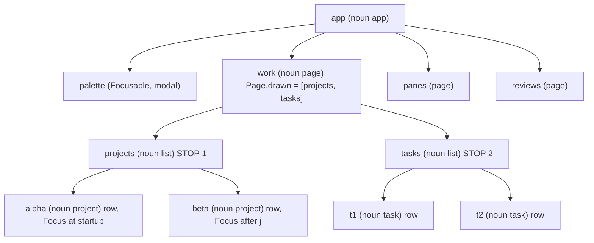

# UI model: how ochazuke stores and draws the screen

Read from the code at `c45567c` (feat(list): j and k spill across lists on a page), which builds on `89de0d6` (focus order is drawing order). Line numbers are checked against `b2e0aa9` (HEAD, docs only on top of `c45567c`).
The mtm facts in section 2 come from a dump run against a copy of `matomeru/cmd/mtm` with two projects and two tasks; the real row ids are hex, shortened here.

## 1. The one store: `Runtime`

Everything the UI holds lives in one `*Runtime` (runtime.go:127). Pages, lists, inputs and terminals have no registry of their own. Each one is an `Instance` whose `Component` field holds the `*Page`, `*List` and so on.

```js
Runtime = {
  Nouns:      { list: Noun, project: Noun, page: Noun, ... },   // :128  name -> Noun (bindings, verbs, Focusable)
  Instances:  { app: Instance, work: Instance, projects: Instance, "alpha": Instance, ... }, // :129  id -> Instance, the whole tree
  Focus:      "alpha",            // :130  the ONE focused instance id
  Mode:       { Name: "normal" }, // :131  the ONE global mode
  Page:       "work",             // :132  current page id, always an ancestor of BaseFocus()
  Operations: { "list.move": Operation, "focus.next": Operation, ... },   // :134  "noun.verb" -> handler
  rows:       { "alpha": "projects", "t1": "tasks" },  // :148  row id -> owning list id
  modals:     ["palette"],        // :149  open modal ids, outermost first (a stack)
  modalInstances: { palette: true },// :150 instances Push/OpenModal created
  seq:        17,                 // :151  registration counter -> Instance.seq
  jobs:       { 3: job },         // :153  running and finished jobs
}
// pages:  none of its own. PageList() (pages.go:136) = Children("app") whose Component is *Page
// lists:  r.List(id) (runtime.go:341) = Instances[id].Component.(*List)
```

## 2. mtm's work page: the instance tree

Wired by mtm `New` (cmd/mtm/main.go:230-266): `AddPage("work")`, then `AddList("projects", Parent("work"))`, then `AddList("tasks", Parent("work"))`. `SetItems` turns each row into an instance.

```js
Instances = {
  app:      { Noun: "app",     Parent: "",         focusable: false },
  palette:  { Noun: "palette", Parent: "app",      focusable: true  },  // modal body, not on a page
  work:     { Noun: "page",    Parent: "app",      focusable: false, Component: Page  },
  projects: { Noun: "list",    Parent: "work",     focusable: true,  Component: List  },
  alpha:    { Noun: "project", Parent: "projects", focusable: false, Label: "alpha" },
  beta:     { Noun: "project", Parent: "projects", focusable: false, Label: "beta"  },
  tasks:    { Noun: "list",    Parent: "work",     focusable: true,  Component: List  },
  t1:       { Noun: "task",    Parent: "tasks",    focusable: false },  // exists only after `enter` on a project
  t2:       { Noun: "task",    Parent: "tasks",    focusable: false },
  panes: {...}, "panes/list": {...}, reviews: {...}, "reviews/list": {...}, "reviews/answer": {...}
}
// startup:            Focus = "alpha"  (main.go:266 projectList.Focus() -> selected row)
// after j:            Focus = "beta"   (list.move delta 1 -> List.Move -> syncFocus)
// after j again:      Focus = "tasks"  (spill past the last row; tasks is empty, so focus sits on the list)
// after k:            Focus = "beta"   (spill back: previous stop's last row)
// after k, enter:     Focus = "t1"     (project.open -> taskList.Focus())
// after j:            Focus = "t2"
// after j:            unchanged        (t2 is the last stop's last row: no wrap at the page end)
// after }:            Focus = "alpha"  (next stop = projects, lands on its selected row)
// after } or tab:     Focus = "t2"     (wraps; tasks remembers its selected row)
// after ):            unchanged        (no noun on this page is a Region)
```

Only `list`, `palette` and `terminal` are `Focusable` nouns, and any `*Input` counts as focusable too (focus.go:82). `project` and `task` are not focusable.

## 3. The structs

| struct | file:line | fields that matter |
|---|---|---|
| Instance | instance.go:19 | `ID`, `Noun`, `Parent` (the only tree link, no child list), `Bindings` (rows on this one instance), `Unfocusable` (opt-out), `Label`, `Data`, `Component` (the `*Page`/`*List`/`*Input`/`*Terminal`), `seq` (registration order), `lastFocus` (where focus was inside it, used by landing), `Payload.Return` (a modal's return focus) |
| Page | pages.go:15 | `Focus` (start focus), `Remembered` (focus while hidden), `Render func(r,w,h) Block`, `mode`, `drawn` / `drawing` (ids Placed in the last / current frame) |
| List | list.go:29 | `id`, `items []ListItem`, `selected int`, `offset`, `marks`, `noSpill` (list.go:36), `columns` (a table, table.go). It has no focus flag: `Focused()` derives it from `r.Focus` (list.go:223) |
| ListItem | list.go:20 | `ID` (becomes the row instance id), `Label`, `Noun` (the row's noun), `Data`, `Cells` (a table's text per column) |
| Terminal | terminal.go:49 | `id`, `stream`, `frame`, `cols`/`rows`. `AddTerminal` (terminal.go:67) makes it an Instance of noun `terminal` (Focusable, Pin "terminal", terminal.go:235) |
| Input | input.go:16 | `ID`, `Text`, `Cursor`, `Mode`, `pin`. `AddInput` (runtime.go:292) makes it an Instance of noun `editor` (or a Kind); focusable because its Component is `*Input` |
| Modal | none | A modal is a plain Instance listed in `Runtime.modals`; `Push` (focus.go:266) or `OpenModal` (focus.go:331) creates it. Its look is a `ModalView{Title, Render}` (model.go:21) in `Model.ModalViews` |
| Noun | noun.go:22 | `Bindings map[mode][]Binding`, `Focusable` (every instance is a stop, noun.go:222), `Region` (a panel that `)`/`(` jump between, noun.go:226), `Pin` (a mode forced on focus, noun.go:219), `Actions`. `Define(name)` (noun.go:194) creates or returns one |
| Model | model.go:30 | `Runtime`, `Palette`, `ModalViews`, `Width`/`Height`, `Status` (last error), `Notices`, `Sidebar`, `scroll`, `ticker` (:49). It keeps no list of components |

## 4. Rendering: who draws what

```
Model.View (model.go:375) -> Model.render (model.go:416)
  header = { Title, Subtitle: page.Title, Tabs: pageTitles() }   // tabs in registration order (Children("app")); when they overflow, a window around the active tab with ‹N / N› hidden counts (Layout.tabs)
  beneath()                     // while a modal is open, the page draws with the focus under the modal
  pageContent -> page.render (pages.go:30) -> Page.Render(r,w,h)  // THE APP'S FUNCTION draws its children
       mtm renderWork (main.go:324): "projects (n)", projectList.View, "tasks: ...", taskList.View
       each List.View / InputBlock / Terminal.ViewBlock / grid.View calls r.Placed(id) first
  layout.Shell(header, page, footer())   // model.go:439; footer = Status or BindingHints(Focus) + jobs ticker
  for id of r.modals: ComposeModalBlock(...) // model.go:440, outermost first, each drawn over the last
```

- Who decides the draw order of a page's children? Only the app's `Render` function, by the order it calls `View`. `Layout` (layout.go:13) holds no state; `Panel`/`Split` draw strings and take a `focused bool` from the caller.
- Is the drawn order recorded? Yes, since `89de0d6`. `Placed(id)` (pages.go:44) appends to `page.drawing` during `page.render`, and the deferred swap copies it into `page.drawn`. Only the components that call `Placed` (List, Input, Terminal, grid) are recorded. List rows are not recorded; only the list id is.
- The highlight: `List.View` reverses the selected row only when `l.Focused()` is true (list.go:293). Otherwise the selected row shows only the `> ` marker.

### Tables

A table is a `List` with columns, not another widget, so focus, selection, marks, the window and scrolloff, spill and the one highlight are the list's own. `AddList(id, items, Columns(cols...))` (or `List.SetColumns`) gives a list its `[]Column{Title, Width, Min, Max, Align, Priority, Wrap}`; each `ListItem.Cells` holds the row's text per column in the same order, and `Label` stays the row's name for the palette, search and `{{label}}` (it is the first cell of a row with no cells). A list without columns draws exactly as before.

`List.View` on a table (`tableView`, table.go) draws a bold header line, then the rows at widths from `tableLayout`: a column with `Width` is fixed, a flexible one (`Width` 0) needs `Min` (default 10 cells, or its title's width when wider, never more than its widest cell) and grows toward its widest cell from the left while room is left; two spaces between columns. When the least widths do not fit, the column with the largest `Priority` drops (ties: the rightmost), until one is left, which is cut. Cells are cut at their display width with `…` (`ansi.Truncate`); `AlignRight` pads on the left. The focused list's selected row is reversed across the whole width; the `* ` mark gutter prefixes the header and every row while the list has a mark. The header takes one line of the list's height, and the selected row's placed line accounts for it, so the page's follow is unchanged.

Rows can be taller than one line (`tallView`): a `Wrap` column wraps a cell longer than its width onto further lines of its row (breaking at spaces and after dots) while the other cells sit on the first line, and `ListItem.Section` draws a label line above the first row of each run of rows with the same section. `Max` caps a flexible column's growth. The window of a tall table starts at the list's offset, never below the selected row, and moves down only until the selected row fits whole; when it starts inside a section, the section's label is repeated on its first line. The selected row is reversed on every one of its lines, its label not. The `?` help is such a table (`helpColumns`, help.go).

A noun declares its table with `NounBuilder.Columns(...)` (`Noun.Columns`): data only, never applied by the runtime. The CLI catalog carries it as `columns` on the noun (`cli.CatalogNoun.Columns`), state rows bring `cells` (`cli.Row.Cells`), and a host that mounts the noun's rows passes the columns to `Columns` (nabe does). Stories: `cmd/o-story/stories/tables/` (wide, narrow with dropped columns, truncation, empty, spill between a table and a plain list).

### Details

A detail is the read-only text beside (or below) a list about its selected row, which scrolls while the list keeps the focus. `AddDetail(id, item, Parent(page))` registers an instance of the `detail` noun whose component (`Detail`, detail.go) holds the offset, the item it belongs to and the last window's size; `Runtime` gains no field. `item` is a func naming what the detail shows now (the selected row's id). The page's `Render` draws it with `Detail.Window(text, width, height)`: the text is wrapped to the width, the window cut at the offset, and the marker (`12–40 / 300`) returned when it overflows, for the app to put in its panel title. A new item starts at the top, checked on every `Window` and every scroll, so `j` then `J` typed before the next frame scrolls the new row from its top; the same item keeps its offset while its text refreshes, clamped to the new length. A detail is not a focus stop.

`J` and `K` are `app` rows in normal mode running `detail.scroll {lines: ±1}` with the count (`10J`), guarded by `detail-scrolls`: no modal is open, the page holding the focus has a detail (its first, in tree order) that overflowed in the last frame, and the focus is not inside it. Being on `app`, they are the same key on every page and stand aside for any inner noun that binds `J`/`K` (the outline's `outline.move`). `detail.scroll` is a motion, so it stays off the footer, except the `J` row's own hint, `J/K detail`, shown while the guard holds; `K` is hidden. Stories: `cmd/o-story/stories/detail/`.

## 5. Focus: stops, regions, rows

| term | what it is | decided by |
|---|---|---|
| stop | an instance whose noun is `Focusable`, or an `*Input`, and that is not `Unfocusable` | `focusable` focus.go:77 |
| region | an instance whose noun is `Region`: a group that `)`/`(` jump between, never itself a stop | `region` focus.go:573 |
| row | a list row instance. Focus sits on it, but its noun is not focusable, so its stop is the list | `stopOf` focus.go:66 (nearest focusable ancestor) |

**Where focus sits:** on the **row instance** (`Runtime.Focus = "alpha"`), never on a "focused list" flag. The list counts as focused because the row's ancestry includes it (`holds`, list.go:225). The focus sits on the list itself only when the list is empty. `stopOf("alpha") = "projects"`.

**Keys and what they move:**

```js
{ j: "list.move +1", down: "list.move +1", k: "list.move -1", up: "list.move -1",
  space: "list.mark" }                                           // bound on noun "list" (list.go:303-309)
  // the row doesn't bind j; key lookup walks Ancestry(row) -> list -> page -> app and the list answers.
  // list.move (list.go:345) tries spill first; inside the list, List.Move (list.go:135) changes `selected`,
  // then syncFocus -> RetargetFocus moves Focus to the new row (list.go:240).
  // It stays in the same stop, so the mode is kept (focusMoved, focus.go:111).
{ "}": "focus.next", "{": "focus.previous",                     // bound on noun "app" (focus.go:729-735)
  tab: "focus.next", "shift+tab": "focus.previous",             // same op: tab and } are identical
  ")": "focus.next {scope: region}", "(": "focus.previous {scope: region}" }
```

**The walk, `JumpFocus` (focus.go:662) step by step:**
1. `root = focusRoot()`: the top modal, else the current page, else app (focus.go:562).
2. `ring, order = units(root, focusable)` (focus.go:590):
   a. Walk `Children` depth-first from root. `Children` (instance.go:121) scans the `Instances` map, then sorts by `seq`, so siblings come in registration order.
   b. The first instance on each branch that is a unit goes into `out`, and the walk does not collect anything below it (a list's rows are never units).
   c. `order[id]` = tree index + len(drawn). Then each instance from `drawnUnder(root)` (= `page.drawn`) lowers the rank of every ancestor up to root to its draw index.
   d. Stable sort `out` by `order`. Drawn stops come first, in draw order. Undrawn stops follow, in tree order.
3. `current` = the outermost unit on `Ancestry(Focus)` below root (for row "alpha", that is "projects").
4. If the focus is not inside any unit (it sits on the page), start from the drawn neighbour (focus.go:689-699).
5. `next = (index + steps) mod n`, which wraps, then `setFocus(landing(ring[next]))`.

**`landing(id)`** (focus.go:638): the component's `FocusTarget()`, which for a list is its selected row (list.go:228). Otherwise `lastFocus`, if that is still inside the unit. Otherwise, for a region, the landing of its first stop. Otherwise the id itself.

**Spill (`List.spill`, list.go:154), built in `c45567c`:** `list.move` on a focused list moves past its edge onto the page's next stop in drawing order, using the same `units` ring as `}`.
- `j`/`down` past the last row: the next focusable thing in drawing order. A list lands on its **first** row; other stops land as `}` does (`landing`).
- `k`/`up` before the first row: the previous stop. A list lands on its **last** row.
- Empty lists are passed through: focus stops on the empty list itself, and the next `j`/`k` spills on (lists a, b, c with b empty: `k` on c1 -> `b`, `k` -> a's last row).
- No wrap at the page ends: on the first stop's first row or the last stop's last row, the move clamps.
- `AddList(id, items, NoSpill())` (instance.go:97) opts a list out; its motions clamp inside it.
- Never spills: a list in a popup/modal (the focus root is not a page), and the programmatic `List.Move` API, which always clamps (list.go:135).
- Tests: `TestListMoveSpillsAcrossListsInDrawingOrder`, `TestListSpillOptOutAndEmptyList` (visual_motion_test.go:115, :131).

## 6. Tree of the work page



## 7. What is a ring?

No page stores a ring or array of focusable items. `Page` has no stop list. The only "ring" is the local variable in `JumpFocus` (focus.go:672). It is rebuilt on every `}`/`tab` from two things: the tree (`Children` in registration order, filtered by `focusable`, which asks each instance's noun) and the last frame's `Page.drawn`. So the second recollection is the true one: items know whether they are focusable, and the code iterates them. Order comes from the screen first, and registration order breaks ties for undrawn stops. No API declares an order (commit message of `89de0d6`). (`history.go`'s "executed-request ring" is unrelated.)

## Owner's model vs. the code

| owner said | code today | decided by |
|---|---|---|
| "each list item is a focusable element" | Each row is an **Instance**, and **Focus does sit on it**. But the row's noun is not `Focusable`, so the row is **not a stop**. The list is the stop | `focusable` focus.go:77, `stopOf` focus.go:66 |
| "`{`/`}` move by parent" | Correct in effect. `}` jumps to the next **stop** (the list, the row's parent) and lands on that list's selected row | `JumpFocus` focus.go:662, `landing` focus.go:638 |
| j/k move between items | Inside a list they change `List.selected`, and `syncFocus` re-points `Focus` at the new row. Past an edge they spill to the next/previous stop in drawing order (no wrap; `NoSpill()` and modals clamp) | `List.Move` list.go:135, `spill` list.go:154, `syncFocus` list.go:240 |
| "array or ring of focusable items per page" | Not stored. Rebuilt per keypress | `units` focus.go:590 |
| "items know if they are focusable and we iterate" | True: noun.Focusable / `*Input` / `Unfocusable`, iterated over the tree | `focusable` focus.go:77 |
| order = ? | Drawing order (`Placed` during `Page.Render`), with registration order (`seq`) as the fallback | `units` + `Placed` pages.go:44 |
